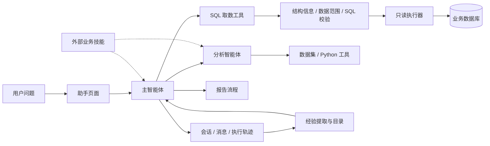
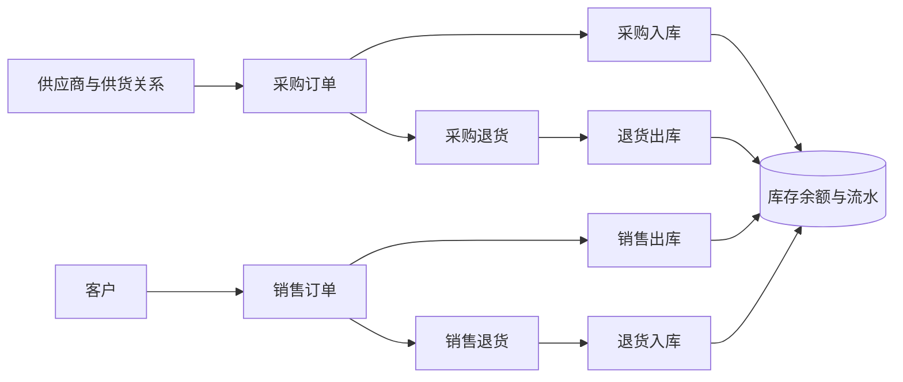
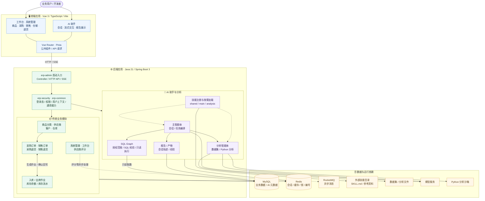

<div align="center">
  
  <h1>启衡 ERP</h1>
  <p><strong>让进销存业务有迹可循，让业务数据成为 AI 分析的基础。</strong></p>
  <p>基于 Spring Boot 与 Vue 3 的学习型 ERP 项目</p>
  <p>
    
    
    
    
    
    
  </p>
  <p>
    <a href="#-项目介绍">项目介绍</a> ·
    <a href="#-功能模块">功能模块</a> ·
    <a href="#-系统架构">系统架构</a> ·
    <a href="#-快速开始">快速开始</a> ·
    <a href="#-项目文档">项目文档</a> ·
    <a href="#-后续规划">后续规划</a>
  </p>
</div>

## ✨ 项目介绍

启衡 ERP 是一个面向**学习与演示**的进销存项目。系统围绕商品、供应商、客户与仓库等基础资料，组织采购、销售、出入库和退货业务，并提供库存流水、工作台及供应商评分等能力。在传统业务之上，项目还探索通过 AI 助手查询业务数据、进行分析并生成报告。

项目适合用于学习 ERP 业务流程、前后端分离项目的模块划分，以及 AI 如何结合业务系统中的数据。仓库提供数据库结构、系统测试数据和可选的模拟业务数据，方便搭建隔离环境体验。

> 本项目以学习和演示为主要目标。模块入口、功能代码、测试结果及实际环境中的可用性是不同的概念；具体验证范围请查看[当前代码状态](docs/current-status.md)和[测试资料](docs/testing/README.md)。

### 项目特点

- **📦 围绕业务流程组织**：从基础资料到采购、销售、出入库和退货，关注单据与库存之间的关联。
- **🔎 库存变化可追溯**：库存余额配合出入库单据和库存流水，便于理解业务处理后的库存变化。
- **🤖 AI 结合业务数据**：提供会话、受控 SQL 取数、分析及报告相关代码，探索自然语言与 ERP 数据的结合。
- **🧪 提供演示数据**：包含商品、客户、供应商、仓库及业务数据，便于在隔离环境中体验和测试。
- **📚 文档与代码相互配合**：按架构、数据库、部署、开发规范和测试分类，方便从不同入口了解项目。

## 🧭 功能模块

### 基础资料与系统管理

| 模块 | 主要内容 |
| --- | --- |
| 🏷️ 商品与分类 | 商品资料、商品分类，以及按分类组织商品 |
| 🏭 供应商 | 供应商资料、商品供货关系与供应商评分 |
| 👥 客户 | 客户资料及销售业务关联 |
| 🏢 仓库 | 仓库基础资料及其库存信息 |
| 🔐 系统管理 | 用户、部门、角色及权限管理 |

### 进销存业务

| 模块 | 主要内容 |
| --- | --- |
| 🛒 采购管理 | 采购订单及关联采购入库，支持单据状态流转 |
| 🧾 销售管理 | 销售订单及关联销售出库，支持单据状态流转 |
| 📥 出入库管理 | 根据业务单据处理入库、出库及执行数量 |
| 📊 库存管理 | 按仓库与商品查看库存余额、锁定数量和库存流水 |
| ↩️ 退货管理 | 采购退货、销售退货及与原订单的关联处理 |
| 📈 工作台 | 聚合展示业务数据，并提供简化的安全库存补货量提示 |

采购和销售单据包含草稿、提交、审核及部分执行等状态；退货关联原业务并通过对应入出库影响库存。具体校验与状态流转以服务代码为准，详见[传统业务架构](docs/architecture/business.md)。

### AI 助手与数据分析

| 能力 | 代码中的主要职责 |
| --- | --- |
| 💬 会话与智能体 | 提供助手会话、任务与流式交互入口 |
| 🛡️ 受控取数 | 结合用户上下文、SQL 校验与只读执行器访问数据 |
| 📉 数据分析 | 使用数据集、SQL 和 Python 工具处理分析任务 |
| 📄 报告与产物 | 提供报告生成、记录及访问相关能力 |
| 🧠 上下文与经验 | 包含会话上下文压缩、经验提取与检索相关机制 |
| 🧩 业务技能 | 从外部目录加载业务技能，按任务提供规划和分析规则 |

模型服务、只读数据源、Python 沙箱等需要按实际环境配置。AI 输出受模型、数据和配置影响，不能代替业务事实核验；可用性及数据权限需要在目标环境测试。详见 [AI 架构](docs/architecture/ai.md)。

## 🔍 核心业务机制

### 商品分类与基础资料

商品、分类、供应商、客户和仓库是后续单据的基础。商品记录关联分类，分类通过上级 ID 形成树形结构；商品挂载具体分类后，可以结合分类层级组织和筛选商品。分类本身不承载库存，库存由“仓库 + 商品”确定。

供应商与商品通过供货关系关联。采购明细需要匹配当前供应商、商品和供货关系，服务会检查关系是否存在、是否属于该供应商以及是否与商品匹配。供货关系还保存报价等信息，可用于供应商评分和采购参考。客户与仓库则分别为销售订单提供交易对象和发货位置。

主要数据关系：`product_category → product`、`supplier → supplier_product → product`、`warehouse + product → warehouse_stock`。字段与索引见[数据库表结构](docs/database/schema/README.md)。

### 采购：从订单到分批入库

采购订单记录供应商、目标仓库及商品明细。它描述采购计划，库存变化则由后续仓库入库确认产生。

1. **创建与提交**：填写供应商、仓库和明细；提交时检查业务对象及供货关系等条件。
2. **审核与仓库作业**：订单审核通过后，进入仓储处理流程并生成待处理的采购入库单。
3. **确认入库与回写**：仓库确认本次入库后，系统按来源明细回写订单累计入库数量，并根据完成情况更新订单状态。
4. **部分履约**：允许分批处理；未完成时仍有后续待入库数量，直到全部完成。入库数量不能超过订单剩余数量。
5. **取消约束**：已审核采购订单只有在尚未发生确认入库事实时才可取消，关联的未确认工作单也需要处理。

采购订单包含草稿、已提交、已审核、部分入库、入库完成和取消等状态。明细会保留下单时的数量精度快照，避免商品资料后来修改时，旧订单的数量规则随之变化。具体实现可从 [`PurchaseOrderServiceImpl`](erp-server/erp-purchase/src/main/java/com/qiheng/erp/purchase/service/impl/PurchaseOrderServiceImpl.java) 和[业务架构](docs/architecture/business.md)开始阅读。

### 销售：预占库存与分批出库

销售订单除了记录客户、仓库及商品，还需要处理可售库存，避免多个订单同时占用同一批数量。

```text
可用库存 = 实物库存 - 已锁定库存
```

销售订单提交时，服务会对相关仓库库存行加锁、检查每个商品的可用数量，并在同一事务中增加锁定量。库存不足时不能按该数量提交；并发修改导致更新失败时，事务会回滚。审核通过后生成待确认的销售出库单；仓库确认出库后，累计出库数量和订单状态随之回写，支持部分出库。

尚未发生出库事实且满足状态条件的订单可取消：已提交或已审核的订单需要释放对应锁定库存，并处理尚未确认的关联出库单。已提交订单编辑时会重新计算锁定量；已锁定的订单不能直接切换仓库。实现入口为 [`SalesOrderServiceImpl`](erp-server/erp-sales/src/main/java/com/qiheng/erp/sales/service/impl/SalesOrderServiceImpl.java)。

例如某商品实物库存为 100、已锁定 20，则可用量为 80。新销售订单提交 30 后，锁定量变为 50、可用量变为 50；这一步是预占，实际库存出入仍以仓库确认处理为准。

### 仓储：作业单、库存余额与流水

仓储部分区分三个层次：

| 对象 | 回答的问题 | 关联方式 |
| --- | --- | --- |
| 入库单 / 出库单 | 本次仓库要处理什么、处理多少？ | 记录仓库、来源业务、作业状态及商品明细 |
| 库存余额 | 现在每个仓库的商品有多少、锁定多少？ | 按仓库和商品维护 `warehouse_stock` |
| 库存流水 | 哪次业务引起了什么库存变化？ | 流水与作业单、业务来源和明细关联 |

作业单包含草稿、待确认、已确认和已取消等状态。采购入库、销售出库及退货通过来源类型和来源 ID 连接业务单据；确认后，仓储服务处理库存并向来源业务回写执行进度。库存预占共用服务进行数量检查，部分并发处理使用数据库行锁和版本校验。具体路径和约束见[业务数据关系](docs/database/relations.md)。

### 退货：关联原单并限制可退数量

采购退货和销售退货由统一退货模块处理，以类型区分来源；退货明细关联原订单明细，不能脱离来源随意退货。服务会在提交、审核等环节重新检查可退数量，并按来源订单加锁处理并发，避免多个退货申请超出来源可退范围。

| 类型 | 审核后的仓库动作 | 库存方向 |
| --- | --- | --- |
| 采购退货 | 生成采购退货出库单，并预占相应实物库存 | 仓库确认出库后减少 |
| 销售退货 | 生成销售退货入库单 | 仓库确认入库后增加 |

审核可逐条确定通过数量，至少一条明细的审核数量须大于零。退货单支持草稿、提交、审核、部分执行、完成和取消等状态；取消时还需按类型处理未确认工作单和可能存在的库存预占。实现入口为 [`ReturnOrderServiceImpl`](erp-server/erp-return/src/main/java/com/qiheng/erp/returnorder/service/impl/ReturnOrderServiceImpl.java)。

### 供应商评分：从业务事实到综合分

评分代码将价格、交付、质量和服务分开处理，再计算供货关系推荐分和供应商综合分。其中价格、质量可在供货关系维度计算，交付、服务为供应商维度。

| 指标 | 代码中的计算或数据依据 |
| --- | --- |
| 价格 | 按商品参考采购价与有效报价比较，价格分上限为 100 分；条件不足时为未就绪 |
| 交付 | 结合近 180 天到达承诺日的有效订单应交金额与逾期罚额，未交付部分也纳入相应口径 |
| 质量 | 依据近 180 天完全入库订单的质检事实，按合格金额占合格与不合格金额之和计算 |
| 服务 | 采用供应商维度的人工服务分；调整后触发相关综合分和推荐分重算 |

```text
综合分 / 推荐分 = 价格分 × 30% + 交付分 × 30% + 质量分 × 30% + 服务分 × 10%
```

任一指标缺失时综合结果为未就绪，而不是将缺失分数当成零或重新分配权重。计算器内部以百分制分数放大 100 倍的整数保存结果。系统还包含评分变化记录、消息触发及定时校正；是否生效取决于任务、消息服务和样本数据。详见 [`AggregateScoreCalculator`](erp-server/erp-purchase/src/main/java/com/qiheng/erp/purchase/service/scoring/AggregateScoreCalculator.java)、[`SupplierScoreScheduledJob`](erp-server/erp-purchase/src/main/java/com/qiheng/erp/purchase/job/SupplierScoreScheduledJob.java)。

### 登录与权限

后端使用 Sa-Token 处理登录状态和会话，登录用户上下文供业务接口使用。角色、权限及用户关联由系统模块管理；例如采购接口会检查 `purchase:query`、`purchase:create` 或 `purchase:manage` 等权限，再进入相应业务服务。前端入口控制不能替代后端权限检查。

不同接口的权限及数据范围需以具体代码为准；目前文档尚未确认采购和销售是否按部门实施数据范围隔离。相关入口见 [`erp-security`](erp-server/erp-security/) 和 [`PurchaseOrderController`](erp-server/erp-purchase/src/main/java/com/qiheng/erp/purchase/controller/PurchaseOrderController.java)。

## 🤖 AI 工作机制

AI 模块围绕用户会话、业务取数、分析和报告组织，以下说明的是代码中的组件关系，具体工具调用顺序由实际任务和模型决定。



### 受控查询

`SqlQueryTool` 将取数需求和可信用户上下文交给 `SqlGraphService`，由相关组件处理数据库结构信息、数据范围、SQL 校验与只读执行。设计上的目的是让模型在受限范围内取得分析数据，而不是直接作为普通业务写接口操作库存或单据。

表、字段、SQL 语法和数据范围的实际限制由代码及配置决定。只读账号和目标环境权限仍需正确配置，并通过接口与安全测试验证；不能仅凭架构图认为所有数据访问都已被充分隔离。

### 分析与报告

主智能体可调用分析工具处理数据，分析模块提供数据集、SQL 和 Python 工具相关能力，分析文件和结果有独立记录。报告流程包含内容准备、生成、审核和存储；前端按照报告契约展示结果。模型可能产生不准确的解释，阅读结果时应结合数据来源、统计口径及限制判断。

### 会话、上下文与经验

会话、消息、数据集、分析结果、报告和执行轨迹由对应数据记录保存。上下文压缩在消息超过配置阈值时尝试摘要较早内容并保留最近消息；摘要失败或不符合要求时保留原消息。经验任务可从轨迹提取和合并经验，再通过目录与检索供后续任务使用；任务是否运行取决于配置开关与调度设置。

### 可扩展的业务技能

AI 技能以外部目录中的 `SKILL.md` 和参考资料描述判断方法及计算规则。主智能体使用 `shared + main` 技能，分析智能体使用 `shared + analysis` 技能：前者侧重明确问题和规划，后者侧重分析步骤与计算口径。技能清单在模型调用时注入，匹配后按需读取正文和参考文件；技能不直接访问数据，仍需通过查询和分析工具取得实际结果。

当前仓库包含需求预测、库存健康、库存策略、补货、采购执行、供应商选择六类技能。未来可以按相同目录结构继续增加；具体清单以 [技能目录](erp-server/skills/) 为准。技能内容有规则并不等于每种分析已通过真实模型和业务数据验证，库存健康中的最近入库天数也不能等同于真实批次库龄。加载、刷新和部署条件见 [AI 架构](docs/architecture/ai.md#业务技能加载与扩展)。

入口：[AI 架构](docs/architecture/ai.md) · [`MainAgentController`](erp-server/erp-ai/src/main/java/com/qiheng/erp/ai/controller/MainAgentController.java) · [`SqlGraphService`](erp-server/erp-ai/src/main/java/com/qiheng/erp/ai/sql/graph/SqlGraphService.java) · [`AnalysisTool`](erp-server/erp-ai/src/main/java/com/qiheng/erp/ai/analysis/AnalysisTool.java)。

## 🔄 业务流程

以下示意主要的业务关联；实际操作需要经过相应服务的权限、状态和数量校验。



## 🏗️ 系统架构



图中箭头概括模块协作及主要依赖，虚线表示按需使用或异步处理；后端模块由 `erp-admin` 在同一应用中组装。AI 的模型、技能目录和沙箱需按环境配置，业务状态及完整调用链见[系统总体架构](docs/architecture/overview.md)。

| 层次 | 技术 / 组件 | 主要用途 |
| --- | --- | --- |
| 前端 | Vue 3、TypeScript、Vite、Pinia | 页面交互、路由与状态管理 |
| 后端 | Java 21、Spring Boot 3、MyBatis Plus | 业务接口、服务与数据访问 |
| 数据与缓存 | MySQL、Redis | 业务数据、缓存、锁和编号等 |
| 异步处理 | RocketMQ | 供应商评分、系统异常等消息处理 |
| AI | Spring AI、Spring AI Alibaba、Python 沙箱 | 模型交互、智能体和数据分析相关能力 |

实际依赖版本以 [后端 POM](erp-server/pom.xml) 和 [前端 package.json](erp-web/package.json) 为准。更多模块关系见[系统总体架构](docs/architecture/overview.md)。

### 模块之间如何协作

后端以 `erp-admin` 为启动入口，`erp-common` 和 `erp-security` 提供通用响应、异常及身份上下文；系统、商品、采购、销售、仓储、退货和工作台各自负责对应业务。仓储处理出入库后，通过来源回写将执行结果交还采购、销售或退货服务，使订单进度与库存作业保持关联。

MySQL 保存业务数据与 AI 元数据；Redis 用于缓存、会话、锁和编号等；RocketMQ 承担供应商评分、系统异常等异步消息处理。AI 模块根据配置访问模型服务、只读数据源和 Python 分析沙箱。是否启用某个组件以及具体连接方式，以实际配置和部署环境为准。

## 🚀 快速开始

### 1. 准备环境

本地开发需要 Java 21、Maven、Node.js、npm，以及项目依赖的 MySQL、Redis 和 RocketMQ。请准备独立测试环境，并按照[配置说明](docs/deployment/configuration.md)核对连接信息；AI 功能还需要根据使用范围配置模型服务、只读数据源和分析环境。

### 2. 初始化数据库

创建 MySQL 8 空测试库后，按顺序导入：

1. [01-schema.sql](docs/database/init/01-schema.sql)：创建数据库表、索引和约束。
2. [02-system-demo.sql](docs/database/init/02-system-demo.sql)：导入部门、权限、角色和测试用户等系统数据。
3. 如需完整业务演示，再按[模拟数据包说明](docs/database/demo-data/README.md)导入业务数据、运行规则检查并同步 Redis 编号序列。

系统账号和业务数据均为测试用途；初始化条件、导入示例及注意事项见[空测试库初始化](docs/database/init/README.md)。

### 3. 启动后端

先完成数据库、Redis、RocketMQ 等连接配置，核实当前 profile 指向独立测试环境。在 `erp-server/` 目录执行：

```bash
mvn -pl erp-admin -am package -DskipTests
java -jar erp-admin/target/erp-admin-1.0.0-SNAPSHOT.jar
```

JAR 版本以实际构建产物为准；`-DskipTests` 表示打包时跳过测试。默认后端端口为 `8081`，以实际配置为准。

### 4. 启动前端

在 `erp-web/` 目录执行：

```bash
npm ci
npm run dev
```

Vite 默认使用 `5173` 端口。前端默认代理目标为本机 `8080`；若后端使用默认的 `8081`，需要将 `VITE_PROXY_TARGET` 设置为实际后端地址。完整配置及启动步骤见[本地开发说明](docs/deployment/local.md)。

也可以使用仓库中的 [Docker 部署方案](docs/deployment/docker.md)；部署前请核对镜像、配置和初始化步骤。

## 🧪 模拟数据与测试

### 数据包包含什么

[模拟数据包](docs/database/demo-data/README.md)提供业务 SQL、规则检查、Redis 编号序列同步脚本和使用说明。已整理的样本包括 22 个上级分类、104 个下级分类、1,560 个商品、200 个客户、200 个供应商和 5 个仓库，以及相关业务记录。联系人、电话、地址及交易均为虚构内容。

使用时先导入空库结构与系统测试数据，再按数据包说明导入业务数据，执行规则检查和 Redis 编号同步。数据包适用于说明中指定的兼容结构和未导入该批数据的测试库，不支持重复导入；供应商评分快照导入后还需按说明校正。

此前这套数据已在隔离 MySQL 和 Redis 中导入并通过 36 项规则检查，也通过本地后端接口读取了部分商品、分类和联系信息。这不意味着每条单据都由业务服务逐单生成，或所有业务接口均已完成验收。

### 如何验证

| 验证目标 | 入口 / 方式 | 验证范围 |
| --- | --- | --- |
| 前端构建 | `erp-web/` 下执行 `npm run build` | TypeScript 检查与前端构建 |
| 页面交互 | 如 `npm run smoke:product-categories` | 浏览器冒烟；模拟接口模式不能代替真实后端测试 |
| 接口与结构契约 | `npm run check:openapi` | OpenAPI、数据库结构及相关契约静态检查 |
| 后端测试 | `erp-server/` 下执行 `mvn test` | 按模块配置运行测试，依赖环境和结果以实际执行为准 |
| 业务数据规则 | 按模拟数据包说明执行检查 | 检查该数据包定义的规则，不覆盖所有业务路径 |
| 跨模块流程 | [四模块接口集成测试](docs/testing/integration/README.md) | 采购、销售、仓储和退货链路；以实际环境和结果为准 |

前端、后端、业务接口及 AI 的验证方式和环境依赖各不相同。请从[测试资料](docs/testing/README.md)选择相应检查，并以当前版本和实际运行结果为准。

## 🗂️ 项目结构

```text
qiheng-erp/
├── erp-web/                # Vue 前端、页面及前端测试脚本
├── erp-server/
│   ├── erp-admin/          # 后端启动入口
│   ├── erp-common/         # 通用能力
│   ├── erp-security/       # 登录与权限相关能力
│   ├── erp-system/         # 用户、部门、角色与权限
│   ├── erp-product/        # 商品与分类
│   ├── erp-purchase/       # 供应商与采购
│   ├── erp-sales/          # 客户与销售
│   ├── erp-warehouse/      # 仓库、库存与出入库
│   ├── erp-return/         # 采购退货与销售退货
│   ├── erp-dashboard/      # 工作台数据聚合
│   └── erp-ai/             # AI 助手、取数、分析与报告
├── deploy/                 # 部署配置与脚本
└── docs/                   # 项目文档、初始化和测试资料
```

## 📚 项目文档

| 文档 | 内容 |
| --- | --- |
| [文档目录](docs/README.md) | 各类文档的总入口 |
| [架构设计](docs/architecture/README.md) | 系统架构、传统业务与 AI 模块 |
| [数据库资料](docs/database/README.md) | 表结构、字段、索引、数据关系及初始化 |
| [部署说明](docs/deployment/README.md) | 本地开发、Docker、配置与运行维护 |
| [开发规范](docs/development/README.md) | 前后端、数据库、接口和 Git 规范 |
| [测试资料](docs/testing/README.md) | 前端、后端、业务集成测试及验证范围 |
| [接口契约](docs/api/erp-openapi.yaml) | OpenAPI 接口描述 |
| [当前代码状态](docs/current-status.md) | 已有能力与仍需核实的事项 |

## 🧩 后续规划

项目计划继续加强库存健康和补货分析，围绕**是否需要补货、补多少、向谁采购以及依据是什么**，研究结合销量、可用库存、有效在途、供应周期、估算库龄和参考采购价格等信息。

目前已有与补货、预测和库存健康相关的 AI 技能规则；独立、可验证的库存健康与补货功能仍按[设计和任务清单](docs/plans/inventory-replenishment.md)推进，不能把技能文件等同于完整功能已验收。完整财务成本核算不属于该规划的首要范围。

规划中的第一版思路是按仓库和商品汇总库存、近期销售消耗、符合条件的在途采购和供应周期，计算建议采购量，并展示使用的数据和计算依据。估算库龄与参考采购价格用于辅助判断，仍需先明确业务口径和数据不足时的处理方式；建议由用户确认，不能绕过现有采购单据流程直接修改库存。
