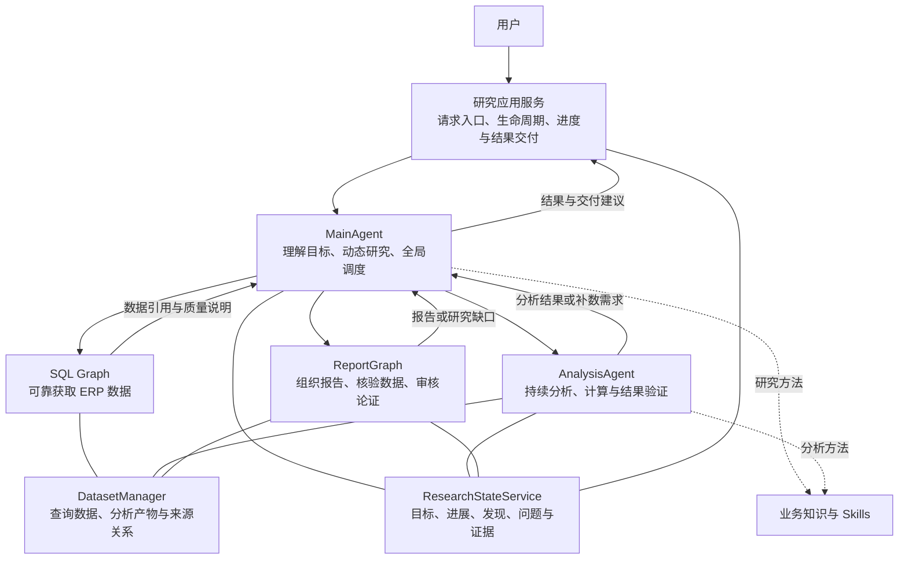
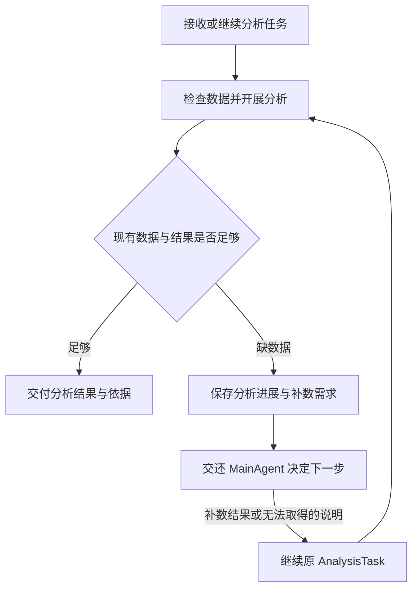

# ERP Agent 架构设计

> 日期：2026-10-27。类型：已确认的整体架构设计，作为后续模块设计与实现的总入口。
> 本文确定职责、运行思路和协作边界，不表示新架构已经实现。
> 交互 JSON、字段名称、状态枚举、工具签名、数据库表结构、存储选型及框架 API 在对应模块实施前补充；文中的名称和交接示例用于说明思路，不是冻结的接口契约。
> 当前代码与历史验证见 [AI Graph MVP 设计与运行说明](ai-graph-mvp.md)；原架构的工作区完整快照见 [v4.1 历史归档](ai-agent-architecture-v4.1-archive-2026-10-27.md)。

## 1. 目标与基本原则

ERP Agent 面向查询、业务分析、经营建议和报告交付。用户的问题不一定能在开始时拆解完整，系统需要根据真实数据和分析结果不断决定下一步。

整体采用：**主智能体动态推进研究，专业智能体持续分析，确定性子图负责可靠执行，业务服务管理状态和数据。**

本版首先确定以下原则：

1. **用户目标持续可见，执行路径允许变化。** 可以形成阶段性研究思路，不要求开始时列全所有 SQL、算法、步骤和证据。
2. **MainAgent 拥有全局研究调度权。** 专业模块可以提出发现和缺口，主智能体决定如何继续。
3. **执行与研究分工。** SQL Graph 对一次取数负责，AnalysisAgent 对一个专业分析目标负责，不各自接管整个用户问题。
4. **业务状态独立于模型消息。** 对话和摘要帮助模型接续工作，结构化业务记录说明实际做了什么、还缺什么。
5. **数据与产物通过引用流转。** 大量明细不进入主智能体的消息和图检查点。
6. **结论需要依据，失败需要说明。** 区分事实、预测、推断与建议；能够完成就交付，无法继续时保留已有结果和限制。

旧架构将证据清单提前固定，后续主要按差集执行。该方式能推进已知清单，但不适合作为开放研究的总调度机制。本版允许在取数和分析之后发现新的数据需求。Graph 仍适合承载局部执行流程，不再要求旧的 Planner/Need/EvidencePlan 主循环约束新架构。

本阶段围绕查询、分析、建议和报告形成闭环。实际创建、修改或提交 ERP 单据属于后续独立接入的业务能力，不因生成建议或报告而自动执行。

## 2. 整体结构

图中的连线表达逻辑协作，不表示模块可以任意改写共享对象。业务状态由服务管理，原始数据和产物由数据管理能力提供受控读取。

| 层次 | 主要组成 | 主要职责 |
|---|---|---|
| 研究决策层 | MainAgent | 理解目标，根据当前发现选择下一步，提出交付判断 |
| 专业执行层 | SQL Graph、AnalysisAgent、ReportGraph | 完成取数、分析和报告等专业工作 |
| 业务支撑层 | 研究应用服务、ResearchStateService、DatasetManager | 管理生命周期、权威记录、数据与产物 |
| 公共基础能力 | 模型接入、身份权限、授权 Schema、业务知识、Skills、消息记忆与检查点 | 为各模块提供一致的基础支持 |

## 3. 研究应用服务与 MainAgent

### 3.1 研究应用服务

研究应用服务是用户请求与 Agent 运行之间的业务入口。名称可暂称 ResearchApplicationService。

它负责建立研究、校验身份和归属、组织运行上下文、处理用户补充和取消、管理运行预算与异常、发布进度，并保存和交付最终结果。

它落实可明确执行的程序规则，但不替代 MainAgent 决定业务研究方向。Agent 返回结果也不等于业务任务已经完成，交付和运行收尾由应用服务协调。

### 3.2 MainAgent

MainAgent 是持续研究的主体，负责：

- 理解用户问题，必要时澄清范围或业务条件。
- 追踪需要回答的目标，避免只解决其中一部分。
- 根据当前证据调用 SQL Graph、AnalysisAgent 或 ReportGraph。
- 判断分析提出的数据需求是否值得补充，处理无法取得的数据。
- 根据审核缺口继续研究，必要时调整原有思路。
- 提出当前可交付的结论、未解决问题和限制。

不再设置一个必须提前拆完全部需求、步骤和证据的独立 Planner。目标整理和阶段性规划属于 MainAgent 的研究过程，不要求在所有取数之前完成一份固定清单。

主循环的基本形态是：

> 读取目标和当前进展 → 决定下一步 → 调用专业能力 → 获取结果或缺口 → 更新研究记录 → 再次决策。

一次发现可能带来新的查询，也可能推翻原先假设。MainAgent 应解释为什么需要继续或改变方向，不因工具可用就无限扩展研究范围。

简单查询可以直接交付有依据的结果；复杂分析进入完整报告流程。交付深度与问题复杂度相匹配。

## 4. SQL Graph：可靠完成一次取数

SQL Graph 根据明确的数据需求，从当前授权范围内获取合适的 ERP 数据。它不承担整个研究方向的规划。

内部适合采用相对确定的子图：

> 理解取数要求 → 获取授权 Schema 和业务口径 → 生成 SQL → 校验 → 执行 → 检查结果 → 必要时修正。

复用现有 SQL 守卫、独立只读连接池、只读执行器、Schema 登记和授权能力。SQL 子图已作为工具接入 MainAgent，前端已接入实时文字、工具状态和追问。运行中的会话可在后端进程存活期间通过内存通道快照重新订阅；后端重启后的运行恢复与事件持久化仍需后续完善。

结果检查应关注本次数据需求是否得到满足，包括业务口径、字段、时间、粒度、完整性与截断情况。SQL 执行成功只是其中一部分。

最终返回数据引用、必要摘要和质量或限制说明。无法取数或需求不清楚时，明确反馈原因，由 MainAgent 决定补充信息、改变方法或说明限制，不静默生成替代数据。

SQL Graph 不直接改变整个研究的目标和完成状态，也不创建或修改业务单据。

### 4.1 首批 SQL 子图运行方式

首批划分为准备上下文、生成 SQL、校验执行、结果检查与发布四个节点。服务端从会话取得可信用户，按当前权限生成 Schema 快照；模型看到快照文本和授权业务口径，SQL 守卫使用同一快照中的结构化清单。恢复后生成 SQL 或执行前重新读取当前用户权限和 Schema，模型输出不能决定权限范围。SQL 语法或结果不符可在有限次数内修正，授权拒绝不交给模型绕过。

结果先写入受控文件并登记为暂存数据集，图状态只传递引用和元信息；检查节点核对完整性并结合业务需求调用模型辅助检查，通过后发布。SQL 自带 LIMIT 不代表全量；当前多表内连接仅支持守卫能明确校验字段归属的形式，外连接、派生表等暂不支持。查询要求全量时，无法完整取回的数据必须明确报告，不得静默截断。

同一用户和会话串行复用 SQL 图线程，每次取数分配独立业务执行 ID。当前状态保存在官方 RedisSaver 检查点中；上层可靠记录结果后显式确认，清空最新临时状态，新查询整体替换工作状态。历史检查点仍由当前框架保留，数量限制与清理由后续单独处理。中断只能从节点边界恢复，正在运行的数据库调用可能重跑；暂存和发布使用执行 ID、尝试次数避免同一次结果被重复交付。

图调用当前使用五分钟等待上限，但尚未验证它能覆盖同步节点全部执行时间，也未验证超时后模型或数据库调用是否真正停止。因此当前不能保证超时后立即重试不会与旧执行并发；接入 MainAgent 之前需验证取消和锁的生命周期，避免把等待超时当作执行已停止。

数据集元信息通过 MyBatis-Plus 存 MySQL `ai_dataset`，实际数据以 JSONL 文件保存在配置目录中：每行是数组，列顺序对应元信息，避免重复列名覆盖。读取时校验归属及当前 AI、表和字段权限。文件目录应位于持久存储；多实例必须使用共享目录。`created_at`、`expires_at` 按 UTC 写入；`erp.ai.dataset.ttl-seconds` 为 0 时不自动过期，正数表示保留秒数，过期或文件丢失不可读取。SQL 图执行结束并确认最新检查点到达结束位置后，在会话锁内清理本次未发布的 STAGED 记录及文件，恢复或确认交接时可重试；无法确认结束的暂存和过期数据目前没有自动回收。当前授权能力主要是模块、表和字段级，若存在仓库或部门行级权限，必须在接入前另外落实。

新表通过 `docs/database/sql/029_ai_dataset.sql` 迁移；部署前须执行迁移并配置可持久化的数据目录。该迁移不会自动作用于现有数据库。模型结果检查是辅助判断，不能保证业务口径完全正确。

## 5. AnalysisAgent：持续的专业分析

### 5.1 职责与自主范围

AnalysisAgent 接收一个专业分析目标和相关数据引用，独立推进分析。它可以：

- 检查数据结构和质量，判断是否适合当前方法。
- 使用分析 Skill，选择成熟算法或生成必要的 Python 代码。
- 执行计算、查看结果、检查可靠性并调整方法。
- 记录发现、疑问、假设与方法限制。
- 发现数据不足时提出补数需求，已有依据充分时交付分析结果。

MainAgent 管整个用户问题，AnalysisAgent 管一个专业分析目标内部的方法与验证。它可以建议新的调查方向，但是否扩大整体研究范围由 MainAgent 决定。

### 5.2 分析任务与暂停续接

一个分析目标可以跨多次 Agent 调用持续推进，业务上使用同一个 AnalysisTask 追踪。

暂停表示本次调用保存进展后交还控制权，不要求一个调用一直挂起等待。恢复时提供原目标、当前进展、未解决问题和本次新增信息。

相同 Agent 线程用于接续模型上下文，AnalysisTask 用于明确业务进度，两者相互配合。具体线程标识和恢复 API 在实施时确定。

恢复不默认保留 Python 进程或内存变量。需要续用的代码、参数和中间产物应能够通过引用重新取得，使计算环境可以重建。

### 5.3 补数交接的参考思路

以下是语义参考，不是固定 JSON 或字段协议：

| 交接方向 | 应说明的信息 |
|---|---|
| AnalysisAgent → MainAgent | 正在解决的问题、已完成工作、缺少的数据及用途、重要口径、缺失对分析的影响 |
| MainAgent → AnalysisAgent | 正在回应哪个数据需求、补到了什么、哪些部分不满足或无法取得、新数据引用和相关说明 |
| AnalysisAgent → MainAgent | 当前分析结论、依据和方法、可靠性限制、仍需主智能体处理的问题 |

拿到一个新数据集不自动表示补数需求已满足。是否能继续原方法、需要调整方法还是应停止该分析，由补数结果与分析判断共同决定。

第一阶段可先采用串行研究和单个分析任务续接，不要求实现完整 SubTask 树或多个分析任务并行。

## 6. ResearchStateService：研究的业务记录

ResearchStateService 保存结构化业务进展，作为研究过程的权威记录。它不替代 Agent 检查点，也不保存大量原始数据。

当前只确定概念和关系，不在本文冻结字段、类结构或数据库表：

| 概念 | 表达什么 |
|---|---|
| ResearchRun | 一次具体研究的目标、归属、进展、结果与限制 |
| 研究目标 | 用户需要回答的问题，以及哪些已回答、哪些尚未解决 |
| ExecutionStep | 实际发生的一次查询、分析调用或审核操作及其输入输出 |
| AnalysisTask | 一个持续推进的专业分析目标、当前进度与待补信息 |
| 数据需求 | 分析或审核过程中发现的补数需求及处理情况 |
| 发现、问题与假设 | 已确认内容、待调查内容和暂未获得支持的解释 |
| 结论与证据引用 | 交付结论及其相关数据、分析方法和计算产物 |

研究步骤在实际执行时记录，不要求预先创建全部步骤。一次 AnalysisTask 可以对应多次 ExecutionStep；某次调用正常返回补数需求，并不代表分析任务已完成或失败。

Agent 提出结构化发现和进展，服务负责校验和保存。实际执行的开始、结果与异常由调用适配层登记，不依赖模型自己编写执行日志。

会话、研究、分析任务、执行步骤和 Agent 线程分别表达不同对象。一个会话可以包含多次研究，不能把会话历史直接当成本次研究的完整状态。

## 7. DatasetManager：数据与分析产物

DatasetManager 统一管理 SQL 数据和分析产物：

- 原始查询结果。
- 清洗、聚合和其他衍生数据。
- 统计、预测及方法验证结果。
- 图表与相关分析文件。
- 来源、版本、业务含义、完整性和上下游关系。

数据引用对应确定的数据版本。重新查询或重算时应保留必要的版本关系，避免旧结论在不知情的情况下指向已经变化的数据。

各模块主要传递引用、结构、摘要和必要样本。Python 执行能力按授权读取完整数据，主智能体无需接收每一行明细。

数据集引用与证据不是同一个概念。数据集说明数据或产物在哪里；证据还需要说明它如何支持某个数字或结论，例如使用了哪些记录、聚合口径或计算方法。

当前不冻结持久化选型，但需要区分业务记录、Agent 检查点与数据产物的保存职责。若承诺任务可恢复，相关数据和产物也必须可恢复；Caffeine 可以用作缓存，不能独自承担可靠恢复的保证。

## 8. ReportGraph：组织交付与质量审核

ReportGraph 消费研究目标、已确认发现、分析结果和证据引用，不需要复制 MainAgent 的全部对话历史。

基本过程为：

> 组织内容 → 生成报告 → 核验重要数字 → 审核业务论证 → 修订或返回研究缺口。

审核分为两个层面：

- **可程序检查的部分**：数字、引用、数据范围、计算与口径能否对应和复核。
- **专业判断的部分**：结论是否有足够支持，是否忽略关键条件，是否将预测或假设写成事实。

数字计算正确不自动代表业务解释或因果判断成立。事实、预测、推断和建议需要清楚区分。

表达和结构问题可在 ReportGraph 内修订；缺少数据、计算或关键论证时，向 MainAgent 返回明确的研究缺口。ReportGraph 不自行扩展整个研究，也不为通过审核补造依据。

简单查询可以直接交付可追溯结果；复杂研究经过报告审核后再交付。两者均应说明重要限制。

## 9. 上下文、业务知识与 Skills

### 9.1 模型上下文与业务状态

Agent 的消息和检查点用于接续交互，研究业务状态用于说明实际进展，数据管理能力用于保存实际数据。三者不相互代替。

每次决策前，调用适配层提供与当前角色有关的最新精简状态。主智能体关注目标、发现与开放问题，分析智能体关注本任务进展和可用数据，报告模块关注交付内容及证据。

完整执行历史按需读取，不能只依赖模型主动想起查询进度。消息压缩也不能丢失业务系统中已经记录的目标、待补问题和数据引用。

各 Agent 的消息与运行作用域独立，不共享一个无边界的可变消息列表。具体摘要、Hook 和检查点接法在框架适配时验证。

### 9.2 业务知识与 Skills

业务知识解释 ERP 指标、状态和统计口径。Skill 提供研究或分析方法、适用条件、验证方式与常见限制，不将所有问题固定成同一条流程。

| 使用方 | 参考内容 |
|---|---|
| MainAgent | 库存诊断、补货决策、供应商表现等研究方法 |
| AnalysisAgent | 数据质量、时间序列、需求预测、异常检测、统计分析等方法 |
| SQL Graph / ReportGraph | 与当前取数或审核任务相关的业务口径和判断依据 |

分析优先使用适合且经过验证的方法和脚本，必要时生成代码。代码在受控环境执行，执行约束由工具落实，不仅依赖提示词。

业务知识与方法的可见范围应与服务端授权一致；授权 Schema、数据读取和产物访问不能由模型自行扩大。

## 10. 完成、受阻与恢复原则

MainAgent 提出研究充分性和交付判断；应用服务检查明确可执行的条件，包括目标覆盖、重要依据、未解决阻塞和必要审核结果。

业务充分性需要模型与领域规则共同判断，不把“预先列出的证据项都存在”作为整个研究完成的唯一判据。

需要区分以下情况，具体状态枚举后续设计：

- 目标得到回答，可以交付。
- 已有部分结果，但存在明确限制。
- 需要用户补充，暂时不能继续。
- 数据或能力不可获得，研究受阻。
- 执行失败、运行预算耗尽或用户取消。

局部执行可以有限修正或重试。一次局部失败是否需要结束整个研究，取决于它是否破坏关键前提，不默认所有取数失败都能继续，也不默认任何失败都必须整轮作废。

重复请求且没有新增依据、持续重复失败的方法、超出运行预算等情况，需要由运行机制识别和收束。结束时说明已经确认的内容、没有解决的问题及原因。

用户补充、Agent 续接与重新发起研究应有清晰区别。运行机制需要防止同一任务被重复或并发推进，细节在实施时补充。

### 10.1 前端断线与运行状态展示

后续接入前端时，研究任务的执行与前端页面及连接的生命周期解耦。页面关闭、刷新、连接中断或前端出现异常，不应仅因此停止后端仍在运行的任务；任务结束、取消和失败由后端运行状态确定。

前端重新进入会话时，应先读取后端保存的当前运行状态和已产生的用户可见内容，再恢复实时事件展示，使用户看到最新进度、待回答追问或最终结果。实时事件用于增量展示，不能作为恢复当前状态的唯一依据；断线期间产生的内容需要按后端实际保存的状态衔接，避免遗漏或重复展示。

追问恢复时还需确认后端的等待请求是否仍然有效。后端已重启、等待已结束或结果尚未保存时，应根据实际运行状态继续或重新发起交互，不能仅凭历史页面认定旧请求仍可回答。当前已有进程内运行快照与重新订阅；跨进程恢复、事件持久化和取消语义仍需后续完善。

新架构使用独立运行版本和检查点作用域。旧图检查点及暂停请求不能直接交给新 Agent 续跑；旧规划结构不再提供专用展示，历史原文仍保存在数据库中，不自动清空。

## 11. 完整研究示例

用户提出：

> A 仓库现在情况怎么样？哪些产品需要补货？

下面只是可能的研究过程，不是必须照搬的模板：

1. MainAgent 明确仓库现状与补货建议两个目标，必要时澄清范围。
2. SQL Graph 获取库存与相关业务数据，将结果注册为数据集。
3. MainAgent 根据结果调用 AnalysisAgent 分析缺货风险。
4. AnalysisAgent 发现缺少历史需求，保存进展并提出补数需求。
5. MainAgent 查询相关数据后，继续原分析任务。
6. 分析发现部分产品需求增长，但在途采购或提前期信息不足；MainAgent 判断其对建议的影响，再决定是否补查。
7. ReportGraph 组织结论并核验依据；证据不足时返回明确缺口，MainAgent 继续研究。
8. 应用服务保存并交付结论、依据和限制；无法继续的部分如实说明。

每次获得新结果后重新决定下一步，路径可能缩短、扩展或改变。开始时不需要知道完整证据清单。

## 12. 实施边界与后续补充

### 12.1 当前代码的复用方向

| 范围 | 处理方向 |
|---|---|
| SQL 守卫、只读连接池与执行器、Schema 登记与授权 | 复用基础能力，接入新的取数流程 |
| 模型接入、超时和网关兼容处理、RedisSaver | 复用基础设施；按角色调整配置并验证实际 Agent 调用 |
| 会话与消息历史、进度推送、取消、执行锁、摘要能力 | 保留业务价值，解除对旧节点、旧 State 和旧展示协议的耦合 |
| 旧主图、Planner/Need 差集流程、专用状态键与提示词 | 按新研究架构重建，不要求继续承接旧编排约束 |

模型配置可复用不代表所有默认选项原样沿用。当前统一强制 JSON 输出属于旧规划流程的要求，新 Agent 的输出和工具调用方式在框架接入时验证。本次不修改模型配置或依赖版本。

### 12.2 实施顺序与验证方向

先验证当前框架、模型网关和检查点能支撑所需调用，再围绕一个真实案例逐步打通：

> 建立研究 → SQL 数据集 → 分析发现缺数据 → 补数 → 同一分析任务续接 → 可追溯的小报告 → 正常或受阻交付。

随后再扩展算法、业务 Skills 和审核深度。第一阶段不要求完整子任务树、多分析任务并行或通用调度系统。

验证需要覆盖真实取数与分析、补数无法取得、重复续接、取消、结果引用、审核返工和运行恢复。实施与验收记录维护在 [AI Graph MVP 设计与运行说明](ai-graph-mvp.md)，不能将设计示例记为已完成能力。

### 12.3 具体细节在对应模块实施前补充

后续按模块讨论交互 JSON、必要字段、状态转换、工具参数、异常与重试、存储结构、接口与进度事件、线程与恢复 API、算法和运行预算。

这些细节应服务于本文的职责和协作关系。补充时提供语义参考与实际验证依据，不预先冻结所有模块的实现。

本文是整体目标架构的现行依据；OpenAPI、数据库和前端契约在实际改动对应模块时同步。历史讨论稿与旧实现记录不覆盖本文，当前运行能力仍以实际代码和验证记录为准。

### 12.4 当前代码目录

后端 `erp-ai` 按职责组织：`agent` 负责主智能体运行和消息记录，`clarification` 负责用户追问，`conversation` 负责会话和历史消息，`sql` 负责 SQL 子图、守卫和授权结构，`dataset` 负责数据集，`knowledge` 负责业务知识。`controller`、`mapper` 和 `domain` 保持项目的入口、数据访问及数据类型约定；`memory` 保留现有记忆能力。

前端 AI 模块中，`clarification` 存放追问组件及其数据结构，`stream` 负责流式事件，`contracts` 负责消息转换；页面和通用组件仍分别位于 `views`、`components`。当前使用 `ask_user` 展示追问，旧 `PLAN`、`NEEDS` 展示协议不再使用。普通历史消息和当前追问工具消息仍可读取，数据库中的历史原文不会因目录整理而删除。
