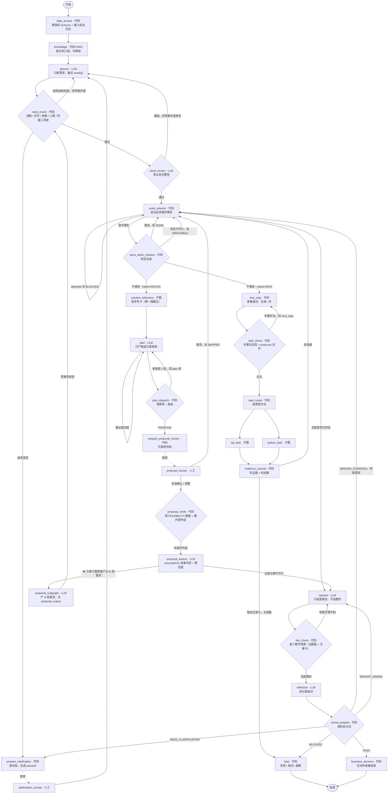

# ERP Agent 架构设计

> 类型：架构设计文件；本版作为后续实现依据，不表示代码已经完成。
> 日期：2026-10-14 初版 / 2026-10-20 合并修订（v4）/ 2026-10-22 需求驱动细化（v4.1）
> 目标：将 `erp-server/erp-ai` 从"一次性产出完整计划"改造为**需求驱动的轮次式 ReAct 架构**：Planner 只拆需求，**证据项清单一次列全，后续轮次由代码按差集推进**，直到所有需求进入终态。
> v4.1 在 v4 基础上把主循环从"plan 每轮提议下一步"改为**代码差集驱动**，新增 `need_review`（业务完整性审阅）与 `next_step`（差集→步骤生成），并把"建议/方案"需求单独接入方案链路（用户多选 → 验证可行性 → 回 planner 再拆一轮）。
> 本版整合了初版《最终规划表》与《AI Agent 修订架构 v3》的全部内容，并落定七项架构修正。演进过程、逐项论证与被否决方案见[附录 §26](#26-附录架构演进与决策)。
> 本轮范围：只修订设计文件，不修改代码、数据库或接口。

---

## 0. 顶层架构（文字流程图）

```text
前端：需求区 + 证据区 + 报告区
                 │ chat / resume
                 ▼
Controller → GraphService
  - 取得服务端可信身份，校验会话与任务归属
  - 管理运行预算、取消、暂停阶段、版本、重复请求
  - 将内部图输出转换成允许公开的前端事件
                 ▼
CompiledGraph（Bean 单例，启动时编译）
  - 父图 State：需求数组、证据链、当前需求、步骤、报告、暂停点
  - 官方 RedisSaver：检查点保存和恢复
  - Node：读取本轮 State，执行职责，返回局部更新
                 │
      ┌──────────┼──────────┐
      ▼          ▼          ▼
  需求层        执行层      输出层
  拆需求      SQL/Python   组装报告
  选需求      受控取数     逐数字溯源
  判完成      写证据链     结论核对
```

核心原则：**凡是能由代码判定的，绝不让模型回忆。** 需求有完成判据、候选方案有前提假设、证据有来源标注——模型负责判断与组织，代码负责判定与计算。

任务 State 是执行的事实记录；Agent 消息记忆为模型提供对话与摘要。摘要不会替代需求状态、证据链或业务回执。

父图、子任务检查点和 Agent 消息记忆使用不同 thread 命名空间。节点返回 `Map<String, Object>` 局部更新，框架按 KeyStrategy 合并。配置 Saver 后，引擎在相应检查点保存状态；Saver 不负责摘要或业务事务。

---

## 1. v3 → v4 的七项架构修正

本版相对 v3 落定七项修正，逐项理由见[附录 §26.4](#264-v3--v4-逐项论证)。

| # | 修正 | 修正前（v3） | 修正后（本版） |
|---|---|---|---|
| 1 | **判定权归代码** | plan 一次调用同时输出 `satisfied` 和 `action`，模型可宣布需求完成 | 拆出 `done_when_checker` 代码节点做判定；plan 输出协议删除 `satisfied`，只提议不判定 |
| 2 | **`evidence_plan` 静态化** | plan 节点在运行中动态追加待查项，等于让 LLM 在第 N 轮动态回忆"我还缺什么" | planner 在拆需求时一次列全；后续节点只能读。确需补充时由 `need_review` 审出、回 planner 追加并计数（v4.1 改，见[第 1.1 节](#11-v4--v41-的五项细化修正)修正 8） |
| 3 | **溯源前移** | `reporter → reflection → revise_prepare → fact_check`，LLM 在前、代码在后 | `reporter → fact_check → reflection → revise_prepare`，代码先保证数字都真实存在，模型只判断结论是否成立 |
| 4 | **`condition` 结构化** | 表达式字符串 `"evidence.net_gap > 0"`，求值方式未定义 | 结构化对象 `{left, op, right}`，受限比较器求值；删除 `condition_check` 字段 |
| 5 | **新增 `INFEASIBLE` 终态** | 需求状态只有 PENDING/RUNNING/DONE/SKIPPED/BLOCKED，"全部方案不可行"无处落地 | 增加 `INFEASIBLE`，与 `DONE` 并列作为需求终态 |
| 6 | **进展判定用指纹** | "每轮必须产生新证据"以"有无新 key"判定，与"同名 key 覆盖"冲突 | 以证据指纹（key+value 集合的哈希）判定；同 key 新值算进展，重复同值算无进展 |
| 7 | **需求上限拆两级** | 单一 `max-needs`，但 v3 自身例子就需要 6 个需求 | `max-user-needs`（用户需求）与 `max-derived-needs`（派生填充需求）分开计数 |

另有三项结构调整：`knowledge` 节点只返回业务口径、不裁剪 Schema（`focused_schema_ref` 删除）；`plan_dispatch` 只做状态更新与路由，PROPOSE 交由 `prepare_proposal_review`；需求上限校验项由 3 条扩到 6 条。

> 上表是 **v4 的修正**。v4.1 在其之上又做了五项细化（主循环差集驱动、`evidence_plan` 语义反转、新增 `need_review`、`Need.intent` 二分、方案数据不进主证据链），见[第 1.1 节](#11-v4--v41-的五项细化修正)。v4.1 **不推翻**这七项——第 1 项"判定权归代码"在 v4.1 里反而更彻底了：主循环里连"提议下一步"都不再经过模型。

### 1.1 v4 → v4.1 的五项细化修正

v4.1 不推翻 v4 的七项修正，只把"谁来决定下一步"这条链改成确定性的，并给"建议类"需求单独开一条链路。

| # | 修正 | v4 | v4.1 |
|---|---|---|---|
| 8 | **主循环改差集驱动** | `done_when_checker` → `plan`(LLM) 提议一步 → `plan_dispatch` → `task_check` → `task_router` → 子图 | `done_when_checker` → `next_step`(**代码**) 按差集生成一步 → `task_check` → `task_router` → 子图。**主循环不再有 LLM 提议步骤的节点**，少一次模型调用、也少一处"模型觉得还缺什么"的自由裁量 |
| 9 | **`evidence_plan` 语义反转** | = 要"取"的原始数据清单（输入）；`done_when.keys` = 要"产出"的证据清单（输出），两者是**不同集合** | = 要产出的**全部证据项**（输入 + 计算产物），每项带稳定 id；`done_when.keys` ⊆ `evidence_plan` 的 id 集合（可代码校验）。**否则计算产物永远进不了差集，`done_when_checker` 永远不满足** |
| 10 | **新增 `need_review`（LLM）** | 无；planner 一次产出即直接进 `need_check` | `need_check`(代码，结构合法) 之后加 `need_review`(LLM，业务完整性)。代码判不了"漏了在途"这类业务遗漏，由模型审；审出问题回 planner 修复，**用独立的审阅预算**（不与格式修复共用） |
| 11 | **`Need.intent` 二分** | 无 | `DATA`（要事实）与 `ADVICE`（要建议）。`ADVICE` 需求走方案链路，产出多张候选方案卡，由用户多选后**回 planner 再拆一轮** |
| 12 | **方案数据不进主证据链** | v4 §13.7 假设骨架的 `needs_data` 直接进证据链 | 方案卡自持 `filled`（含 source/asOf），主证据链只装"需求"的证据；`fact_check` 溯源时**两处都查** |

修正 8–12 的落点见[第 2 节](#2-节点清单与职责)节点表、[第 4.1–4.3 节](#4-需求与证据链契约)契约、[第 9 节](#9-next_step差集驱动代码)差集驱动与[第 10 节](#10-plan只产候选方案骨架llm)plan 职责收窄、[第 13.7 节](#137-方案链路从建议到可行方案)方案链路与[第 19 节](#19-完整-stategraph-装配设计)图拓扑。

---

## 2. 节点清单与职责

| # | 节点 | 类型 | 进来时手里有什么 | 做什么 | 交出什么 / 去哪 |
|---|---|---|---|---|---|
| 1 | `data_access` | 代码 | 服务端身份、会话历史 | 算授权表/列/行范围，实时读取表结构与索引；载入有界对话历史 | `authorized_schema_ref`、`dialogue_history` → `knowledge` |
| 2 | `knowledge` | 代码 | 权限码 | **按权限码装配业务口径**：这些数怎么算才对、状态机怎么读、哪些坑不能踩；**失败可降级跳过** | `business_knowledge` → `planner` |
| 3 | `planner` | LLM | 原话 + 口径 + 表字段 + 节点记忆（首轮）；`planner_mode` + `confirmed_proposals`（展开轮） | **只做需求拆解**，输出需求数组（意图、依赖、条件、证据项清单、完成判据）；两种模式见[第 5 节](#5-planner只做需求拆解) | `needs` → `need_check` |
| 4 | `need_check` | 代码 | 本轮新增需求 | 结构校验：格式、无环、依赖完备、条件合法性、**证据项与完成判据的包含关系**、数量上限；模型请求澄清时在此挂起 | → `need_review` / 回 `planner` 修复 / `stop` |
| 5 | `need_review` | LLM | 本轮新增的 `DATA` 需求 + 授权 Schema 摘要 | **审业务完整性**：是否漏了业务上必须查但没列的数据项、判据是否真能回答原话；**通过时发布需求数组**。`ADVICE` 不审（归方案子图自审） | → `need_selector` / 回 `planner` 修复 / `stop` |
| 6 | `need_selector` | 代码 | 需求数组、证据链 | 选出当前需求：第一个 PENDING 且依赖全终态且条件成立 | `current_need_id` → `done_when_checker` |
| 7 | `done_when_checker` | 代码 | 当前需求、证据链 | 判定证据是否齐备：`evidence_plan` 的 id 全部在证据链里→DONE，不可行→INFEASIBLE，否则继续。节点名沿用历史命名，判据已不含 `done_when` | → `need_selector` / `next_step` / `solution_reference` |
| 8 | `next_step` | 代码 | 当前需求 + 证据链 | **差集驱动**：证据项 id 集合 − 证据链 key 集合，取第一个"依赖已满足"的缺项生成一步 | `current_steps` → `task_check` |
| 9 | `task_check` | 代码 | 待执行步骤 | 字段完整、类型合法、未越权、产出 key 与证据项对齐 | → `task_router` / 回 `next_step` / `stop` |
| 10 | `task_router` | 代码 | 合法步骤 | 按步骤类型分派 | → `sql_task` / `python_task` |
| 11 | `sql_task` | 子图 | SQL 步骤 | 生成 → 校验 → 执行 → 纠错 | 结论 → `evidence_commit` |
| 12 | `python_task` | 子图 | Python 步骤（公式与变量引用） | 沙箱执行，**所有数值由它产出** | 结论 → `evidence_commit` |
| 13 | `solution_reference` | 子图 | 参考查询步骤 | 查该类问题的常用手段、适用条件、历史采用率。**第一版跳过**（ERP 无参考库，`prior` 取 0.5） | `kind=REFERENCE` 参考卡 → `plan` |
| 14 | `evidence_commit` | 代码 | 子图结论 | 写入证据链（key=证据项 id、source=stepId、asOf、kind、confidence），**同名 key 覆盖**；更新证据指纹 | → `need_selector`（循环）/ `stop`（无进展） |
| 15 | `prepare_proposal_review` | 代码 | 候选骨架列表 + 证据摘要 | 保存待确认骨架、预期版本与 pauseId，登记暂停点 | `pending_human` + 骨架卡 → `proposal_human`【暂停】 |
| 16 | `proposal_human` | Human | 用户的**多选** / 调整 / 取消 | 消费动作并撤销本次暂停授权 | 确认或调整 → `proposal_verify`；取消 → 该需求置 SKIPPED |
| 17 | `proposal_verify` | 代码 | 用户选中的骨架 + 证据链 | 取 `purpose=FEASIBILITY` 的数据项；**硬约束由代码判定**（数据 op 方案参数） | 方案卡 `filled` → `proposal_assess` |
| 18 | `proposal_assess` | LLM | 方案卡 + 已取数据 | 判定**软条件**（自然语言假设）是否成立，给出理由；产出 `confidence` | `confirmed_proposals` + `planner_mode=EXPAND` → 回 `planner` |
| 19 | `reporter` | LLM | 需求结论 + 证据链 + 已填充的方案卡 | **只做组装与叙述**，不新增方案、不新增数字 | 报告 + 候选 proposal → `fact_check` |
| 20 | `fact_check` | 代码 | 报告 + 证据链 + 方案卡 | **代码先查**每个数字能否溯源（**主证据链与方案卡 `filled` 两处都查**） | → `reflection` / 回 `reporter` |
| 21 | `reflection` | LLM | 原始需求 + 验收条件 + 证据链 + 报告 | 核对，输出四分类之一 | → `revise_prepare` |
| 22 | `revise_prepare` | 代码 | reflection 判定 | 缺证据→转新需求；报告错→回 reporter；澄清→暂停；受阻→stop；计数 +1、报告升版本 | → `need_selector` / `reporter` / 澄清 / `stop` |
| 23 | `business_decision` | 代码 | 报告 + 候选动作 | 有无可执行业务动作 | → END / `prepare_report_review` |
| 24 | 报告审阅 · 草稿 · 业务执行 | Human + 代码 | 沿用原设计 | 人工选方案 → 工作区调参 → 最终提交 → 回执。**属报告之后的环节，不在本轮范围** | → END |
| 25 | `stop` | 代码 | — | 明确的失败、取消或超限结束 | → END |

节点总数 25，其中 **4 个人工暂停点**：澄清、`proposal_human`、报告审阅、草稿提交。

> **v4 → v4.1 节点级差异**：`plan`(LLM) 退位为"只产候选方案骨架"，仅在方案链路内被调用；主循环的"提议下一步"由 `next_step`(代码) 承担。新增 `need_review`(LLM)、`next_step`(代码)、`proposal_verify`(代码)、`proposal_assess`(LLM) 四个节点。`plan_dispatch` 退化为"落骨架"，其 `ADD_STEP / SKIP / NEED_MORE_EVIDENCE` 三种动作全部删除——`SKIP` 由 `condition` 不成立直接产生，"补清单"由 `need_review` 审出后回 planner 产生。`task_router` 不再分派到 `solution_reference`（该节点为方案链路专用）。

Node 不等于一个模型；记忆加载、权限、调度、规则、交互和回执可以直接由代码实现。所有请求数据在 State / TaskContext 中，不由单例节点成员变量保存。Node 与 Dispatcher 均可构造器注入。

---

## 3. 记忆体系流程图

### 3.1 存储分工

| 层次 | 内容 | 范围 | 维护者 |
|---|---|---|---|
| 父图检查点 | 需求数组、证据链、当前需求、步骤、报告、暂停点、回执 | 当前任务 run | Graph + 官方 RedisSaver |
| Agent 工作记忆 | 对话、执行反馈、摘要与近期 messages | tenant/user/conversation/agentType | Planner/SQL/Python Agent + Saver + 摘要 Hook |
| 子图执行 State | 当前任务输入、精确 SQL/代码、错误、重试次数、质量反馈和输出引用 | 当前 step 及其执行 | DataAgent 节点适配 + 子图 Saver |
| 长期归档 | 原始对话、规划、代码、结果、报告与候选经验 | 跨任务持久 | 现有持久化服务及后续扩展 |

Planner、SQL、Python 直接复用同一套持久消息与摘要能力，不另外建设手工尝试记录压缩体系。共用机制与存储基础设施，不共用一份 messages。

每次 Agent 调用加载该作用域消息、注入当前 TaskContext；超阈值触发摘要。执行结果、错误和结果充分性反馈以带 taskId/stepId 的消息写回对应 Agent，使下一次生成知道已经尝试什么、哪里失败、还缺什么。

最新需求、权限、精确 SQL/代码、错误、步骤状态与回执仍从显式 State 注入；聊天摘要不承担游标推进、鉴权或业务事务。

> 现状与口径注记（2026-10-23，节点记忆改纯文本转写）：`ai_node_working_memory` 不再存事件 JSON，改为「模型视角的纯文本转写」——一行 = 模型的一条消息，行首标记 `[输入]` / `[输出]` / `[摘要]` 说明角色，正文与真正发给模型的内容一字不差。写入分两类：planner 输入与模型输出同时写流水表与工作记忆表；澄清提问/回答、定稿标记、格式反馈、审阅问题只写流水表（模型视角里它们已包含在上一轮输出与下一轮输入中）。读取侧因此退化为「逐行按标记转消息 → 压缩后原样写回」，按 pauseId 配对问答、按 requestId 反查正文、双协议判定、当前任务链排除等逻辑全部删除。澄清问答仍走 State 的 `clarification_history` 动态拼接进下一轮输入（前端提交的 `answer` 本身已是「问题\n答案」文本），任务结束后由下一次 `start` 重置。
>
> 现状与口径注记（2026-10-19）：MVP 图的节点记忆以 `ai_node_memory` / `ai_node_working_memory` 落地——Planner 输入、模型输出、澄清提问/回答、格式反馈与结局标记均由对应节点在发布拍写入，收尾不写记忆；计划定稿只追加"通过"标记（瘦身 ACCEPTED_PLAN，只含 requestId/status），正文由同轮模型输出原文承载。二阶段「节点记忆全量过程化」已完成：写侧补齐澄清问答与格式耗尽结局，读侧按 pauseId 配对问答、按 requestId 反查计划正文，当前任务链不重复注入。本节的 Agent 工作记忆（对话 messages、执行反馈、摘要）是规划图共用机制，尚未接入。

> 现状与口径注记（2026-10-21）：第 4.5 节「授权 Schema」与第 4.4 节「证据链」的数据契约已落库但尚未接入取数。`ai_data_table` / `ai_data_table_column` / `ai_data_table_relation` 三张登记表登记 20 张业务表的清单、列语义与表间关系；AI 自身表、权限与用户表、系统内部表一律不登记——不在清单里就查不到。表级开关只有 `status` 一个（登记表即授权范围，登记了但停用就改 `status`），列级的 `status=0` 表示该列结构上存在但不下发给模型。启动时由 `SchemaSyncService` 从 `information_schema` 刷新结构字段，语义字段人工维护、同步不覆盖；新列自动登记但默认 `status=0`。组装由 `DataAccessNode` 在图首完成，Schema 文本固定在一轮任务内。表间关系指向库中不存在的列时不会自愈（模型会照着它生成必然失败的 SQL），经 `SchemaIssueReporter` 投到系统异常通道（异常类型 `DATA_SCHEMA_INVALID`），工作台出现待办由人工修正。
>
> 现状与口径注记（2026-10-21，代码结构）：实现按**能力域**分包，`graph` 与 `memory` 是两个能力域，`service` 只放对外服务与受控数据底座。`graph/GraphTopology` 承载第 19 节的节点、边与 State 键策略（改图结构不碰 Spring 装配），`graph/node` 为第 2 节的节点实现，`graph/runtime` 为第 18 节的编排与运行，`graph/support` 为跨域支撑。原 `workflow` 与 `service.graph` 两个包已合并为 `graph/`。第 17 节的两类状态常量在实现里分列为 `RunStatuses`（对外运行态）与 `MessageRunStatus`（落库轮次态，原名 `AiRunStatus`），二者取值重名易混，故后者改名消歧。
>
> 现状与口径注记（2026-10-21，第 9 节 plan）：当前实现的 `Plan` 协议是「一次产出全部步骤」，与本节「每轮只提议一步」的形态不同。差别在后续两轮：受控 SQL 守卫与执行器（第 11、13 节）消费的是「单条 SQL + 当前可见 Schema」，与 plan 协议形态无关，可直接基于现有协议实现；本节的「planner 只拆需求 / plan 每轮提议一步」拆分需要第 4 节需求层（`needs`/`done_when`/`evidence_plan`）整体落地后另行实施，届时 `plan_dispatch`、`task_check`、`task_router` 与证据指纹进展判定一并接入。
>
> 现状与口径注记（2026-10-22，v4.1 第 9 / 10 节）：主循环已改为差集驱动，`plan` 的"每轮提议一步"职责**取消**，改为只产候选方案骨架（第 10 节）。现有 `Plan` 协议（一次产出全部步骤）**不复用**——它与结构化 `evidence_plan` 是两套形态：现有协议按"步骤"组织，新协议按"证据项"组织（带 id / source / depends）。受控 SQL 守卫与执行器仍不受影响。`plan_dispatch` 的 `ADD_STEP` / `SKIP` / `NEED_MORE_EVIDENCE` 三个动作随之删除，`need_check` 的校验项从六条扩到十四条（新增顺序、ADVICE 形状、`condition` 标量性、PROPOSAL 字数上限、instruction 不得写表名字段名等），`need_review` 为新增节点。

### 3.2 共用记忆配置与摘要 Hook

优先复用项目现有 `AiSummaryHook`、`AiSummaryChatModel` 和官方 `SummarizationHook`。当前项目配置 `messagesToKeep=20`，保留近期消息，用摘要承接较早历史；不是固定保留最早 20 条。

压缩结果替换并持久化 Planner 的工作消息，原始消息在 MySQL 独立归档。是否压缩**只看 token**：消息少但单条巨大的历史同样要压；保留范围同时受"最多保留条数"与"最近窗口预算（阈值一半）"约束，避免只压掉一条、压完仍超阈值。工具调用与结果需成对完整；不把"20 条"当作完整任务事实的唯一来源。

摘要长度按待压缩历史的固定比例（当前 10%）给，再受应用侧与供应商两个输出上限约束。压缩在读取路径内同步执行，会阻塞本轮 planner，因此压缩前后各推一条进度事件（`memory_compact` →「正在压缩历史记忆」）；摘要失败也收尾，界面不会停在"正在压缩"。

通过公共 AgentMemoryConfig / AgentFactory（设计职责名）统一装配 Saver、serializer、摘要模型、摘要 Hook 与运行上下文。Planner/SQL/Python 各自挂载适配后的 Hook，不为每个 Agent 重写摘要流程。

现有 Hook 在判断阈值前就通过 AiRunRegistry 校验 Run，因此独立 Agent thread 必须绑定父运行作用域，继承预算、取消和生命周期，不能原样传入未注册 thread。只挂载适用职责，不复制主 Agent 全部最终回复记录 Hook。

阈值、近期保留数和输出预算通过共用配置管理，可按 Agent 类型覆写。阈值必须落在「模型上下文窗口 - 输出预算」之内，否则压缩在窗口溢出前永远触发不了，等于死代码。摘要失败保留原文，但仍须遵守模型输入预算。

不使用 Spring AI 1.1.2 中不存在的 `MessageWindowChatMemory.Builder.onOverflow`，不另建重复的 Planner 或 SQL/Python 分层摘要框架。

### 3.3 标识、归档与可选检索

| 标识 | 用途 |
|---|---|
| conversationId / sessionId | 用户的一段对话，可包含多轮任务 |
| runId / 父 threadId | 当前图任务及恢复 |
| agentMemoryThreadId | tenant / user / conversation / agentType 的独立消息记忆，包含 planner、sql_generate、python_generate |
| childThreadId | run / step / agent 类型 / attempt 作用域的子任务检查点 |

子任务 attempt 改变时仍使用该会话对应 Agent 的记忆线程，消息有 runId/stepId 标签；新 childThreadId 不清空 Agent 记忆。当前 TaskContext 精确限定本次任务，旧结果只有经有效性检查才能复用。

同一 agentMemoryThreadId 的加载、注入、摘要、模型调用、反馈写入和保存采用单写者串行保护（会话级 Agent 记忆租约）。不同 Agent 记忆线程可并行；父 run 租约不能替代这个保护。同一会话不同 run 调用同一 Agent 也必须遵守。

当前项目的历史检索 Agent、工具和摘要索引保留为可选扩展，首版 Planner 默认不注册检索工具、不依赖跨会话检索；后续按效果启用。不删除已有代码。

`planning_history` 只保存有界规划摘要或归档引用，不重复存完整 Planner messages。Planner 记录计划；Reporter 完成后再记录真实报告。压缩后写回工作 State，完整原文独立归档。

---

## 4. 需求与证据链契约

### 4.1 Need 对象

```json
{
  "id": "N1",
  "intent": "DATA",
  "need": "判断华东仓 A 物料下个月是否会缺货",
  "depends": [],
  "condition": null,
  "evidence_plan": [
    { "id": "N1-E1", "label": "当前库存量", "instruction": "查华东仓 A 物料当前可用库存", "source": "SQL",    "depends": [] },
    { "id": "N1-E2", "label": "预测需求量", "instruction": "查 A 物料下个月预测需求",       "source": "SQL",    "depends": [] },
    { "id": "N1-E3", "label": "在途采购量", "instruction": "查 A 物料未入库的采购单量",     "source": "SQL",    "depends": [] },
    { "id": "N1-E4", "label": "净缺口",     "instruction": "用 N1-E2、N1-E1、N1-E3 计算净缺口 = N1-E2 − N1-E1 − N1-E3", "source": "PYTHON", "depends": ["N1-E1", "N1-E2", "N1-E3"] }
  ],
  "status": "PENDING"
}
```

**清单里的每一项都必须产出**，缺任何一项这条需求都不算完成——完成判据就是清单全齐，不再单列一个字段。

| 字段 | 谁写 | 谁读 | 作用 |
|---|---|---|---|
| `id` | planner | 代码 | 需求编号，依赖关系靠它。`N` 段=用户需求，`D` 段=派生需求 |
| `intent` | planner | 代码 | `DATA`（要事实）/ `ADVICE`（要建议）。**`ADVICE` 需求走方案链路**（第 13.7 节） |
| `need` | planner | 模型 | 这个需求要干什么，一句话 |
| `depends` | planner | 代码 | 依赖哪些需求先完成 |
| `condition` | planner | 代码 | 条件型需求的开关；结构化对象，见 4.3 |
| `evidence_plan` | planner | `need_check` / `next_step` | **这个需求要产出的全部证据项**；每项带稳定 id，见 4.2 |
| `status` | **代码** | 代码 | 运行期状态，planner 产出后由 `need_check` 统一初始化为 PENDING |
| `conclusion` | 代码 | `reporter` | 需求完成时的结构化结论，是 reporter 的素材来源 |
| `proposals` | 代码 | `reporter` | 该需求产出的候选方案卡 |

`status` 取值：`PENDING / RUNNING / DONE / SKIPPED / BLOCKED / INFEASIBLE`。

- `SKIPPED` 也算依赖满足，否则条件不成立时下游会永久卡住
- `BLOCKED` 不算依赖满足，且其下游一并标 `BLOCKED`
- `INFEASIBLE` 表示已尽力但结论不可行（候选方案全部不成立），与 `DONE` 并列，报告如实说明

**状态不进入模型输出协议。** planner 产出需求数组时不含 `status`，由 `need_check` 统一置为 `PENDING`，此后只由代码节点改写。模型碰不到状态机。状态最终改为按证据链派生，见第 4.2 节的待落地约定。

**`intent` 是需求性质，不是执行细节**，因此由 planner 在拆需求时一次定死（planner 是唯一一次理解用户意图的节点）。判定看**产出物**：要产生业务动作（补货、采购、调拨、促销、停用/启用等）的是 `ADVICE`，只要事实与判断的是 `DATA`。`DATA` 走主循环取数；`ADVICE` 只出一条 `source=PROPOSAL` 的方案项，由方案子图给出候选方案，**不自己查数、不算数**。当前枚举只有两个值，再多就是过度设计。

### 4.2 `evidence_plan`（证据项清单）

> **`evidence_plan` = 这个需求要产出的全部证据项（输入 + 计算产物），清单全齐即完成。**

**不再单列完成判据字段**：v4.1 曾用 `done_when.keys` 表示"其中必须产出才算完成的子集"，但 `next_step` 按**整个** `evidence_plan` 算差集——没进完成门的项照样会被做，于是出现"清单没做完、需求已判完成"的不一致状态。任何自洽读法下完成门都等于整个清单，该字段因此冗余，已删除（2026-10-23）。原先"列了但不阻塞完成"的项（如预测偏差系数）改为**不进清单**。

上例中：

| 证据项 id | 含义 | source | 产出方式 |
|---|---|---|---|
| `N1-E1` | 当前库存量 | SQL | 查库存 |
| `N1-E2` | 预测需求量 | SQL | 查预测 |
| `N1-E3` | 在途采购量 | SQL | 查未入库订单 |
| `N1-E4` | 净缺口 = 预测需求 − 库存 − 在途 | PYTHON | 算出来 |

`N1-E3` 是在途采购量，它是算 `N1-E4` 的中间输入，本身不是"判断缺不缺货"的结论；但它仍然是这个需求要产出的一项证据，所以必须在清单里，否则差集驱动取不到它。**清单里的每一项都必须产出**。

**每项的字段**：

| 字段 | 含义 |
|---|---|
| `id` | 证据项的稳定标识，**同时是证据链的 key**。不随轮次变化 |
| `label` | 业务含义，给模型与用户看 |
| `instruction` | **只写「要交付什么 + 必须遵守的业务口径」，不写怎么实现**：SQL 项写对象、时间窗口与归期、粒度、状态含取、单位、业务定义；PYTHON 项写目标、用到的证据项与产出口径（**不写算法步骤**）；需要选方法的量（预测、补货量、方案测算）只给目标 + 可用输入 + 验收口径；PROPOSAL 项只写交接注意事项。**不写表名、字段名、过滤条件、JOIN、输出列与 SQL**——由取数子图读 schema 自己规划，`need_check` 第 14 条会拦；`instruction` 描述的是需求，要指明按哪个时间、哪些状态时用表结构注释里的中文说法，不写英文列名或比较式 |
| `source` | `SQL` / `PYTHON` / `PROPOSAL`，**决定步骤类型与路由**，由代码消费。`PROPOSAL` 只给 `ADVICE` 用，一条 ADVICE 需求恰好一项 |
| `depends` | **这一项要用到的、别的证据项的结果**，同需求与跨需求写法相同。只是查表、关联表不算依赖，SQL 项为空是常态 |

**证据项按执行顺序排列**：被依赖的写在前面，先取数、再计算、**最后一项必须是这条需求的结论**（判断 / 数字 / 清单 / 排名）。数组顺序即执行顺序，执行侧一次线性遍历即可，不需要拓扑调度；顺序由 `need_check` 校验，「最后一项是不是结论」由 `need_review` 判——那是语义判断，代码判不了。

**完成判定必须是可判定的，不能是自然语言**——这是"判定权归代码"的落地基础。判定规则只有一行：

> **`evidence_plan` 的 id 集合 ⊆ 证据链 key 集合** → 该需求 `DONE`

**`evidence_plan` 一次列全，之后按差集执行。** planner 在拆需求时静态列出（LLM 静态列举强项），后续轮次的"还缺什么"退化为确定性差集计算：

```
缺项集合 = { item.id | item ∈ evidence_plan } − { card.key | card ∈ evidence_board }
```

若执行前发现清单确有遗漏或算错，**由 `need_review` 审出并回草案作者重写**（整条替换该需求的证据清单），而不是由执行链上的模型节点临时追加。v4 的 `NEED_MORE_EVIDENCE` 动作随 `plan` 退位一并删除。

**合并规则是"替换"，不是"追加"**：模型用同一个需求 id 交回**完整的计划**（证据清单、`depends`、`condition`），代码整条替换；不交回的旧项就是删除，换口径要用新 id。正文与 `intent` 保持定稿值，状态沿用旧值。理由见下方待落地约定第 2、3、8 条。

> **落地约定（2026-10-23）**——以下十三条已定；与上文 v4.1 描述冲突处，以本约定为准。
>
> 1. **完成判据不再单列字段，`done_when` 已删（已实施）**。`done_when.keys` 与 `evidence_plan` 是子集关系，而 `next_step` 按**整个** `evidence_plan` 算差集——清单里没进完成门的项照样会被做，于是出现"清单没做完、需求已判完成"的不一致状态。任何自洽读法下完成门都等于整个清单，该字段因此冗余。删除后完成判定退化为一行：`evidence_plan` 的 id 集合 ⊆ 证据链 key 集合（由代码节点判定）。原先"列了但不阻塞完成"的项（如预测偏差系数）改为**不进清单**。
> 2. **需求数组的合并由代码完成（已实施）**。模型每轮只输出**本轮新增的需求**或**要重写的那条需求的完整证据清单**，不重发全部需求；`need_check` 把结果并进 State 里已有的需求数组。
> 3. **已有需求整条替换它的计划（已实施）**。同 id 的需求，正文与 `intent` 保持定稿值，**证据清单、`depends`、`condition` 一起换成模型这一轮交的**——三者是一个整体，冻结引用会在证据项换 id 后留下悬空（真实模型实测踩到：N1 把 `N1-E5` 换成 `N1-E8`，N2 的条件仍指向 `N1-E5`）。不交回的旧项即删除，换口径要用新 id；**被删掉的 id 就退役了，不得再复用**（证据链的 key 与 id 一一对应）。同一轮把同一个需求 id 写两次直接打回。
> 4. **证据项允许跨需求引用（已实施）**。`depends` 的存在性查全局，同需求与跨需求写法相同。**依赖双轨**：模型在需求级 `depends` 里显式声明（引用了谁就把谁写进去，依赖看得见），代码同时按引用自动推导一条边（`NeedDependencies`），漏写也不会排错序。`instruction` 里提到的证据项 id 必须写进该项 `depends`，为空是常态，不能据此报「缺数据源」（真实误报过一次）。由 `need_review` 审（代码只判存在性与成环）。
> 5. **指令分层（已实施）**。planner 只写目标与业务口径；表名、字段名、过滤条件、JOIN 与输出列由取数子图读 schema 自己规划；`need_review` 只判目标能不能实现、口径有没有说清，**不判算法、不判字段对不对得上**。数字类口径必须标单位（金额分、数量业务单位、评分 0-100），换算在取数与计算侧做一次。
> 6. **ADVICE 只出方案（已实施）**。`ADVICE` 需求的 `evidence_plan` 恰好一条 `source=PROPOSAL` 项，instruction **只写「交接给方案子图的注意事项」**：用户这次明确提的约束与要留意的点，一两句即可，没提就写「无特殊约束」（代码上限 120 字）；**不写**现状分析、目标复述、手段清单、评估维度、动作范围、补多少、向谁补、分几步——都归方案子图。`ADVICE` 也不进 `need_review`。方案由方案子图产出，经用户选择与可行性验证写入 `confirmed_proposals`，**再由方案子图展开成 D 段需求**（不再回 planner）。**方案子图与展开链路属后续批次。**
> 7. **证据项按执行顺序排列（已实施）**。被依赖项写在前面，`need_check` 校验同需求依赖必须出现在前面；跨需求引用不受此限。
> 8. **需要补充或修正证据时重写该需求（已实施）**。`need_review` 审出缺口或算法错误后回 planner，planner 交回完整清单整条替换；补项与重算用同一个动作。
> 9. **状态改为派生**。`PENDING` / `RUNNING` / `DONE` / `SKIPPED` / `BLOCKED` 由证据链与依赖图纯函数算出（`NeedStatusResolver`），不再作为字段存进 State；`INFEASIBLE` 是代码判定，落在证据链的一个特殊条目。前提是先有证据链，**属后续批次实施。**
> 10. **方案展开：一个方案 = 一条新需求（2026-10-23 改：由方案子图直接产出）**。`confirmed_proposals` 里的每个已确认方案，由**方案子图**展开为**一条 D 段需求**：子图拿到选中方案、依据证据项的实际值与专家知识，产出 `need`（形如"方案 XXX 的数据查询与分析"）与**按执行顺序排列**的 `evidence_plan`（这个方案要查什么、算什么）。方案验证阶段已取过的 `purpose=FEASIBILITY` 数据不重复取。方案数 = 产出需求数，可代码校验。**不再回 planner 拆一轮**，理由见 §10.1.2。
> 11. **已采证据不能重写，只能新增 + `supersedes`（后续批次）**。已经采集过证据的需求，`need_check` 拒绝整条替换并提示"请新增需求 id"；确需换口径时用新 id 并声明 `supersedes` 旧 id，旧条目保留审计、从完成差集中排除。依赖链与证据链落地后实施，当前没有证据链，该守卫恒真。
> 12. **业务定义写在知识文档，不写在提示词（已实施）**。可用库存、在途、净缺口、风险缺口、建议补货量、延期交付、逾期未到、滞销、库存周转天数这些「怎么算」的口径全部落在 `knowledge/*.md`（按权限注入，planner 与 review 同源，八份文档统一章节结构）。提示词只规定「按知识里的定义写清公式」。**知识里没有的口径**：会改变结论的必须澄清，不影响结论的才允许写明假设；review 也不许拿「行业标准」补规则。`condition` 只允许引用标量结论（数量 / 布尔 / 字符串），要判「清单非空」就加一条数量项。
> 13. **需求草案有两个来源，共用一条管线（2026-10-23 定，节点未落地）**。`PLANNER_OUTPUT`（planner 产）与 `PROPOSAL_OUTPUT`（方案子图产）各占一个键；`need_check` / `need_review` **读两份、哪份有值校验哪份**，两份都有值时以方案子图那份为准；**审阅通过后清空两份草案键**（消费完成）。校验失败与审阅不通过时，**哪份草案键有值就回谁**——草案在审阅通过前一直留着，所以这个信号一直在，不需要额外的"作者"字段。同一时刻只有一份草案。

#### 4.2.1 为什么 instruction 只写业务口径（DataAgent 对照）

参考实现是 `spring-ai-alibaba/DataAgent`（`data-agent-management`）。它的 `prompts/planner.txt` 对取数步骤的规定是：instruction 必须明确**真实表名与字段名、聚合维度、指标、过滤条件、排序或 Top N、期望输出列**，并明确禁止"生成 SQL""查询数据"这类模糊描述；`prompts/new-sql-generate.txt` 则不规划，只把当前步骤翻译成一条方言 SQL，并要求"不遗漏当前步骤的过滤/分组/排序、不额外解决其他步骤"。

差异在于**它没有独立的取数规划节点**：planner 拿得到 schema，所以规划一次性压在 planner 里做完，SQL 节点只做翻译、语义一致性校验与报错重试。

我们有一条独立的取数子图（读 `authorized_schema_ref` + `business_knowledge`），把实现层的规划放在子图里更合适：

| 层 | 负责 | 不负责 |
|---|---|---|
| planner | 指标、粒度、时间范围、单位与换算、业务含取、业务定义 | 表名、字段名、过滤条件、JOIN、输出列、SQL |
| 取数子图 | 选表、选列、过滤与 JOIN、方言、输出列 | 业务口径的判断 |
| need_review | 口径有没有歧义、引用成不成立、是否漏查 | 字段对不对得上、SQL 怎么写 |

schema 事实只在系统提示里出现一次（子图自己读），不会被 planner 抄进每条 instruction 再每轮重复喂回模型。

#### 4.2.2 ADVICE 的方案项（`source = PROPOSAL`）

`ADVICE` 需求的证据清单**恰好一条** `source = PROPOSAL` 的项，它自己不查不算。

**它的 `instruction` 只写"交接给方案子图的注意事项"**：这次用户明确提出的特殊约束、这次需要特别注意的点，一两句话即可。

- 不写现状分析、不写目标复述、不列事实、不定方案——方案子图自己会做。
- 用户没提约束就写「无特殊约束」，**不要自己编**；示例只示字段形状，不要照抄。
- 方案要依据的事实由**上游 DATA 需求**提供，写进 `depends` 引用即可。

**动作范围、单选还是组合、补多少、向谁补、分几步，都不由 planner 决定**——那是方案子图的事。

**专家知识是经验，不是模型的产出。** 让 planner 现场把这些维度写全，它写不全也不稳定（上下文一长注意力就散），每次写得还不一样。所以它单独成文，由**消费者**读取，**不注入 `instruction`**：instruction 会随需求存进 State，每轮都渲染进 planner 的输入，塞一大段知识既费 token 又稀释注意力。

知识文件按决策类型拆分，放在 `erp-ai/src/main/resources/proposal/`：

| 文件 | 内容 |
|---|---|
| `common.md` | 通用：数量精度与单位、停用对象不参与、组合顺序与总量一致性 |
| `transfer.md` | 调拨：调出仓自身安全库存与出库速度、时效、单位与批次兼容 |
| `purchase.md` | 采购：最小起订量、报价有效期、评分样本、交付周期、拆量依据 |
| `promotion.md` | 促销：毛利底线、去化目标、活动周期 |

**故意不放 `knowledge/` 目录**——那个目录按权限码装配进 **planner** 的系统提示，塞进去会稀释 planner 的注意力。

两个消费者，取的范围不同：

| 消费者 | 取什么 |
|---|---|
| **方案子图** | 通用 + 它自己选中的动作类型对应的文档 |

**`need_review` 不读专家知识**：它只审 `DATA` 需求（§6.1），方案与 D 段都由方案子图自己对照专家知识、自己验证，主循环的 review 没有方案的上下文，硬塞知识只会让它按标准清单挑"你没查这个"。

每个文件只有「待补」占位时自动跳过，填好内容即生效，不必改代码。**清单内容待补**（要查业务资料）。

**它的值是方案本身**（进证据链的那个 key）：

```json
{
  "candidates": [ /* 候选方案骨架 */ ],
  "selected":   [ /* 用户选中并通过可行性验证的方案 */ ]
}
```

**由这个方案展开出来的 D 段需求不进证据链**，它是**需求草案**，走草案通道（`PROPOSAL_OUTPUT`）进 `need_check`，与 planner 产的需求同一条管线（见 §10.1）。业务充分性由方案子图自审，不再进 `need_review`。

### 4.3 `condition` 与结构化比较

条件型需求（如"只有确实缺货才出补货方案"）由 `condition` 表达：

```json
{ "left": "evidence.E5", "op": "GT", "right": 0 }
```

| 字段 | 含义 |
|---|---|
| `left` | 形如 `evidence.<证据项 id>`，从证据链取该 key 的实际值 |
| `op` | `GT / GTE / LT / LTE / EQ / NEQ` 之一 |
| `right` | 数字、布尔或字面量字符串 |

求值器为受限比较器：变量必须存在于证据链，操作符走白名单，右值只允许字面量，**不支持函数调用、算术表达式与变量组合**。条件成立即需求激活，不成立则该需求标 `SKIPPED`。

`condition_check` 字段已删除：结构化之后条件必然由代码判定，不存在交给模型的第二条路。

**同一套受限比较器复用两处**，不写两遍判定逻辑：

| 用在哪 | 左值 | 右值 | 判定者 |
|---|---|---|---|
| `condition`（需求开关） | 证据链的 key | 字面量 | 代码（`need_selector`） |
| 方案卡 `requirements`（方案硬约束） | 方案已取数据的证据项 id | **方案参数 `params` 里的值** | 代码（`proposal_verify`） |

**方案硬约束的右值只允许取自 `params`**，不允许模型编造阈值。外部知识型条件（如"调拨时效 ≤ 12 天"）不写成断言，改由方案卡的自然语言 `assumptions` 承载，由 `proposal_assess`（LLM）在拿到数据后判断。

### 4.4 证据链与来源标注

```json
{ "key": "net_gap", "value": 580, "unit": "件",
  "kind": "FACT", "source": "step_7", "confidence": "MEDIUM",
  "asOf": "2026-10-19", "computed_by": "python_task" }
```

| `kind` | 含义 | 能否作为报告的数据来源 |
|---|---|---|
| `FACT` | SQL 查到或 Python 算出的真实数据 | 是 |
| `REFERENCE` | `solution_reference` 查到的手段参考、适用条件、历史采用率 | **否，仅供 plan 参考** |

混在一起的后果是 `fact_check` 会把参考建议当成数据来源，报告里出现"根据参考建议，成本为 XX"这种假引用。

写入规则：append 策略，但**同名 key 覆盖**（保留 stepId 版本），总量设上限（`max-evidence-items = 20`，防 Redis 检查点膨胀）。

**数值来源标注**：`computed_by` 区分 `sql_task`（查得）、`python_task`（算得）与 `service_task`（业务 Service 算得）。确定性业务口径优先由业务 Service 计算并以受控工具暴露，不绕道 Python 沙箱；两者都算 FACT，都可溯源、可复现。

### 4.5 授权 Schema 与业务口径

`data_access` 计算当前登录用户的授权表清单：按业务模块的权限码取交集，实时读取这些表的字段、类型、注释、主键与索引，组装为 `authorized_schema_ref`。**模型能看到的表就是这一份，没有第二份。**

`knowledge` 按**同一套模块推导**装配业务口径（`business_knowledge`），**不裁剪 Schema**。装配失败时降级为空串，流程继续——它是增强不是依赖。

**"能查什么"与"该知道什么"必须同源。** 权限码取冒号前的模块前缀，模块前缀就是登记表里的 `module_code`：

| 权限码前缀 | 可见表（`ai_data_table.status = 1`） | 注入的业务口径 |
|---|---|---|
| `product` | `product`、`product_category` | `knowledge/product.md` |
| `customer` | `customer` | `knowledge/customer.md` |
| `supplier` | `supplier`、`supplier_product`、`supplier_score_change_log` | `knowledge/supplier.md` |
| `purchase` | `purchase_order`、`purchase_order_item` | `knowledge/purchase.md` |
| `sales` | `sales_order`、`sales_order_item` | `knowledge/sales.md` |
| `return` | `return_order`、`return_order_item` | `knowledge/return.md` |
| `warehouse` | `warehouse`、`warehouse_stock`、`inbound_bill(_item)`、`outbound_bill(_item)`、`stock_bill(_item)` | `knowledge/warehouse.md` |
| `system` / `dashboard` / `ai` | **无** | **无**（这三个模块没有业务表） |
| `*`（超管） | 全部 20 张 | 全部业务口径 |

**公共口径 `knowledge/shared.md` 对所有用户都注入**——数量放大 100 倍、金额按分、状态名的中文读法、软删除规则、单号规则、日期语义，是读懂任何一张表的前提。

**当前是整篇注入，不做检索切分。** 口径文档按模块组织（`shared` + 7 个业务模块），命中模块就整篇拼进 system prompt。采购员一次注入约 44KB（≈15K token）——上下文撑得住，但会稀释注意力。

**后续会换成 RAG 检索**（按用户提问命中的口径片段注入，而不是整篇）。当前形态是过渡态：先把口径写准、把"哪些口径对哪些问题有用"沉淀下来，检索层再基于这些内容做召回。**这一版不提前切层**——切了之后还得维护两套。

**口径文档的唯一副本原则**：一条规则只写在一个文档里，别的文档用「见 xxx.md」指过去。同一份口径注入两遍会白白吃掉模型的注意力。

**⚠️ `ai:assistant:use` 只是一个页面入口权限，不带来任何数据可见性**——它的模块前缀是 `ai`，而登记表里没有 `module_code = 'ai'` 的行。只有这一个权限码的用户，在 AI 里**可见表数为 0**。页面级权限 ≠ 数据权限。

**没有对应口径文档的模块自然被过滤掉**，不会拼出空标题。

SQL 执行前按 `authorized_schema_ref` 校验实际引用的表与列，不以模型看到的 Schema 为准。行范围（部门数据权限）由代码在 SQL 上强制，不依赖提示词。

---

## 5. planner（只做需求拆解）

```text
读取节点记忆（PlannerMemoryContext，纯文本转写，逐行还原为历史消息）
    ↓ 注入本轮 TaskContext
一次模型调用，输出需求数组
    ↓ 父图接受需求
保存 Planner 工作记忆
```

planner 的输出协议只含需求数组与澄清请求，**不含完成判定**：

```json
{
  "needs": [ ... ],
  "needs_clarification": false,
  "questions": []
}
```

需求拆解失败时输出 `needs_clarification = true` 与结构化问题列表，问题对象含 `id`、`question`、`options`；options 非空时展示单选候选，空数组时自由输入，候选项不得为空或重复，用户始终可以自行补充。

planner 输出同样可能格式错误，复用现有的格式修复机制：错误写回 State、下一轮把具体错误喂回模型、只保留最近一次失败输出。上一份完整输出不重复注入——它就是工作记忆历史里模型自己的最后一条 `[输出]`。

`needs` 需求数组一经产出，`evidence_plan` 即固化；后续轮次只读不增。

### 5.0 planner 的输入结构（三段分离）

planner 一次调用的输入分三段，**变与不变分开**：

| 段 | 内容 | 变化频率 |
|---|---|---|
| **system prompt** | 静态任务说明 + **当前可见的表结构** + 输出格式说明 | 一轮任务内恒定 |
| **user input** | 轮次头 + 本轮任务句 + 本轮上下文 | 每轮 |
| **节点记忆** | 模型视角的纯文本转写：`[输入]` 本轮输入 / `[输出]` 模型原文 / `[摘要]` 压缩摘要 | 每轮 |

**工作记忆一行 = 模型的一条消息**，行首标记决定角色，正文原样带出去；下一轮按序直接塞回。澄清提问与回答不单独占行——提问在上一轮 `[输出]` 里，回答在下一轮 `[输入]` 的「已确认的澄清」段里，天然相邻。

**表结构放 system prompt 而不是每轮拼进 user input**：它一轮任务内不变，每轮重复只会稀释注意力、白烧 token。

**user input 的每一段独立判断有没有内容，没有就整段不出现**，不拼空标题：

```
[输入] 第 3 轮 | 2026-10-22 03:15:00 +0800
本轮任务：补齐证据

## 时间口径
今天 2026-10-22。上月 2026-09-01~2026-09-30，本月 2026-10-01~2026-10-31，下月 2026-11-01~2026-11-30。相对日期按此推算。

## 原始需求
…

## 已确认的澄清
…

## 已有需求
[…]        ← 需求本体，不含状态（状态是代码侧信息，不进模型视野）

## 已确认的候选方案      ← 仅 EXPAND 轮
[…]

## 待补齐的缺口          ← 仅 REFINE 轮
[…]

## 具体错误              ← 仅修复轮；上一轮输出不重复，它在历史里模型自己的 [输出] 中
{…}
## 审阅反馈
[…]
```

**时间口径由代码算好给模型**：相对日期让模型自己推月份边界是易错点，代码算更可靠。它压成一行——每轮都重复且值不变，多行排版只是白占 token。

**上一轮输出不在输入里重复**：工作记忆的历史中，模型自己的最后一条 `[输出]` 就是它；修复轮只补「具体错误」与「审阅反馈」这两段本轮新增的反馈。

**需求上限不注入提示词**：它是代码约束，给模型数字反而干扰它判断该拆几条。

**节点记忆记的是"本轮真正喂给模型的输入"**（带轮次、时间、任务句），不是用户原话——排查时能对着记忆复现每一轮模型看到了什么。system prompt 不记，它是静态规则不是本轮输入。工作记忆表里那一行正文，就是模型实际收到的消息正文（含 `[输入]` 标记），一字不差。

### 5.1 planner 的三种模式

planner 会被调用多次，每次的输入与产出不同。模式由**应用服务**在进入 planner 前根据 State 决定，**不需要模型判断**。

| 模式 | `planner_mode` | 本轮任务句 | 触发时机 |
|---|---|---|---|
| 首轮拆解 | `INITIAL` | 拆解需求 | 任务开始 |
| 反馈补充 | `REFINE` | 补充缺口 | 报告层发现证据缺口时 |
| ~~方案展开~~ | ~~`EXPAND`~~ | ~~展开方案~~ | **2026-10-23 取消**：方案子图直接产出 D 段需求，planner 不再展开（§10.1） |

**任务句只做指路**：具体怎么做写在系统提示词的任务表里，输入里再抄一遍既费 token，又可能与提示词措辞不同步。任务句与提示词表的行一一对应。

**模式不把内部枚举名塞给模型**——它不认识 `INITIAL`/`EXPAND`/`REFINE`，也不需要认识，只需要知道这轮该干什么。静态提示词讲清每种任务分别怎么做，每轮只注入"这轮是哪一种"。

**修复不是第四种模式**，是同一模式的重做。修复分两种，任务句不同（模型该做的事不一样）：

| 修复类型 | 任务句 |
|---|---|
| 格式 / 结构错 | 修正输出 |
| 业务漏查 | 补齐证据 |

**轮次计数**：`round_no` 由 planner 每被调用一次 +1（唯一写者），出现在 user input 的头一行与记忆条目的 `round` 字段。口径是 **planner 调用次数**——模型视角的"第几次被叫"，而不是图的执行轮次（那和模型无关，塞进去反而乱）。

| 模式 | `planner_mode` | 输入 | 产出 | 触发时机 |
|---|---|---|---|---|
| 首轮拆解 | `INITIAL` | 用户原话 + 业务口径 + 授权 Schema + 节点记忆 | 用户需求 `N1..N3` | 任务开始 |
| 反馈补充 | `REFINE` | 已有需求 + 缺口清单（`refine_gaps`）+ 授权 Schema | 补充的证据项与新需求 | 报告层发现证据缺口时 |

**方案派生的 D 段需求不再由 planner 产出**（2026-10-23 改，§10.1）：由**方案子图**产出，走 `PROPOSAL_OUTPUT` 草案通道进 `need_check` 结构校验；业务充分性由子图自审。下面的 EXPAND 说明留档。

**一个方案就是一条需求，不再往下拆。** 方案本身要回答的问题是"这个方案靠不靠谱、代价多少"，它本身就是一条需求；EXPAND 轮要做的只是**把它要查什么、算什么规划出来**。

多选 N 个方案时，**一轮 EXPAND 产出 N 条需求**（方案与需求一一对应）：少 N-1 次模型调用，且方案之间能横向对比数据。

**`EXPAND` 模式拆出来的是"把方案说清楚"的分析需求**，不是"执行方案"的需求——生成调拨单、扣减库存、通知仓库属于**报告之后**的业务执行环节（第 16 节），不在分析链路的范围内。

```json
// EXPAND 模式的一个典型产出
{
  "id": "D1",
  "intent": "DATA",
  "need": "核算「全部内部调拨」方案的调拨总成本与到货时效",
  "depends": ["N2"],
  "condition": null,
  "evidence_plan": [
    { "id": "D1-E1", "label": "单位调拨成本", "instruction": "查 A 物料的内部调拨单位成本", "source": "SQL", "depends": [] },
    { "id": "D1-E2", "label": "调拨时效",     "instruction": "查 A 物料历史平均调拨送达天数", "source": "SQL", "depends": [] }
  ]
}
```

**证据项 id 用需求 id 前缀**（`D1-E1`），不沿用方案卡的 `P1-E1`——这样"证据项 id 必须以需求 id 开头"这条不变式不用放宽。方案与需求的对应关系由方案卡的 `source_need_id` 承担。

**`EXPAND` 模式只取方案 `needs_data` 里 `purpose=DETAIL` 的项。** `purpose=FEASIBILITY` 的项已在方案验证阶段取过，其值存在方案卡的 `filled` 里，**不重复取**；若 planner 认为还需要补一项验证数据，可以新增 `purpose=FEASIBILITY` 的证据项，此时它在主链里重新取一次。

**"拆需求"归模型节点，代码不越权。** v4 的方案链路由 `plan_dispatch` 用代码把骨架直接转成需求——那只能把"验证假设要取的数据"搬过去，规划不出"把方案说清楚还需要什么"。**禁的是代码模板化地转需求，不是禁另一个模型节点产需求**：2026-10-23 起由方案子图产出（§10.1.2）。

**展开轮次的收敛条件**（三条同时成立才不会再展开）：

1. 方案卡带 `expanded` 标记，展开过就不重复展开
2. `max-derived-needs` 管住**同时未完成**的派生需求数
3. `EXPAND` 模式下若找不到未展开的方案 → planner 不产出新需求 → 流程自然走到 `need_selector`

---

## 6. need_check（结构校验，代码）

| # | 检查 | 处理 |
|---|---|---|
| 1 | 输出不是合法需求数组 / 字段缺失 | 回 planner 修复 |
| 2 | `intent` 不在枚举内（`DATA` / `ADVICE`） | 回 planner 修复 |
| 3 | 需求 `depends` 指向不存在的需求 | 回 planner 修复 |
| 4 | **有效依赖图成环**：需求级 `depends` + 证据项跨需求引用 + `condition` 引用并起来判，反向依赖与成环是同一次判断 | 回 planner 修复 |
| 5 | `condition` 结构非法（op 不在白名单、left 指向非法 key） | 回 planner 修复 |
| 6 | **`evidence_plan` 项缺 `id`/`label`/`instruction`/`source`，或 `id` 重复、前缀不对** | 回 planner 修复 |
| 7 | **`evidence_plan` 项的 `source` 不在枚举内（`SQL`/`PYTHON`/`PROPOSAL`）** | 回 planner 修复 |
| 8 | **`evidence_plan` 项的 `depends` 指向不存在的项，或引用自身**；存在性查**全局**，允许跨需求 | 回 planner 修复 |
| 9 | **证据项没有按执行顺序排列**：同需求的依赖项排在自己后面 | 回 planner 修复 |
| 10 | **ADVICE 不是恰好一条 `PROPOSAL` 项，或 DATA 出现 `PROPOSAL` 项** | 回 planner 修复 |
| 11 | 需求数量超上限 | 回 planner 修复 |
| 12 | **`condition` 引的不是标量结论**：`right` 是空字符串（拿 `NEQ ""` 变相判"清单非空"），或 `left` 引用的项 label 是清单 / 明细 / 列表 / 排名这类多行结果 | 回 planner 修复（提示它先加一条数量证据项，再让条件引它） |
| 13 | **`PROPOSAL` 项的 `instruction` 超过 120 字** | 回 planner 修复（这一项只写交接注意事项，写长基本就是在替方案子图定手段） |
| 14 | **`instruction` 里出现授权表结构中的表名或字段名**（状态枚举字面量不算） | 回 planner 修复（只写业务口径，选表选列是取数子图的事） |

第 3、4 条都按**有效依赖图**判（`NeedDependencies`）：证据项引用了别的需求就算依赖，模型漏写需求级 `depends` 不会让依赖消失。`need_selector` 排顺序读的也是这张图，两处不各写一套。

第 9 条是**顺序即执行**：数组顺序就是执行顺序，执行侧一次线性遍历即可，不需要拓扑调度；同时人读清单也是先取数、再结论。

第 10 条把 ADVICE 钉死在"只出方案"上：它自己不查不算，要查的事实在上游 DATA 需求里。

第 12 条是真实踩出来的：模型会写 `{"left": "evidence.N1-E3", "op": "NEQ", "right": ""}` 或 `GT 0` 去引用一条**清单**，而比较器只会比标量、类型不一致就当条件不成立——需求会被静默跳过。判据是 label 形态（含"清单 / 明细 / 列表 / 排名"且不含"数量 / 条数 / 合计"等标量词），提示直接要求它加一条数量项再引用。

第 14 条用授权表结构里的真实标识符做词表，只匹配小写标识符，因此状态枚举字面量（`APPROVED`、`CONFIRMED`）不会被误杀——那些本来就是业务口径的一部分。表名与字段名一旦写进需求，就等于让 planner 替取数子图做了选择，和"instruction 只写业务口径"的定位冲突。提示词同时要求"用注释里的中文说法描述口径"，守卫只负责兜住漏网的。

上限分两级独立计数：

| 上限 | 默认 | 含义 |
|---|---|---|
| `max-user-needs` | 3 | **同时未完成**的用户需求数（`INITIAL` 模式） |
| `max-derived-needs` | 6 | **同时未完成**的派生需求数（`EXPAND` / `REFINE` 模式） |

**上限的口径是"同时未完成"，不是"历史累计"。** 终态需求（`DONE` / `SKIPPED` / `INFEASIBLE` / `BLOCKED`）不占名额：一条需求跑完了，名额就该还回去。否则"先拆三条、跑完再补三条"这种正常节奏会被上限卡死，而报告层恰恰需要"发现缺证据 → 补一条新需求"这条回路。

**计数从 State 派生，不维护第二份计数**：State 的 `needs` 数组带着每条需求的 `status`，名额占用是算出来的，没有"计数忘了归零"这种漂移。终态需求自动不占名额。

**计数在合并之后判**：同一 id 的修订版不重复计数。

派生需求使用独立 id 段（`D1`、`D2`…）以区别于用户需求（`N1`、`N2`…）。

修复计数与格式修复计数分开维护；任一计数耗尽即 `stop`，不强制执行无效需求。

**校验在合并后的完整数组上做。** 新增项要能与已有项对上（跨需求引用），依赖、配额与顺序也都要看全局；只校验本轮新增的部分会漏掉"引用指向一条不存在的事"。

校验通过后：**把合并结果整体写回 State**。已有需求只更新 `evidence_plan`（正文、`depends`、`condition` 与 `status` 保持定稿值），新需求的 `status` 统一初始化为 `PENDING`。

---

### 6.1 need_review（业务完整性审阅，LLM）

**v4.1 新增节点。** `need_check` 只能判结构合法性，判不了"业务上是不是漏查了什么"。

**审阅范围只有 `DATA` 需求。** `ADVICE` 不进这里：它的 `PROPOSAL` 项只是"这次要什么方案 + 注意事项"，方案要查什么、算什么由方案子图现场规划，方案质量也由子图自己验（它有专家知识、SQL、Python 与自验证）。review 拿"数据够不够"这把尺子量它，只会一轮轮要求它把子图本来就会查的东西列出来——审错了层。同理，方案子图展开出的 D 段需求也由子图自审，只有 `need_check` 结构闸门是共享的。

| 例子 | `need_check` 能判吗 | `need_review` 能判吗 |
|---|---|---|
| `evidence_plan` 少写一个必填字段 | ✅ 判得出 | — |
| 需求没查"在途采购量"就下"会缺货"的结论 | ❌ 判不出 | ✅ |
| 完成判据只要求"库存量"，无法回答"会不会缺货" | ❌ 判不出 | ✅ |
| 取数口径有歧义（含不含停用仓没说）或 `instruction` 提了证据项 id 却没进 `depends` | ❌ | ✅ |
| `ADVICE` 的方案项该查哪些数、算得对不对 | ❌ | ❌ 归方案子图 |
| 表里有没有这个字段、SQL 该怎么写 | — | ❌ 归取数子图 |

`need_review` 的输出协议：

```json
{
  "verdict": "OK",
  "issues": []
}
```

```json
{
  "verdict": "ISSUES",
  "issues": [
    { "need_id": "N1",
      "problem": "判断会不会缺货只查了库存与安全库存，没有需求量与在途，结论会偏",
      "suggestion": "重写 N1 的清单：追加「下个月预测需求量」与「未入库在途采购量」，净缺口改成用这两项算" }
  ]
}
```

| `verdict` | 处理 |
|---|---|
| `OK` | → `need_selector` |
| `ISSUES` | → 回 planner 重写被点名需求的**完整**证据清单（**带 issues 原文作为反馈**）→ 回 `need_check` → 再 `need_review` |
| 待审需求里没有 `DATA`（只有 `ADVICE`） | 不调模型，直接按 `OK` 定稿发布——`ADVICE` 的交接说明没有可审的内容 |

模型偶尔只输出 `issues` 数组、漏掉 `verdict` 外壳：代码按数组语义解读（非空即 `ISSUES`、空数组即 `OK`），不为此再烧一轮格式修复。

**审阅顺序（与 `prompts/need_review.md` 一致，照专家手册 `COM-005` 的写法）：**

| 步 | 判什么 | 说明 |
|---|---|---|
| 1 | 读目标 | 先确定这条需求要交付的是判断 / 数字 / 清单 / 动作，**只沿它自己要交付的东西查**；只查现状的题不因"没有预测"退回 |
| 2 | 结论有没有落地 | `evidence_plan` 的最后一项应是这条需求的结论；停在中间量就报"缺结论项"（顺序本身由 `need_check` 查） |
| 3 | 输入够不够、取不取到 | 问"清单已安排哪些输入、哪个计算项会用它们"。**缺执行结果不是问题**；缺必要输入、口径不支持、表结构取不到才报。**不检查算法实现**，不要求换方法 |
| 4 | 口径、共享量与引用 | 范围 / 归期 / 粒度 / 状态 / 单位是否说清到会改变结论；同一量是否被重复扣减或重复占用；`depends` 与 `condition` 引用是否成立 |
| 5 | 怎么写问题 | 指到证据项 id + 业务后果 + 具体修改动作 |

**两条支撑定义（写进提示词，也写在这里，避免两处漂移）：**

- **`depends` = 这一项要用到的、别的证据项的结果。** 用到谁的结果就写谁；只是查表、关联表不写。所以 SQL 项 `depends` 为空是正常的，**不能据此报"缺数据源"**（真实踩过的误报）。
- **什么算"有依据"：** 报出的每条具体规则，必须能在业务知识或字段注释里找到**直接适用于当前对象**的原文。找不到 → 只报"这个口径在业务知识里没有定义"，**不给算法**；"行业标准""财务惯例""通常做法""更稳妥"都不算依据。已有专门机制覆盖的（如供应商交付分）不要求重复实现。

这条硬约束的来源是真实翻车：审阅曾以"标准财务口径要求平均库存""部分入库应按最后一笔入库时间判延期"退回复写，而这两条在业务知识里都不存在，planner 不改、审阅重报，一题连烧 4 轮。定义成"必须先找到原文"比继续堆"不许做什么"可靠。

**审出问题回 planner，而不是回 `need_check`。** `need_check` 只认结构，结构没问题；缺数据项或算式错了是**规划内容**的问题，只有 planner 能改 `evidence_plan`。

`need_review` 与格式修复**各用各的计数**：审阅失败走 `REVIEW_COUNT`（`max-review-rounds`），输出解析失败走 `REPAIR_COUNT`（格式重试）。共用一份会把合法的多轮修复误判成死循环。

`need_review` 的输入：**待审需求（PENDING 的 `DATA` 需求）**、**同一轮已拆出的 `ADVICE`（只作上下文，不审——不带上的话 review 看不见"方案已经请求过"，会每轮要求补一条）**、**已完成需求摘要**（只给 `id`/`need`/`status`/`depends`/`condition` 与证据项的 `id`/`label`/`source`/`depends`，不带 `instruction`，用于核对跨需求引用）、授权 Schema 摘要（表名 + 字段名，不含明细）、原始用户原话、**业务知识**、**时间口径**、**上一轮自己提的问题**。**不读完整 SQL 与明细结果**，也不需要证据链——它审的是"计划查得对不对"，不是"查出来的数对不对"；也不读专家知识（见 §4.2.2）。

---

## 7. need_selector

选择当前该做的需求：

1. 取第一个 `status = PENDING` 的需求。
2. 检查其上游是否全为终态——`DONE` / `SKIPPED` / `INFEASIBLE` 算满足；`BLOCKED` 不算，且该需求及其下游一并标 `BLOCKED`。上游按**有效依赖图**算（需求级 `depends` + 证据项跨需求引用 + `condition` 引用），不是只读 `depends`。
3. 检查 `condition` 是否成立——用受限比较器求值，左值取自证据链。
4. condition 不成立 → 该需求标 `SKIPPED`，继续找下一个。

结果写入 `current_need_id`。所有需求均已终态时转 `reporter`；全部为 `SKIPPED` / `BLOCKED` 时同样转 `reporter`，由报告说明无可执行项。

**`intent` 不影响选择顺序**，只影响"不满足完成判据时往哪走"（见第 8 节）。

---

## 8. done_when_checker（证据齐备判定）

**本版新增节点，也是 v3「代码先粗判」原则的正式落点。**

| 完成判据 | 判定 |
|---|---|
| `EVIDENCE_KEYS_PRESENT` | 证据链中 `keys` 列出的每个 key 都有值 |
| `PROPOSALS_READY` | `proposals` 数量落在 [min, max] 且每个满足 `require` 约束 |

| 结果 | 处理 |
|---|---|
| 满足 | 需求标 `DONE`，写入 `conclusion`，回 `need_selector` 选下一个需求 |
| 判定为不可行 | 需求标 `INFEASIBLE`，回 `need_selector` |
| 不满足 + 当前需求 `intent=DATA` | → `next_step`（差集驱动取数） |
| 不满足 + 当前需求 `intent=ADVICE` | → `solution_reference`（方案链路） |

模型不参与完成判定。输出协议中不存在 `satisfied` 字段，模型没有宣布需求完成的权力。

---

## 9. next_step（差集驱动，代码）

**v4.1 新增节点，取代 v4 的 `plan` + `plan_dispatch` 在主循环里的位置。**

```text
当前需求的 evidence_plan（有序列表）
    ↓ 减去
证据链中已有的 key 集合
    ↓ 得到缺项集合
在缺项集合里取第一个「depends 已全部满足」的项
    ↓ 生成一步
current_steps = [ { type, produces, instruction, label } ]
```

生成的步骤：

```json
{
  "type": "SQL_QUERY",
  "produces": ["E3"],
  "label": "在途采购量",
  "instruction": "查 A 物料未入库的采购单量"
}
```

| evidence_plan 项的 `source` | 步骤 `type` | 说明 |
|---|---|---|
| `SQL` | `SQL_QUERY` | 交 `sql_task` 子图 |
| `PYTHON` | `PYTHON_ANALYSIS` | 交 `python_task` 子图，`instruction` 里写明用哪些证据项算 |

**为什么不再让 LLM 提议这一步**：差集是确定性计算，让模型参与只会引入两处额外风险——模型可能提议一个不在 `evidence_plan` 里的东西（清单就失去"一次列全"的意义），模型也可能漏掉一个已在清单里的东西（差集白算）。**主循环里没有需要模型判断的空间**，所以把它移出主循环。

**依赖未满足的缺项会被跳过**（`depends` 里的证据项还没进证据链）。所以 `evidence_plan` 的顺序不必严格按依赖排，`next_step` 会自动挑出"依赖已满足"的第一个缺项。

**若缺项集合为空但 `done_when_checker` 仍判不满足**，说明证据链里有 key 没有对应到 `evidence_plan` 的 id（例如上一轮追加时 id 拼错）。`next_step` 直接转 `stop`，并把原因写进 `stop_reason`，不静默空转。

**单步执行**：一次只生成一步，跑完再算下一次差集。串行执行的好处是每一步的输入（证据链）都是确定的，也便于在两步之间插入质量检查。`max-round-steps` 的含义随之变为"单个需求的证据项数上限"，默认 12。

---

## 10. plan（只产候选方案骨架，LLM）

**v4.1 起，`plan` 的职责从"提议下一步"收窄为"产候选方案骨架"，只在方案链路内被调用。**

```json
{
  "action": "PROPOSE",
  "proposals": [
    {
      "id": "P1",
      "name": "全部内部调拨",
      "summary": "从华南仓调拨 580 件到华东仓，零采购成本",
      "params": { "qty": 580, "from_wh": "华南仓" },
      "requirements": [
        { "id": "R1", "label": "华南仓冗余量需满足调拨量", "data_id": "P1-E1", "param": "qty", "op": "GTE" }
      ],
      "assumptions": ["调拨时效在 3 天内可接受", "目标仓能接收该批量"],
      "needs_data": [
        { "id": "P1-E1", "label": "华南仓可调拨冗余量", "instruction": "查华南仓 A 物料的可用冗余量", "source": "SQL", "purpose": "FEASIBILITY" },
        { "id": "P1-E2", "label": "单位调拨成本",     "instruction": "查 A 物料的内部调拨单位成本", "source": "SQL", "purpose": "DETAIL" }
      ]
    }
  ]
}
```

| 字段 | 作用 | 判定者 |
|---|---|---|
| `params` | 方案的**目标量与目标对象**（如 `qty=580`、`from_wh=华南仓`） | — |
| `requirements` | **硬约束**：某个数据项必须满足方案参数。右值只从 `params` 取 | ✅ **代码**（`proposal_verify`，复用受限比较器） |
| `assumptions` | **软条件**：自然语言待验证点（右值是外部知识，模型定不出阈值） | ⚠️ **模型**（`proposal_assess`） |
| `needs_data[].purpose` | `FEASIBILITY`（验证可行性时取）/ `DETAIL`（方案细节计算时取） | 代码（分阶段取数） |

**硬约束与软条件必须分开**，理由是右值来源不同：

| | 右值来源 | 能否代码判定 |
|---|---|---|
| 硬约束 `requirements` | 方案参数 `params`（已知） | ✅ 能：`取到的数据 op params.qty` |
| 软条件 `assumptions` | 外部知识（如"调拨时效 12 天"） | ❌ 不能：模型给不出这个阈值 |

如果把外部知识写成硬断言，判定它就得再挂一个 Python 节点去算——复杂度又回去了。所以**阈值只允许从 `params` 取，软条件只以自然语言存在，由模型在拿到数据后判断**。

骨架数量上限 2–3 个，超了让 plan 砍。

plan 读取的上下文：当前需求（`intent=ADVICE`）、完成判据、证据链摘要（key + 值 + 单位，不含明细）、`solution_reference` 的参考卡摘要、用户原话。完整 SQL、代码与明细结果只存引用不进 State；超阈值复用现有摘要 Hook 压缩。

---

## 10.1 方案子图直接产出需求（2026-10-23 定）

### 10.1.1 变更：不再"回 planner 再拆一轮"

v4.1 的链路是 `plan` 产骨架 → 用户确认 → 可行性验证 → **回 planner** 拆一轮产出 D 段需求。

改成：可行性验证 → **方案子图直接产出 D 段需求** → `need_check`（结构）→ 执行。业务充分性由子图自审。

### 10.1.2 为什么改

1. **信息在回传时丢了。** 方案子图内部有候选方案、用户选的是哪个、依据证据项的实际值、它自己的权衡推理；回给 planner 的只有一张骨架（`params` / `requirements` / `assumptions` / `needs_data`），planner 是在**猜**这个方案要什么。让上下文更少、注意力更散的节点去重建另一个节点刚做完的事，是信息损失 + 一次多余的模型往返。
2. **原先反对的不是"另一个节点产需求"，是"代码模板化地转需求"。** §13.7 里"拆需求始终归 planner，代码不越权"针对的是 `plan_dispatch` 用固定规则把骨架搬成需求——那确实规划不出东西。方案子图是 LLM 节点，它有完整上下文，产出需求仍然是模型规划，不是模板。**这条反对理由要改口径，不是这条设计要保留。**
3. **结构闸门共享，业务审阅不重复。** D 段需求照样走 `need_check`（id 前缀、全局唯一、顺序、引用规则），协议同一套；但业务充分性由**方案子图自审**——它手里有专家知识、真实数据、计算工具和自我验证，`need_review` 没有方案上下文，再审一遍只会按"标准清单"挑毛病、来回改。`need_review` 只审主循环的 `DATA` 需求（§6.1）。

### 10.1.3 新的分工

| 节点 | 产出什么 |
|---|---|
| **planner** | 用户原话 → 需求。`DATA` 需求是事实与判断；`ADVICE` 需求是**一条 `PROPOSAL` 项**（要什么方案 + 本次硬约束） |
| **方案子图** | 选中的方案 → **D 段需求**（把这个方案说清楚需要查什么、算什么）；方案与 D 段的业务充分性由它自审 |
| `need_check` | 结构校验（两个来源共用） |
| `need_review` | 业务复审（**只审 `DATA`**；`ADVICE` 与 D 段不进） |

### 10.1.4 需求草案的两个来源与消费规则

需求草案有两个 State 键：

| 键 | 谁写 |
|---|---|
| `PLANNER_OUTPUT` | planner |
| `PROPOSAL_OUTPUT` | 方案子图 |

消费规则：

1. **同一时刻只有一份草案**——作者切换只发生在上一份被消费完之后。
2. `need_check` **读两份，哪份有值就校验哪份**；两份都有值时以方案子图那份为准，并把另一份清掉（陈旧草案）。`need_review` 只在 planner 草案（`DATA` 需求）上运行；本轮草案来自 `PROPOSAL_OUTPUT` 时直接按 `OK` 定稿——D 段由子图自审。
3. **审阅通过后清空两份草案键**（消费完成）。校验阶段不清——审阅还要看得出这份草案是谁产的。
4. **失败回流的分流靠"哪份草案键有值"**：草案在审阅通过前一直留着，所以这个信号一直在，**不需要额外的作者键**。
5. 于是 planner 与方案子图是**同一角色的两个实例**，共用一条管线。

### 10.1.5 审阅的输入

`need_review` 的输入 = **待审的 `DATA` 需求（PENDING）** + **同一轮已拆出的 `ADVICE`（只作上下文，不审）** + 已完成需求摘要（核对跨需求引用用）+ 授权 Schema 摘要 + 原始需求 + **业务知识** + **时间口径** + **上一轮自己提的问题**。

- `ADVICE` 需求不进待审列表：它的 `PROPOSAL` 项只是交接说明，方案要查什么、算得对不对由方案子图自己规划、自己验证。但它必须出现在输入里，否则 review 看不见"方案已经请求过"，会每轮都要求补一条 `ADVICE`。
- 只有用户**明确提出要方案 / 建议 / 动作**时才要求 `ADVICE`；"会不会缺货""有没有延期"这类事实问题不要求。
- D 段需求也由方案子图自审；它进主循环前只过 `need_check` 结构校验。
- **专家知识不注入 `need_review`**：主循环的 review 没有方案上下文，按专家知识的"标准维度"逐条对照会把子图该做的探索变成审阅的硬要求，又回到来回改。专家知识只给方案子图。

### 10.1.6 连带影响

| 项 | 处理 |
|---|---|
| `plan_dispatch` | 作废（§11.1） |
| planner 的 `EXPAND` 轮 | 取消。`PlannerMode.EXPAND`、`planner.md` 的「展开方案」任务、`PLANNER_MODE` 与 `CONFIRMED_PROPOSALS` 的用途都要改口径——它们今天是死代码，等方案子图落地时一并清理 |
| 修复预算 | `REPAIR_COUNT` / `REVIEW_COUNT` 目前是全局一份，两条作者路径共用（会出现"planner 用完额度、子图就没了"）。将来要按作者拆 |
| 子图请求澄清 | 不请求：缺信息走 `INFEASIBLE`，不占用澄清拍 |

### 10.1.7 这轮不动的部分

方案子图节点本身（未实现）、专家知识清单的内容（待查业务资料）、图上的边接线（执行链批次）。

---

## 11. plan_dispatch、task_check 与 task_router

### 11.1 plan_dispatch（**已作废**）

**2026-10-23 起作废**：方案子图直接产出 D 段需求，不再由代码把骨架转成需求（§10.1）。下面是 v4.1 的设计留档。

**v4.1 起职责收窄为"落骨架"。** v4 的 `ADD_STEP` / `SKIP` / `NEED_MORE_EVIDENCE` 三种动作全部删除：

| 原动作 | v4.1 去向 | 原因 |
|---|---|---|
| `ADD_STEP` | 由 `next_step`(代码) 承担 | 差集计算不需要模型 |
| `SKIP` | 由 `condition` 不成立直接产生 | 跳过是需求开关，不是执行决策 |
| `NEED_MORE_EVIDENCE` | 由 `need_review` 审出后回 planner 产生 | 补清单是规划内容问题，属 planner |

| plan 输出 | 处理 | 去向 |
|---|---|---|
| `PROPOSE` | 写候选骨架到 `proposals`，校验骨架数在 [2, 3] | `prepare_proposal_review` |

骨架数超限时：让 plan 砍（回 `plan` 重新产出），不静默截断——截断等于替模型做选择，而模型排序的依据（各方案的前提假设）可能就在被砍掉的那张卡里。

### 11.2 task_check 与 task_router

`task_check` 校验步骤：字段完整、类型合法、**引用的表在 `authorized_schema_ref` 内**（越权即拒）、**`produces` 与当前需求的 `evidence_plan` 项对齐**（不允许产出清单外的 key）、数量不超上限。不通过则回 `next_step` 重新生成，并把具体错误作为反馈。

`produces` 对齐这条是 v4.1 新增的：`next_step` 从 `evidence_plan` 生成步骤，理论上不会产出清单外的 key，但这条校验把"步骤产出的 key 必须是证据项 id"这条不变式**在执行入口再兜一次**——一旦不匹配，后续 `evidence_commit` 会往证据链里塞一个没有来源定义的 key，报告里就会出现无法解释的数字。

`task_router` 按步骤类型分派到 `sql_task` / `python_task`，不携带业务判断。**`solution_reference` 不再由 `task_router` 分派**，它是方案链路里的独立节点。

---

## 12. 人工介入点设计

### 12.1 设计原则

**人工介入放在「不可逆或高成本动作之前」，且必须是用户此刻已经具备判断力的位置。** 均匀分布只会变成骚扰。

据此筛掉三个候选位置：

| 不加的位置 | 原因 |
|---|---|
| 每轮 plan 之后确认 | 用户看着"下一步要查在途采购"无从判断，纯打扰 |
| SQL / Python 执行前 | 只读操作无风险，子图本身已有纠错与质量检查 |
| 需求拆解后**强制**暂停 | 太早。此时还没有任何结论，用户只能凭空猜 |

### 12.2 四类暂停点

| 暂停节点 | 暂停前保存 | 人工动作 | 恢复后去向 |
|---|---|---|---|
| ClarificationHumanNode | 缺失信息、问题、pauseId | 补充回答 / 取消 | `planner` / `stop` |
| ProposalHumanNode | 候选方案、预期版本、pauseId | **多选确认** / 调整 / 取消 | 选中的方案 → `proposal_verify` / `stop` |
| ReportHumanNode | 报告、多套方案、允许动作 | 修改建议 / 选方案打开工作区 / 结束 | `revise_prepare` / `PrepareDraft` / END |
| DraftHumanNode | 字段定义、草稿、版本、校验错误 | 最终提交 JSON / 取消编辑 | `BusinessToolNode` / `PrepareReportReview` |

报告上的"创建"只打开右侧编辑工作区；用户修改字段并最终提交 JSON 后才执行创建。选择方案和最终提交是两种不同事件。

### 12.3 候选方案确认（多选）

**位置**：`plan_dispatch` 产出候选方案骨架之后、验证可行性之前。

它同时满足三个条件，其它位置都凑不齐：

1. **信息已经充分**——用户此刻已知道缺口 580、知道有哪些手段可用。
2. **大钱还没花**——每个方案后面还要跑一到多轮数据填充，这是整条链最大的开销，此处纠偏最便宜。
3. **用户有系统不知道的信息**——"华南仓下个月检修不能调拨"、"供应商 B 上次出过质量问题"。这类信息库里查不到，但业务人员张口就来。

三种人工动作：

| 动作 | 语义 | 后续路由 |
|---|---|---|
| `CONFIRM` | 确认**所选**的方案（**可多选**，勾选哪几张就验证哪几张） | 选中的方案 → `proposal_verify` 验证可行性 |
| `ADJUST` | 删除某个方案 / 改数量 / 补充一个 | 按调整后的列表继续走 `proposal_verify` |
| `CANCEL` | 不需要方案 | 该需求置 `SKIPPED`，直接进入 `reporter` |

**多选是这一层存在的核心理由。** 三个动作各解决一个问题：

| 动作 | 省下什么 |
|---|---|
| 多选 | 只对用户感兴趣的两张方案做验证取数，**第三张的验证开销一分不花** |
| 调整 | 删掉明显不可行的方案；补一个模型照着参考库列不出来的手段 |
| 取消 | 整个建议链路都不做，直接出报告 |

v4 的 `CONFIRM` 是"认可这批骨架"——只能全要或全不要。v4.1 把它改成"确认所选"，多选语义覆盖了 v4 的 `ADJUST` 的"保留其中几个"场景，但 `ADJUST` 保留：改数量、补一个仍然是 `ADJUST` 独有的能力。

`pending_human` 载荷：

```json
{
  "pauseId": "...",
  "stage": "PROPOSAL_REVIEW",
  "allowedActions": ["CONFIRM", "ADJUST", "CANCEL"],
  "expectedVersion": 3,
  "needId": "N2",
  "multiSelect": true,
  "evidenceSummary": [
    { "key": "E5", "value": 580, "unit": "件", "confidence": "MEDIUM" }
  ],
  "proposals": [
    { "id": "P1", "name": "全部内部调拨",
      "summary": "从华南仓调拨 580 件到华东仓，零采购成本",
      "params": { "qty": 580, "from_wh": "华南仓" },
      "requirements": [
        { "id": "R1", "label": "华南仓冗余量需满足调拨量", "data_id": "P1-E1", "param": "qty", "op": "GTE" }
      ],
      "assumptions": ["调拨时效在 3 天内可接受"],
      "editable": ["qty", "from_wh"] }
  ]
}
```

`evidenceSummary` 是必要的——用户看到"缺口 580"才有判断依据；只给骨架列表等于让他盲选。`editable` 声明哪些字段前端可改，避免用户改出非法参数。

**`multiSelect: true`** 让前端渲染成可勾选的卡片列表而不是单选；后端在 `CONFIRM` 时接收 `selectedProposalIds` 数组。

**每加一个 Human 节点的固定成本**是四项：一个 prepare 节点、一个 human 节点、pauseId 生命周期管理、前端一整套卡片 UI 与测试。候选方案确认是当前唯一同时满足"信息充分、成本未花、用户有独占信息"三条的位置。

### 12.4 暂缓实施的候选

| 候选 | 位置 | 为什么暂缓 | 何时开启 |
|---|---|---|---|
| 需求拆解展示 | planner 之后 | 用户此刻还答不上来，强制暂停无意义 | 做成纯展示 + 允许打断，复用现有 SSE 节点进度，不算新暂停点 |
| 受阻求助 | plan 判 BLOCKED 时 | 有单独实现成本 | 复用 clarification_human，只把触发源从"拆不出来"扩展到"查不到数据"，观察到 BLOCKED 频繁出现时开启，只问一次 |
| 长任务成本确认 | 全局 | 容易变成骚扰 | 做成配置项，默认关；触发条件为"已跑 N 轮仍未收口"，需提供"不再提示"选项 |

### 12.5 恢复机制

```text
准备节点保存问题 / 报告 / 草稿与 pending_human
    ↓ interruptBefore(Human)
图保存检查点，本次执行流结束
    ↓ 前端展示，用户稍后提交
应用服务校验归属、暂停类型、pauseId、版本、重复请求
    ↓ updateState(config, 合法反馈 patch)
更新检查点，取得 updatedConfig
    ↓ stream(null, updatedConfig.withResume())
加载检查点 State，从保存的下一节点继续
    ↓ HumanNode 消费反馈
按回答 / 方案选择 / 最终提交路由
```

`null` 表示不提供新的初始输入，State 来自 Saver。业务回答通过 `updateState` 写入；恢复标记只让引擎进入恢复路径。`withResume()` 属于 RunnableConfig，不属于 OverAllState。

```java
// 只展示已核对的 SAA 1.1.2.0 API；应用服务先完成归属和并发校验。
RunnableConfig updatedConfig = compiledGraph.updateState(config, validatedFeedbackPatch);
RunnableConfig resumeConfig = updatedConfig.withResume();
Flux<NodeOutput> output = compiledGraph.stream(null, resumeConfig);
```

本地 DataAgent 参考 `GraphServiceImpl.java:211-232`，更新反馈和多轮上下文，再添加恢复 metadata 调用 `stream(null, resumeConfig)`。本版恢复不是从 START 重跑。

SAA 1.1.2.0 源码恢复时设置 `currentNodeId=null`，首次执行已暂停节点跳过同一前置中断。经过后续节点再回 Human，可以再次暂停。这是静态核验，实施时要验证连续补充信息、报告重做和草稿校验失败再次提交。

`pending_human` 至少含 pauseId、stage、allowedActions、expectedVersion、状态和相关对象标识。每次暂停生成新 pauseId，已消费的暂停不能再次推动图执行。

同一 run 的恢复必须串行化，校验暂停版本和消费状态在受控更新中完成，避免两个点击各自触发下一阶段。恢复需要持久化检查点及业务归属信息，不依赖只有内存中存在的 SSE 上下文。

新一轮同会话问题建立新 run；未完成任务的反馈使用 resume。会话级 Planner 记忆继续复用，但已结束父任务不能当作新的暂停继续执行。

> 现状注记（2026-10-19）：MVP 规划图已按本节机制落地——计划校验节点生成并保存 `pauseId`，澄清内容随暂停拍落库；恢复接口提交 `{threadId,pauseId,answer}`，同一暂停点消费后不可复用，事件顶层 `checkpointId` 仅作诊断。报告审阅、草稿提交等其余暂停点待第 2 期 prepare 系列按同一模板接入。

---

## 13. SQL / Python 顺序执行、纠错与结果保存

### 13.1 顺序调度

调度按本地 DataAgent 的顺序 PlanExecutor：每次执行一个分析步骤。原 Team、并行执行器、各类型 Slot 和 ResultCollect 从主方案移除。

分析计划只包含 SQL_QUERY 和 PYTHON_ANALYSIS。创建订单等业务写操作在报告交互后的独立链路执行，不进入分析步骤列表。

### 13.2 参考项目已实现的能力

DataAgent 的 PlanExecutor 每次选择一个执行节点。SqlExecute 复制旧结果 Map，加入 step_N 结果并推进步号；PythonAnalyze 保存 step_N_analysis 后推进。框架对相关字段采用 REPLACE，保留旧结果靠节点复制追加，不是自动深合并。

SQL 生成读取当前步骤指令、Schema、前序结果。语义检查失败或执行报错时，把失败 SQL 与原因写入 State，再返回生成节点。重试有上限；本地实现还会阻止重复执行没有变化的失败 SQL。

Python 生成读取 Schema、SQL 样本和本步骤指令；失败后读取上次代码和错误重新生成。

这些是图 State 驱动的工作记忆：错误和结果在下一次生成时显式注入，不是每个节点已有独立 ChatMemory 或跨会话经验库。

### 13.3 SQL 子图与结果充分性检查

```text
PrepareSqlContext（当前需求、授权 Schema、前序证据）
    ↓
SqlGenerate【有记忆的 SQL Agent】 → 语义/授权校验 → SqlExecute
    ↑                │失败                       │执行失败
    └── 执行/检查反馈写回 SQL Agent 记忆，再生成 ──┘
                                                  ↓执行成功
                                    SqlResultCheck【ERP 补充】
                                      ├─ PASS → 返回合格结果
                                      ├─ RETRY → 带缺失项返回生成
                                      ├─ REPLAN / NEED_INFO → 返回父图
                                      └─ STOP → 返回明确失败
```

执行前语义检查关注 SQL 是否表达当前任务；执行后结果检查关注返回数据是否满足步骤验收条件，例如所需指标、时间范围、分组粒度、字段、截断与上游输入。

规则先检查可确定项，必要时模型根据有界结果摘要辅助判断。空结果不自动判为失败；确实无数据与查询条件错误需区分。**不能为了得到非空结果而擅自改变用户要求。**

DataAgent 现有主路径在 SQL 执行成功后回 PlanExecutor，并非通用的"结果不足就再查"循环。本版显式补上结果检查，不将该能力标成上游现成实现。

**步骤验收条件（v4.1 补齐）**：v4 只说"关注步骤验收条件"，但没定义验收条件从哪来、包含什么，导致结果检查无可执行依据。v4.1 把它定为**由父图下发给子图的显式契约**，每条至少包含：

| 字段 | 含义 | 来源 |
|---|---|---|
| `produces` | 本步骤必须产出的证据项 id（单元素列表） | `next_step` 从 `evidence_plan` 生成 |
| `label` | 业务含义（给检查节点看） | `evidence_plan` 项 |
| `acceptance` | 验收条件清单，**每条可机械判定** | `evidence_plan` 项 + 代码内置规则 |
| `required` | 是否必需。缺它 → 结果不合格 | 代码内置 |

`acceptance` 的判定分两档：

| 档 | 规则 | 谁判 |
|---|---|---|
| 确定性 | 非空、非截断（行数未达上限）、必需列存在、数值非 null、单位匹配 | **代码** |
| 语义 | 返回数据是否真的回答了 `instruction` 描述的口径 | 模型（基于有界结果摘要） |

**没有验收条件就没有结果检查**——这不是可以后补的细节：没有它，"结果充分"只能靠模型说了算，第 1 节的"判定权归代码"就在这里漏了。第一版 `acceptance` 只实现确定性档，语义档留空时默认放行并标记 `DEGRADED`，由 `reflection` 兜底。

### 13.4 Python 子图

```text
PreparePythonContext（当前数据结构、样本、分析标准）
    ↓
PythonGenerate【有记忆的 Python Agent】 → Execute → Analyze
    ↑                   │失败               ↓
    └─ 代码、执行/检查反馈写回 Agent 记忆 ──┘          PythonResultCheck【ERP 补充】
                                     ├─ PASS → 返回合格结果
                                     ├─ RETRY → 带缺失分析返回生成
                                     └─ REPLAN / NEED_INFO / STOP → 返回父图
```

执行成功只代表代码运行完成；结果检查还需核对指标、计算口径、要求的产物和可解释结论。Python 数据输入通过受控引用读取完整授权数据，模型只接收结构与适量样本。

pandas 等库由镜像、依赖声明与允许策略确定，优先复用 DataAgent 的执行服务和依赖处理栈，不假定普通 Python 环境已包含所有分析库。

### 13.5 直接复用 Planner 的记忆能力

SQLGenerateNode / PythonGenerateNode 保留在 DataAgent 子图中，将其模型生成调用适配为有持久消息记忆与摘要 Hook 的 SqlGenerationAgent / PythonGenerationAgent。子图条件边继续负责生成、执行、校验与回退，不将整套流程重写为一个自由选择工具的 ReAct 循环。

```text
共用 AgentMemoryConfig / AgentFactory
    ├─ PlannerAgent：planner 消息线程
    ├─ SqlGenerationAgent：sql_generate 消息线程
    └─ PythonGenerationAgent：python_generate 消息线程

各自加载 messages → 注入本轮上下文 → 摘要 Hook → 生成
执行/检查结果 → 对应 Agent 记忆反馈 → 下次生成或结束
```

记忆直接保存本任务指令、已生成 SQL/代码、执行结果摘要、错误与缺失分析，重复失败方法由结果检查和重试规则拦截。摘要替换写回相应 Agent 消息 State，原始过程独立归档。大数据、长代码与产物只保存受控引用和必要摘要，下一次修复的精确 SQL/代码从子图 State 注入。

反馈写入不是让模型凭空"记住"：执行或检查完成后，适配层将有界 observation 作为任务数据显式并入该 Agent 消息；并不需要为了保存反馈额外调用一次模型。成功反馈也要保存，后续步骤可知道该尝试的结果。

反馈使用 runId/stepId/executionId/阶段标识去重。未实际发起工具调用时，不伪造无配对的 ToolResponseMessage；通过受控上下文消息记录外部执行观察。执行错误和数据库返回文本始终作为数据，不提升为系统指令。

Agent Hook 在委托的 Agent 调用前生效，NodeAction 自身不自动触发 Hook。记忆更新通过 Agent 消息策略与公共适配器完成，不在各生成节点里重复实现摘要和消息存储。

### 13.6 输入输出与提交边界

| 契约 | 内容 |
|---|---|
| TaskContext | runId、stepId、planVersion、attempt、指令与验收条件、可信身份及权限引用、上游数据集、agentMemoryThreadId、精确重试反馈、预算和取消 |
| TaskResult | PASS / FAILED / REPLAN_REQUIRED / NEED_INFO / DEGRADED、结果及产物引用、质量结论、证据、错误和记忆反馈标识 |

父图 `step_results[stepId]` 保存执行标识、planVersion、状态、outputRef、datasetRefs、analysisSummary、qualityVerdict、evidenceRefs。代码、大数据和图表独立归档，State 保存引用和有界摘要。

SqlTask/PythonTask 互斥运行，复制已有结果后提交当前步骤。只有通过结果检查的必需步骤才标为 COMPLETED 并推进位置；不合格的原始产物仍可归档，但不能当作已完成证据。

子图重试与父图重试共享全局预算，失败或相同方案无进展时停止或重规划。降级明确标识，并按用户验收条件决定是否允许继续。

**提交边界（v4.1 明确）**：子图**只产出数据，不写业务**。子图返回的 `TaskResult` 里带 `evidence` 字段（证据项 id + 值 + 单位 + 来源 stepId），由父图的 `evidence_commit` 统一写入证据链；子图**不得**自行往父图 State 写证据，也**不得**直接改写 `needs[].status`。这条边界保证"证据链只有一个写者"，避免同名 key 覆盖规则被绕开。

**"通过结果检查"与"证据合格"是两件事**：`TaskResult=DEGRADED`（降级但可用）的结果**允许写入证据链**，但证据卡上标记 `kind=FACT` + `confidence=LOW`；`FAILED` / `NEED_INFO` 的结果**不写证据链**，直接回父图。区别在于：降级是"查到了但不完整"，不写会让差集永远差这一项；失败是"没查到"，写进去等于用假数据占位。

### 13.7 方案链路：从建议到可行方案

**v4.1 重写。** v4 的链路是"plan 产骨架 → 用户确认 → 代码把骨架转成需求 → 正常取数填充"，v4.1 改成三段式：**产方案 → 用户多选 → 验证可行性 → 拆出执行需求**。

**2026-10-23 再改一处**：最后一段由"回 planner 再拆一轮"改为"**方案子图直接产出 D 段需求**"（理由与草案通道见 §10.1、§13.7.2）。

#### 13.7.1 完整链路

```text
【need_selector】选中 N2（intent = ADVICE）
   ↓
【done_when_checker】不满足 + intent=ADVICE
   ↓
【solution_reference】查参考卡（常用手段 / 适用条件 / 历史采用率）
   │   ⚠️ 第一版跳过：ERP 无参考库 → prior = 0.5，适用条件全靠 planner 业务知识
   ↓
【plan】产候选骨架 P1 / P2 / P3
   │   params（目标量与对象）/ requirements（硬约束）/ assumptions（软条件）/ needs_data（分阶段）
   ↓
【prepare_proposal_review】生成 pauseId，暂存骨架
   ↓
【proposal_human】【人工】多选（可勾选多张）／ 调整 ／ 取消
   ↓
【proposal_verify】(代码)
   │   ① 取用户选中方案的 purpose=FEASIBILITY 数据项
   │   ② 硬约束判定：受限比较器（取到的数据 op params 里的值）
   ↓
【proposal_assess】(LLM)
   │   ③ 软条件判定：自然语言 assumptions 逐条给"成立 / 不成立 + 理由"
   │   ④ 产出 confidence = prior × 假设支持率
   ↓
   产出「真正可行的方案」：feasible / confidence / filled
   ↓
   写 State.confirmed_proposals（含 expanded=false）
   N2 标 DONE（产出物就是方案）
   ↓
★【方案子图】直接产出 D 段需求（2026-10-23 改，原为"回 planner 再拆一轮"）
   │   输入：选中的方案 + 依据证据项的实际值 + 专家知识
   │   产出：D1「把方案说清楚」的分析需求，带完整 evidence_plan（只含 purpose=DETAIL 的项）
   │   写 State.proposal_output（需求草案通道，与 planner_output 并列，见 §10.1.4）
   ↓
【need_check】→【need_review】→【need_selector】→ 回到主循环
```

两条约束：

- **`solution_reference` 是增强不是依赖**。查不到时退化为 plan 自己列手段，质量差一点但不能阻断流程（第一版直接跳过）。
- **参考资料必须写适用条件，不能只写手段名字**，否则骨架质量无从保证。有历史采用率时一并带上，plan 排序会自然偏向成功率高的。

#### 13.7.2 为什么由方案子图直接产出需求（2026-10-23 改）

**v4.1 的判断**：方案子图只能规划"验证可行性要取什么"，规划不出"把方案说清楚还需要什么"——所以回 planner 再拆一轮，planner 能补出方案卡当时想不到的项（比如"调拨方案还要看目标仓的库容占用"），并给出结构化的 `evidence_plan`。

**这句话今天只对一半**：说"代码规划不出来"仍然成立（`plan_dispatch` 用固定规则搬骨架确实搬不出新东西），但**方案子图是 LLM 节点**——它在验证可行性时就已经在做取舍（选哪个动作、组合不组合、代价多大），把选中方案摊开看，它比 planner 更清楚"要把这个方案说清楚还缺什么"。

**v4.1 的做法还有一个代价**：回给 planner 的只有一张骨架，planner 是**猜**这个方案要什么。让上下文更少、注意力更散的节点去重建另一个节点刚做完的事，是信息损失加一次多余的模型往返。

**所以 2026-10-23 改为方案子图直接产出 D 段需求**，理由三条见 §10.1.2。同时把"拆需求始终归 planner，代码不越权"这句改口径：**禁的是代码模板化地转需求，不是禁另一个模型节点产需求。** 这也回答了"need 既拆需求又出方案会不会遗漏"：方案是**另一个节点的产物**，不是 need 的字段；need 只说"要什么"，方案链路管"有哪些做法"，方案子图管"要把这个方案说清楚还缺什么"。

D 段需求走**草案通道**（`PROPOSAL_OUTPUT`）进 `need_check` 结构校验，业务充分性由方案子图自审（§10.1.4）。

**D 段需求是分析需求，不是执行需求。** 生成调拨单、扣减库存、通知仓库属于**报告之后**的业务执行环节（第 16 节的 `prepare_draft` / `draft_human` / `business_tool`），不在分析链路范围内。

#### 13.7.3 两阶段取数

| 阶段 | 取哪些 | 在哪取 | 数据落在哪 |
|---|---|---|---|
| 验证可行性 | `purpose=FEASIBILITY` | 方案子图内（`proposal_verify`） | 方案卡 `filled` |
| 细节计算 | `purpose=DETAIL` | 主循环（planner 第 2 轮产出的 D 段需求） | 主证据链 `evidence_board` |

**省成本**：不可行方案不做细节取数；未被用户选中的方案**完全不做取数**。

**方案数据不进主证据链**（v4.1 修正 12）。原因：主证据链按"需求的证据项"组织，方案的数据项不属于任何需求的 `evidence_plan`，塞进去会污染差集（`next_step` 会以为该项已取而跳过）。

因此 `fact_check` 溯源时**两处都查**：主证据链 + 方案卡 `filled`。方案卡的 `filled` 项自带 `source`（stepId）与 `asOf`，同样可溯源。

#### 13.7.4 方案卡

```json
{
  "id": "P1",
  "name": "全部内部调拨",
  "summary": "从华南仓调拨 580 件到华东仓，零采购成本",
  "params": { "qty": 580, "from_wh": "华南仓" },
  "requirements": [
    { "id": "R1", "label": "华南仓冗余量需满足调拨量", "data_id": "P1-E1", "param": "qty", "op": "GTE" }
  ],
  "assumptions": ["调拨时效在 3 天内可接受", "目标仓能接收该批量"],
  "needs_data": [
    { "id": "P1-E1", "label": "华南仓可调拨冗余量", "instruction": "查华南仓 A 物料的可用冗余量", "source": "SQL", "purpose": "FEASIBILITY" },
    { "id": "P1-E2", "label": "单位调拨成本",     "instruction": "查 A 物料的内部调拨单位成本", "source": "SQL", "purpose": "DETAIL" }
  ],
  "prior": 0.5,
  "confidence": null,
  "feasible": null,
  "filled": {},
  "expanded": false
}
```

**骨架阶段不写任何数字结论。** `params.qty` 是目标量，`filled` 里才是真实数据。

#### 13.7.5 可行性判定：硬约束归代码，软条件归模型

| 判什么 | 依据 | 谁判 | 落哪 |
|---|---|---|---|
| 硬约束满足没 | 取到的数据 `op` **`params` 里的值** | **代码**（`proposal_verify`，复用受限比较器） | `feasible` |
| 软条件成立吗 | 取到的数据 + 自然语言 `assumptions` | **模型**（`proposal_assess`） | `feasible` + 理由 |
| 置信度 | `prior × 假设支持率` | **代码** | `confidence` |

**阈值只允许从 `params` 取。** 若把外部知识（如"调拨时效 ≤ 12 天"）写成硬断言，判定它就得再挂一个 Python 节点去算——复杂度又回去了。所以外部知识型条件只以自然语言 `assumptions` 存在，由模型在拿到数据后判断。

**`prior` 与 `confidence` 分开的原因**：`prior` 是"这类手段历史上成不成功"（参考卡给的），`confidence` 是"这张方案的前提在本次数据下成立多少"。合成一个数就分不清是历史经验好还是本次数据支持。

置信度算法：

```
assumptionSupport = 通过的软条件数 / 软条件总数
confidence = prior × assumptionSupport
   prior：无参考卡时 = 0.5（中性）
   软条件一条都还没判时：confidence = null（未知，不是 0）
feasible = 所有硬约束满足 AND 所有软条件成立
```

用户看到的是：

```
P1 全部内部调拨    可行性：待验证   本次置信度：—     历史采用率：92%
P2 紧急采购        可行性：待验证   本次置信度：—     历史采用率：67%
```

取数与判定完成后：

```
P1 全部内部调拨    可行性：成立     本次置信度：100%   历史采用率：92%
P3 部分调拨+外采   可行性：不成立   本次置信度：50%    历史采用率：41%
```

#### 13.7.6 方案链路的边界情况

| 情况 | 处理 |
|---|---|
| 用户取消方案 | N2 标 `SKIPPED`，直接进 `reporter` |
| 所有方案都不可行 | N2 标 `INFEASIBLE`，报告如实说明"无可行方案"，**不硬凑** |
| 参考卡查不到 | `prior = 0.5`，方案仍然产出（增强不是依赖） |
| 硬约束不满足 | 该方案 `feasible = false`，不做细节取数；若用户仍选中，转 planner 后由 planner 判断是否需要修正骨架 |
| 方案数超过 3 张 | `plan_dispatch` 拒收，回 `plan` 砍到 ≤3（不静默截断） |
| `EXPAND` 模式找不到未展开的方案 | planner 不产出新需求，流程自然收敛 |

#### 13.7.7 与 v4 的差异对照

| v4 | v4.1 | 差异性质 |
|---|---|---|
| §13.7「`plan_dispatch` 把调整后的每个骨架**转成新需求** D1/D2/D3」 | 方案子图跑完 → **回 planner 再拆一轮** | 转需求的责任人：代码 → 模型 |
| §13.7「三张方案卡填满 → reporter 只做组装」 | 分两阶段填：验证填 `FEASIBILITY`、细节填 `DETAIL` | 增加阶段 |
| §12.3 `CONFIRM` = 确认这批骨架 | `CONFIRM` = **确认所选（可多选）** | 人工动作语义扩展 |
| §2 `planner` 去向只有 `need_check` | planner 变成**可回环**节点（方案确认后回它） | 图拓扑变化 |
| §2 `plan` 职责「只提议下一步」 | plan 职责收窄为「产候选方案骨架」 | 职责变化 |
| §9 plan 的输出协议 | 改为骨架结构（`params`/`requirements`/`assumptions`/`needs_data`） | 协议变化 |
| §17 State 键 | 加 `confirmed_proposals`、`planner_mode` | 状态变化 |
| 骨架 `assumptions` 是自然语言且隐含阈值 | 拆成 `requirements`（硬，代码判）+ `assumptions`（软，模型判） | 判定归属变化 |


---

## 14. evidence_commit

写入证据链（`evidence_board`），同名 key 覆盖并保留 stepId 版本，同时更新 `evidence_fingerprint`。

**证据链的 key 就是证据项 id**（`E1`、`P1-D2`…），不是 stepId。stepId 记在 `source` 字段上。这样做的原因：`next_step` 的差集计算是"证据项 id 集合 − 证据链 key 集合"，**只有 key 与证据项 id 同构，差集才算得出来**。v4 里证据链用业务语义 key（`on_hand`、`net_gap`）、`evidence_plan` 也是语义 key，两者靠字符串对齐；v4.1 把 `evidence_plan` 改成带 id 的结构化项后，key 必须跟着改成 id，否则两边的对齐要靠命名约定，出错时无法定位。

```json
{
  "key": "E1",
  "value": 580,
  "unit": "件",
  "kind": "FACT",
  "source": "step_3",
  "confidence": "MEDIUM",
  "asOf": "2026-10-22",
  "computed_by": "sql_task"
}
```

**进展判定以指纹为准**：指纹是证据链中全部 key 与 value 的集合哈希。

| 情况 | 判定 | 处理 |
|---|---|---|
| 新增 key | 指纹变化 | 有进展，回 `need_selector` |
| 同名 key 新值 | 指纹变化 | 有进展（确认性复查），回 `need_selector` |
| 同名 key 同值 | 指纹不变 | **无进展**，`stop` |
| 证据链超 `max-evidence-items` | — | `stop` |

原 v3 的"每轮必须产生新证据"以"有无新 key"判定，与"同名 key 覆盖"规则冲突（覆盖算新证据则规则形同虚设，不算则"新"字无定义），且堵死了确认性复查。改用指纹后，两者不再冲突：同 key 同值是真死循环，同 key 新值是复查后的确认。

**每轮必须产生新证据**这条硬规则本身保留，判定方式从"新 key"改为"指纹变化"。

**只有 `evidence_commit` 能写证据链**（第 13.6 节的提交边界）。方案卡 `filled` 由 `proposal_verify` 写，不进证据链。

---

## 15. reporter / fact_check / reflection / revise_prepare

### 15.1 reporter

reporter 使用结构化计划、合格步骤结果、数据口径和证据引用生成报告及候选方案，**不对没有执行的订单声称"已创建"**。**只做组装与叙述，不新增方案、不新增数字。** 报告生成后再保存本轮报告摘要。

每个引用的数字必须带来源 stepId，供 `fact_check` 逐个溯源、供前端展开查看。

### 15.2 fact_check

**代码先查**每个数字能否溯源到证据链；语义问题再上模型。

**溯源范围是主证据链 + 方案卡 `filled` 两处**（v4.1 修正 12）。方案数据不进主证据链，所以只查证据链会漏判方案卡里的数字——报告里"建议从华南仓调拨 300 件"这个 300 来自方案卡，不在证据链里。

| 结果 | 处理 |
|---|---|
| 全部数字可溯源 | → `reflection` |
| 有数字溯不到 | 列出缺失项 → 回 `reporter` 重写（报告版本 +1） |

### 15.3 reflection

reflection 输入原始需求、人工补充、验收条件、SQL 数据证据、Python 分析与产物、候选方案和报告。采用精简核验视图，保留所需证据，不复制完整模型历史，也不清除检查点证据。

输出四分类之一：

| 类型 | 表现 | 去向 |
|---|---|---|
| `PASS` | 需求已满足、结论未被夸大 | `business_decision` |
| `MISSING_EVIDENCE` | 关键数据没查 | 注入新需求 → 回 `need_selector` |
| `REPORT_ERROR` | 数据都有，但报告数字对不上证据链、结论被夸大 | 回 `reporter` 重写（附具体错处） |
| `NEED_CLARIFICATION` | 需求本身有歧义、口径不明 | 暂停问用户 |
| `BLOCKED` | 数据查不到、无权限、源系统无此数据 | `stop`，返回可解释原因，**不硬凑** |

**不分类型的代价**：一个"报告写错了"的小问题会触发一轮昂贵的重新取数，还引入新证据把报告搞得更乱。

`missing` 必须具体到可执行——写"缺华南仓 A 物料可用库存"才转得成查询；写"信息不足"在 `revise_prepare` 就拦下。

### 15.4 revise_prepare

| 判定 | 处理 |
|---|---|
| `MISSING_EVIDENCE` | 转成新需求追加到需求数组末尾；计数 +1；**报告版本 +1，旧报告作废** |
| `REPORT_ERROR` | 回 `reporter`，附具体错处 |
| `NEED_CLARIFICATION` | 暂停问用户 |
| `BLOCKED` | `stop` |
| `PASS` | `business_decision` |

### 15.5 防死循环三条硬规则

1. `max_report_revisions = 2`。到点带缺口出报告，**明确标注未核实项，绝不假装完成**。
2. **每轮必须产生新证据**（判定方式见第 14 节）。没有进展立即停——说明补的方向不对，继续转只会重复。
3. **`missing` 必须具体到可执行**。写"信息不足"在 `revise_prepare` 就拦下。

已有证据一律保留，不清空重来；`report_version` 必须递增，前端与人工选择环节都认版本。

---

## 16. 业务动作边界

### 16.1 business_decision

判断报告是否包含有效、可执行、需要用户选择的业务动作，主要由确定性规则处理，不执行写入、不代替用户同意。

| 条件 | 路由与输出 |
|---|---|
| 普通查询/分析，没有业务动作 | 直接 END，应用服务返回已核验报告与完成状态，不生成表单、不等待人工确认 |
| 存在有效候选业务动作 | `prepare_report_review` → `ReportHuman`，展示报告与方案供用户选择 |

报告核验通过后再发布正式 report_ready。无动作时事件不带暂停授权，requiresHuman=false，并随 run_finished 结束；有动作时准备节点创建 pauseId，requiresHuman=true。

`PrepareReportReview` 保存 `report_id/report_version`、`candidate_proposals`、允许动作、pauseId 和预期版本。ReportHuman 消费输入后撤销本次暂停授权：

- `REVISION_REQUEST`：记录用户意见，回 `revise_prepare`（按报告错处理，回 reporter 重写）。
- `OPEN_DRAFT`：验证 proposalId 属于当前版本报告，进入 PrepareDraft。
- `FINISH`：接受报告并结束。

无业务动作已结束的报告仍可在下一轮对话中收到修改建议，使用会话记忆建立新任务，不保留一个无意义的 Human 等待点。

### 16.2 草稿与最终提交

PrepareDraft 根据选中方案生成表单 Schema 与初始值。接口校验失败时保留用户编辑值，更新字段/业务错误，创建新 pauseId 和相应草稿版本；不重新用模型覆盖输入。

DraftHuman 接收 `SUBMIT_DRAFT` 或 `CANCEL_DRAFT`。用户提交完整 JSON 后直接进入 BusinessToolNode；可信 userId/tenantId、归属、报告/草稿版本和 actionId 由应用服务校验或绑定。

### 16.3 BusinessToolNode

取消独立的最终 JSON 检查节点。BusinessToolNode 根据允许的动作类型选择对应工具，将最终 JSON 转成接口 DTO，直接调用现有 API / 业务服务。此节点使用代码实现，不要求模型再次生成或填写参数。

必填、字段类型、业务规则、当前操作权限等复用现有接口校验；应用服务负责人工确认、提交版本、归属和重复请求。接收最终 JSON 不表示跳过后端校验。

| 工具/API 返回 | 下一节点 |
|---|---|
| 字段或可修改业务校验失败 | 将字段/全局错误写入草稿，回 PrepareDraft，再次暂停等待修改 |
| 无权限或动作非法 | Stop，返回拒绝原因 |
| 创建成功 | BusinessResult，返回实际业务标识与回执，再 END |
| 非字段失败或结果未知 | BusinessResult，返回 NOT_CREATED / UNKNOWN 与说明，不自动重复创建 |

FunctionToolCallback / inputType 解决工具描述与参数绑定。工具使用用户最终确认的载荷，不自行改写业务字段，现有服务承担事务与业务规则。

同一提交绑定稳定 actionId 与载荷摘要；重复提交查询原结果，相同 actionId 配不同载荷拒绝覆盖。业务成功而图检查点尚未保存存在故障窗口，因此幂等与回执由业务持久层保存。

UNKNOWN 先查证业务事实，不盲目再次创建。BusinessResult 单独返回 CREATED / NOT_CREATED / UNKNOWN、业务标识和说明；原报告继续表达分析结果。

---

## 17. State Key 总表

下表是父图设计契约，所有字段在 GraphStateKeys 与 KeyStrategyFactory 中统一定义。运行对象和服务实例不进入 Saver。

| 分类 | Key 与类型 | 写入职责 | 策略 |
|---|---|---|---|
| 可信标识 | `user_id`、`tenant_id`、`session_id`、`run_id`、`thread_id`、`conversation_id`、`request_id`：String | 应用服务；从服务端身份派生 | REPLACE，执行中不可任意改写 |
| 需求输入 | `user_request`：String；`dialogue_history`：有界列表 | 入口与 `data_access` | REPLACE |
| 业务口径 | `business_knowledge`：String | `knowledge` 按权限码装配 | REPLACE |
| 权限 | `authorized_schema_ref`：对象/引用；`authorization_version`：String | `data_access` | REPLACE |
| 需求 | `needs`：List\<Need\>；`needs_ready`：boolean | planner 产出；`need_check` 规范化；`need_selector` / `done_when_checker` / `proposal_assess` 更新状态 | REPLACE |
| 需求草案 | `planner_output`：String；`proposal_output`：String | planner 写前者，方案子图写后者；`need_check` 读有值的那份，`need_review` 只审 planner 的 `DATA` 需求；**审阅通过后清空两份**（消费完成）；`need_check` 失败时"哪份有值就回谁" | REPLACE |
| 当前需求 | `current_need_id`：String | `need_selector` | REPLACE |
| 规划模式 | `planner_mode`：String（`INITIAL` / `REFINE`；`EXPAND` 已取消） | **应用服务**在进入 planner 前决定 | REPLACE |
| 轮次 | `round_no`：int | planner 每被调用一次 +1（唯一写者） | REPLACE |
| 反馈缺口 | `refine_gaps`：List | 报告层审出的证据缺口清单，REFINE 轮读它 | REPLACE |
| 审阅 | `need_check_result`：枚举/对象；`need_review_result`：枚举/对象；`repair_count`：int | `need_check` / `need_review` | REPLACE |
| 提议 | `plan_output`：结构化对象 | `plan` | REPLACE |
| 执行 | `current_steps`：List\<Step\> | `next_step` 生成；`task_check` 校验 | REPLACE |
| 证据 | `evidence_board`：List\<EvidenceCard\>；`evidence_fingerprint`：String | `evidence_commit` | REPLACE |
| 方案 | `proposals`：List\<Proposal\> | `plan_dispatch` 落骨架；`proposal_verify` 填 `filled` | REPLACE |
| 已确认方案 | `confirmed_proposals`：List\<Proposal\> | `proposal_assess` 写（用户选中且已判定可行性）；**方案子图据此产出 D 段需求，不再回 planner** | REPLACE |
| 报告 | `report`：对象；`report_version`：long | `reporter` / `revise_prepare` | REPLACE |
| 核对 | `fact_check_result`：对象；`reflection_verdict`：枚举/对象；`revision_count`：int | `fact_check` / `reflection` / `revise_prepare` | REPLACE |
| 人工反馈 | `human_questions`：结构化列表；`human_answers`：Map；`human_feedback`：结构化动作载荷 | 准备节点写问题，应用服务写反馈，Human 消费 | REPLACE |
| 报告动作 | `business_decision_reason`：String；`selected_proposal_id`：String | `business_decision` / `ReportHuman` | REPLACE |
| 草稿 | `business_draft`：对象；`draft_id`、`draft_schema_ref`：String；`draft_version`：long；`draft_validation_errors`：列表 | PrepareDraft / DraftHuman / BusinessToolNode | REPLACE |
| 最终提交 | `submitted_business_json`：对象；`action_id`、`submitted_payload_hash`：String；`business_tool_outcome`：枚举 | 应用服务与 BusinessToolNode | REPLACE |
| 回执 | `business_result`：对象/引用 | BusinessToolNode / BusinessResult，业务账本为事实来源 | REPLACE |
| 暂停 | `pending_human`：结构化对象；`pause_id`：String；`run_status`：枚举 | 准备节点、应用服务、Human | REPLACE |
| 预算与停止 | `deadline_at`：时间值；`budget_ref`、`budget_policy`、`budget_usage`：可序列化对象；`stop_reason`：对象 | 应用服务、规则节点、Stop | REPLACE |
| 路由 | `planner_next_node`、`need_check_next_node`、`need_review_next_node`、`need_selector_next_node`、`done_when_checker_next_node`、`next_step_next_node`、`plan_dispatch_next_node`、`task_check_next_node`、`task_router_next_node`、`proposal_verify_next_node`、`proposal_assess_next_node`、`fact_check_next_node`、`reflection_next_node`、`revise_prepare_next_node`、`business_decision_next_node`、`report_human_next_node`、`draft_human_next_node`、`business_tool_next_node`：String | 对应节点 | REPLACE |

**v4.1 新增的三个键**：

| 键 | 为什么需要 |
|---|---|
| `planner_mode` | planner 有两种模式（首轮拆需求 / 方案展开），模式由应用服务按 State 决定，**不能靠模型判断**——模型判错会拆出重复需求 |
| `confirmed_proposals` | 方案子图验证完成后，planner 第 2 轮据此拆出新需求。这是"方案 → 需求"的唯一交接点 |
| `need_review_result` | `need_review` 的审阅结论与 issues 原文，回作者时作为反馈带回去 |

**2026-10-23 改写与新增**：

| 键 | 改了什么 |
|---|---|
| `planner_output` | 含义从"planner 的输出"变成"**需求草案之一**"，与 `proposal_output` 并列构成草案的两个来源（§10.1.4） |
| `proposal_output`（新增） | 方案子图产出的 D 段需求草案。`need_check` 读有值的那份；审阅通过后清空两份 |
| `planner_mode` | 去掉 `EXPAND`：方案子图直接产出需求，planner 不再承担展开 |
| `confirmed_proposals` | 仍是"方案 → 需求"的交接点，但接手方从 planner 换成方案子图 |

### 子图执行 State 与共用机制下的 Agent 消息 State

| State | 主要内容 |
|---|---|
| Planner/SQL/Python Agent | 各自 messages：摘要、近期消息与执行反馈；由共用 Saver/Hook 管理，摘要替换使用框架消息替换语义 |
| SQL 子图 | task_input、authorized_schema、last_sql、last_error、retry_reason、result_feedback、attempt_count、result_ref、quality_verdict |
| Python 子图 | task_input、dataset_refs、last_code、last_error、result_feedback、attempt_count、output_refs、quality_verdict |

各子图注册自己的 keys，父子同名字段不代表共享内存。DataAgent 内部步号只操作子图 State；父图索引只在父任务节点接受合格结果后推进，避免上游自增和父适配器再次自增。

TaskContext 可包含运行时服务端身份视图、取消信号和预算句柄，实际通过执行作用域显式绑定。持久 State 只存可序列化身份标识、权限版本和引用；Run、Scheduler、线程、连接、闭包、访问令牌不进入检查点。

---

## 18. Dispatcher 总表

Dispatcher 只读取已验证的路由值，映射到已注册节点。不存在"缺省 team 强制执行"的兜底；缺失/非法值返回受控错误或 Stop。

| Dispatcher | 读 Key | 允许目标 |
|---|---|---|
| PlannerDispatcher | `planner_next_node` | need_check / prepare_clarification / stop |
| NeedCheckDispatcher | `need_check_next_node` | need_review / planner / prepare_clarification / stop |
| NeedReviewDispatcher | `need_review_next_node` | need_selector / planner / prepare_clarification / stop || NeedSelectorDispatcher | `need_selector_next_node` | done_when_checker / reporter / stop |
| DoneWhenCheckerDispatcher | `done_when_checker_next_node` | need_selector / next_step / solution_reference / stop |
| NextStepDispatcher | `next_step_next_node` | task_check / stop |
| PlanDispatchDispatcher | `plan_dispatch_next_node` | prepare_proposal_review / plan / stop |
| TaskCheckDispatcher | `task_check_next_node` | task_router / next_step / stop |
| TaskRouterDispatcher | `task_router_next_node` | sql_task / python_task / stop |
| ProposalVerifyDispatcher | `proposal_verify_next_node` | proposal_assess / reporter / stop |
| ProposalAssessDispatcher | `proposal_assess_next_node` | planner / reporter / stop |
| FactCheckDispatcher | `fact_check_next_node` | reflection / reporter / stop |
| ReflectionDispatcher | `reflection_next_node` | revise_prepare / stop |
| RevisePrepareDispatcher | `revise_prepare_next_node` | need_selector / reporter / prepare_clarification / stop |
| BusinessDecisionDispatcher | `business_decision_next_node` | prepare_report_review / END |
| ReportHumanDispatcher | `report_human_next_node` | revise_prepare / prepare_draft / END |
| DraftHumanDispatcher | `draft_human_next_node` | business_tool / prepare_report_review |
| BusinessToolDispatcher | `business_tool_next_node` | business_result / prepare_draft / stop |

Dispatcher 可以构造器注入规则或配置，不要求无参构造。普通边可以支持扇出；本版采用顺序调度。同一源节点不要同时配置普通路由和条件路由。

---

## 19. 完整 StateGraph 装配设计

### 19.1 节点、边与编译

注册第 2 节的全部节点，包括 stop 与四个 Human。条件边完全按第 18 节配置，**下列源节点不再配置普通边**。

**普通边（无条件）**：

| 源节点 | 目标节点 |
|---|---|
| START | data_access |
| data_access | knowledge |
| knowledge | planner |
| planner | need_check |
| sql_task | evidence_commit |
| python_task | evidence_commit |
| reporter | fact_check |
| prepare_clarification | clarification_human |
| prepare_proposal_review | proposal_human |
| prepare_report_review | report_human |
| prepare_draft | draft_human |
| business_result | END |
| stop | END |

**条件边（经 Dispatcher）**：

| 源节点 | 允许目标 |
|---|---|
| need_check | need_review / planner / prepare_clarification / stop |
| need_review | need_selector / planner / prepare_clarification / stop |
| need_selector | done_when_checker / reporter / stop |
| done_when_checker | need_selector / next_step / solution_reference / stop |
| next_step | task_check / stop |
| plan_dispatch | prepare_proposal_review / plan / stop |
| task_check | task_router / next_step / stop |
| task_router | sql_task / python_task / stop |
| evidence_commit | need_selector / stop |
| proposal_verify | proposal_assess / reporter / stop |
| proposal_assess | planner / reporter / stop |
| fact_check | reflection / reporter / stop |
| reflection | revise_prepare / stop |
| revise_prepare | need_selector / reporter / prepare_clarification / stop |
| business_decision | prepare_report_review / END |
| report_human | revise_prepare / prepare_draft / END |
| draft_human | business_tool / prepare_report_review |
| business_tool | business_result / prepare_draft / stop |

**`planner → need_check` 是普通边**：请求澄清的判定放在 `need_check`（它已经解析了模型输出，能同时决定"挂起"还是"校验"）。这样澄清分支不必再经过一个单独的 `prepare_clarification` 节点——发布拍与校验在同一处，省掉一个节点和一次状态往返。

**三条回边**（图里仅有的环）：

| 回边 | 位置 | 收敛保障 |
|---|---|---|
| `need_check` → **草案作者** | 结构错 | `REPAIR_COUNT`，耗尽即 `stop` |
| `need_review` → **planner** | 业务完整性不过（只审 `DATA`） | `REVIEW_COUNT`，耗尽即 `stop` |
| `proposal_assess` → **方案子图** | 方案验证完成后产出 D 段需求 | 方案卡 `expanded` 标记 + `max-derived-needs` |

**"草案作者"是动态目标**：看哪个草案键有值就回谁（`planner_output` 有值回 planner，`proposal_output` 有值回方案子图），见 §10.1.4。这条只适用于 `need_check`——`need_review` 只审 planner 的 `DATA` 需求，回流目标固定是 planner。`proposal_assess → planner` 这条回边取消——方案子图直接产出需求，不再回 planner 拆一轮。

**修复计数有两份**：`repair_count` 管结构/格式修复（`need_check`、`need_review` 的解析失败），`review_count` 管业务审阅回流（`need_review` 判 `ISSUES`）。两者都在需求数组定稿（审阅通过）、发布澄清、用户回答澄清时归零。**`need_check` 校验通过时不归零**——否则"审出问题→重拆→再审出问题"这条回边会不断重置预算，永远停不下来。分成两份是因为一次修不完是常态，共用一份会把合法的多轮修复误判成死循环。

回边构成的环长度（节点跳数）分别是 2、3 和 8，**编译时的递归深度上限必须大于 8**，否则方案链路一走到展开轮就栈溢出。方案链路改成"方案子图直接产出需求"后，环变成 `proposal_assess → 方案子图 → need_check`，跳数相当，上限仍按较长者取。`solution_reference` 挂在 `done_when_checker` 之后而不是 `task_router` 之后——它不产生可溯源的业务事实（`kind=REFERENCE`），是方案链路的入口。

第 2 节节点表、第 18 节 Dispatcher 表、本节两张边表共同组成完整父图拓扑。三者必须一致：**任何出现在条件边表里的源节点，不得同时出现在普通边表里。**

```java
// graph 的节点与边按上述完整契约注册；compile 返回 CompiledGraph。
StateGraph graph = new StateGraph("erp_agent", keyStrategyFactory);
// 项目装配层在这里注册全部 Node、普通边与 Dispatcher 条件边。
CompiledGraph compiledGraph = graph.compile(CompileConfig.builder()
    .saverConfig(SaverConfig.builder().register(redisSaver).build())
    .interruptBefore("clarification_human", "proposal_human", "report_human", "draft_human")
    .build());
```

上述片段只展示框架编译 API，省略的项目节点注册不是可直接执行的完整代码。设计实施时输出实际生成的图并对照这三张表验收。

### 19.2 主流程图



### 19.3 生命周期

CompiledGraph 与 Agent Bean 启动时构建一次，请求通过 runId/threadId 隔离数据。图暂停后释放本次流和执行资源，后续恢复读取检查点。

父任务检查点生命周期覆盖人工等待窗口；三个 Agent 的会话记忆采用独立生命周期和各自单写者租约。MemorySaver 仅用于本地实验/测试，生产恢复继续使用现有官方 RedisSaver 和维护机制。

---

## 20. Controller 与前端事件协议

Controller 委托应用服务，延续当前 ERP 的身份、会话归属、运行控制、消息归档和 SSE 生命周期。接口命名下表为设计提案，实际实现时与现有 API 契约统一。

| 请求 | 含义 | 关键输入 |
|---|---|---|
| chat | 新建本轮图任务 | conversationId、query、requestId |
| resume：ANSWER_QUESTIONS | 补充信息 | runId、pauseId、answers、expectedVersion |
| resume：REVIEW_PROPOSALS | **多选**确认 / 调整 / 取消候选方案 | runId、pauseId、expectedVersion、**selectedProposalIds**、adjustments |
| resume：REVISION_REQUEST | 对报告提出修改意见 | runId、pauseId、reportVersion、feedback |
| resume：OPEN_DRAFT | 选择方案并打开工作区 | runId、pauseId、reportVersion、proposalId |
| resume：SUBMIT_DRAFT | 最终 JSON 提交 | runId、pauseId、draftVersion、submitId、payload |
| resume：CANCEL_DRAFT / FINISH / CANCEL_RUN | 取消编辑、结束报告、取消任务 | runId、pauseId、expectedVersion |

userId、tenantId、可信角色和内部 actionId 不从客户端声明取得。恢复反馈在校验后写入允许的字段，禁止客户端提交任意 State patch。

| 前端事件 | 公开载荷 |
|---|---|
| run_started | runId、conversationId、状态 |
| needs_updated | 需求数组、当前需求 id、状态分布 |
| step_progress | stepId、类型、阶段、可公开说明 |
| clarification_required | pauseId、问题、选项、当前版本 |
| proposal_review_required | pauseId、needId、证据摘要、候选方案卡、**可多选**、可编辑字段 |
| report_ready | reportId/version、报告内容或引用、requiresHuman、方案及允许动作；需人工交互时附 pauseId |
| draft_ready | pauseId、draftId/version、表单字段、可编辑值、错误 |
| business_result | actionId、CREATED/NOT_CREATED/UNKNOWN、订单标识、说明 |
| run_stopped / run_finished | 停止原因、可公开的部分结果或完成状态 |

需等待用户的事件携带 pauseId 与允许动作；不能直接向前端输出 `node.state().data()`。内部 Schema、模型消息、权限范围、工具参数与调试信息经明确投影后才公开。

报告输出和工作区编辑是独立阶段，用户多次修改草稿可以在前端完成，不必每次触发模型；最终提交后才恢复业务执行。前端组件和视觉布局留待开发阶段细化。

---

## 21. 关键约束（踩坑清单）

| # | 约束 |
|---|---|
| 1 | 分别定义父图、Planner、子图 State 契约，不共享完整可变对象 |
| 2 | 首版按 DataAgent 顺序执行，不保留并行 Slot/ResultCollect 或分析阶段业务写操作 |
| 3 | REPLACE 不会自动深合并步骤结果，顺序节点需先复制再追加 |
| 4 | 子图接受质量合格结果后父图才推进索引，不能父子各推进一次 |
| 5 | 恢复使用 updateState + 恢复 config + stream(null)，不从 START 重跑 |
| 6 | Human 展示内容在暂停前准备，反馈校验阶段、版本和消费状态 |
| 7 | 无业务动作直接返回报告结束；有动作才打开工作区，最终 JSON 直交工具，由现有 API 校验并执行 |
| 8 | 单例 Node 不保存当前用户、计划或 Run；图执行不依赖传播 ThreadLocal |
| 9 | 服务端取得可信身份，Schema 缓存与执行校验使用同一权限来源 |
| 10 | 每个条件边目标必须注册，普通路由与条件路由不能冲突 |
| 11 | Dispatcher 可构造器注入，缺路由不能默认强制执行 |
| 12 | Planner/SQL/Python 复用同一正常记忆和摘要机制，Run 作用域与单写者租约统一适配 |
| 13 | 生成 Node 委托有 Hook 的 Agent，不为节点另建独立尝试摘要体系 |
| 14 | 有界记忆保留精确当前错误和状态，原始记录独立归档 |
| 15 | SQL/代码运行成功不等于需求满足，结果检查与最终反思分层执行 |
| 16 | 失败、无进展和超限有明确终态，所有嵌套重试受全局预算限制 |
| 17 | 创建使用稳定 actionId，UNKNOWN 先查证，不能盲目重放工具 |
| 18 | Planner 内部输出不当作最终回复，前端只接收公开事件投影 |
| 19 | **完成判定只在代码节点做，plan 输出协议不含 satisfied，模型无法宣布需求完成** |
| 20 | **待查清单由 planner 一次列全，后续只读；确需补充由 need_review 审出后回 planner 并计数** |
| 21 | **溯源在代码层且先于语义核对：fact_check 在 reflection 之前** |
| 22 | **条件判定用结构化比较器，不用表达式字符串，不交给模型** |
| 23 | **需求终态含 INFEASIBLE，"已尽力但不可行"不得记为完成** |
| 24 | **进展判定用证据指纹，不用"有无新 key"** |
| 25 | **需求上限分用户需求与派生需求两级计数，派生需求用独立 id 段** |
| 26 | **v4.1：完成判据必须是证据项清单的子集，否则差集取不到计算产物，`done_when_checker` 永远不满足** |
| 27 | **v4.1：证据链 key 用证据项 id，不用业务语义名——差集计算要求两边同构** |
| 28 | **v4.1：主循环不经过 LLM，差集由代码算；LLM 只在 planner、need_review 与方案链路里出现** |
| 29 | **v4.1：方案硬约束的右值只从 `params` 取，外部知识阈值不写成断言** |
| 30 | **v4.1：方案数据不进主证据链，`fact_check` 溯源时证据链与方案卡两处都查** |
| 31 | **v4.1：只有 `evidence_commit` 能写证据链，子图不自行写入** |
| 32 | **v4.1：拆需求始终归 planner，代码不得把方案骨架直接转成需求** |
| 33 | **v4.1：表结构放 system prompt，不每轮拼进 user input**——它一轮任务内恒定，每轮重复只稀释注意力 |
| 34 | **v4.1：State 里的列表与对象一律 JSON 序列化给模型**，不能用 Java `toString` |
| 35 | **v4.1：需求上限是“同时未完成”不是“历史累计”**，且从 State 的状态派生，不维护第二份计数 |
| 36 | **v4.1：格式修复预算与业务审阅预算分开计数**——业务漏查一次修不完是常态，共用一份会误杀合法修复 |
| 37 | **v4.1：模式不把内部枚举名塞给模型**，用自然语言任务句；修复是同一模式的重做，不是第四种模式 |

---

## 22. 实施阶段

先统一版本和 State 契约，再实现最小顺序闭环。以下为阶段顺序，不承诺未经集成验证的固定工期。

| Phase | 内容 | 验收 |
|---|---|---|
| 1. 需求拆解 | Need 契约（`intent` + 结构化 `evidence_plan`）、planner 两模式（INITIAL/EXPAND）、**need_check 十一项校验**（含"完成判据 ⊆ 证据项清单"）、**need_review 业务完整性审阅**、需求上限两级 | 能看到带依赖、条件、意图、证据项清单与完成判据的需求数组；结构错与业务漏查都能回 planner 修复 |
| 2. 选需求与判定 | need_selector、done_when_checker、结构化条件求值、INFEASIBLE 终态 | 条件不成立自动跳过；完成判定完全由代码做出；ADVICE 需求路由到方案链路 |
| 3. 主循环 | **next_step 差集驱动**、task_check（produces 对齐）、task_router、受控取数执行器、evidence_commit 与指纹 | 多轮取数直到需求终态；每轮有进展；无进展即停；**计算产物能被差集取到** |
| 4. 输出层 | reporter 只组装、fact_check 先溯源（**证据链 + 方案卡两处**）、reflection 四分类、revise_prepare | 报告每个数字都能追到 step；修订不超 2 次 |
| 5. 方案链路 | solution_reference（第一版跳过）、候选方案骨架、**proposal_human 多选**、proposal_verify 硬约束判定、proposal_assess 软条件与置信度、**回 planner 第 2 轮展开** | 方案卡片能多选勾选、删除与改数量；验证后能看到 feasible / confidence / filled；展开轮能拆出带完整 evidence_plan 的新需求 |
| 6. 业务执行 | 有/无业务动作分流、多方案、草稿、JSON 转 DTO 调接口、错误回填及回执 | 无动作不暂停，打开不创建，完整提交只创建一次，错误保留编辑值 |
| 7. 经验与增强 | 已验证经验沉淀、按效果开启历史检索、完整角色权限映射、观测 | 检索范围与发布状态正确，全链路预算和取消可观测 |

身份、归属、最小授权边界和业务幂等是前置契约；第 7 阶段完善权限映射不表示前期无授权执行。前端编码另行遵守 ERP 的 preflight、契约、构建和浏览器验收规则。

必须覆盖：连续澄清恢复、语义校验失败、SQL 执行失败、合法空结果、结果不足重查、Python 错误与分析缺失、摘要失败、旧版 Human 回复、重复提交、工具提交后检查点失败和用户取消。

**v4.1 追加的覆盖项**：完成判据引用清单外 key 时 `need_check` 拦下、缺项集合为空时的 `stop` 理由、方案链路多选后只验证选中项、硬约束不满足时 `feasible=false`、软条件全不成立时 `confidence` 的取值、展开轮不再重复展开同一方案。

**阶段 3 未跑通不要做阶段 5**——方案链路完全建立在"证据能否被正常补齐"之上。

---

## 23. 文件结构

优先沿用当前 ERP 的 infra / service / domain 分层，下列为拟新增职责，不表示要求迁移所有已有代码。

```text
erp-ai/src/main/java/com/qiheng/erp/ai/
├── graph/
│   ├── config/ErpGraphConfig.java + GraphKeyStrategyConfig.java
│   ├── state/GraphStateKeys.java
│   ├── node/
│   │   ├── DataAccessNode.java + KnowledgeNode.java
│   │   ├── PlannerNode.java + NeedCheckNode.java + NeedReviewNode.java
│   │   ├── NeedSelectorNode.java + DoneWhenCheckerNode.java
│   │   ├── NextStepNode.java                          v4.1 新增：差集驱动
│   │   ├── PlanNode.java + PlanDispatchNode.java
│   │   ├── TaskCheckNode.java + TaskRouterNode.java
│   │   ├── EvidenceCommitNode.java + FactCheckNode.java
│   │   ├── ProposalVerifyNode.java + ProposalAssessNode.java   v4.1 新增
│   │   ├── ReporterNode.java + ReflectionNode.java + RevisePrepareNode.java
│   │   ├── BusinessDecisionNode.java
│   │   ├── PrepareClarificationNode.java + ClarificationHumanNode.java
│   │   ├── PrepareProposalReviewNode.java + ProposalHumanNode.java
│   │   ├── PrepareReportReviewNode.java + ReportHumanNode.java
│   │   ├── PrepareDraftNode.java + DraftHumanNode.java
│   │   └── BusinessToolNode.java + BusinessResultNode.java + StopNode.java
│   ├── dispatcher/                         对应第 18 节
│   └── subgraph/
│       ├── SqlAnalysisSubgraphAdapter.java
│       ├── PythonAnalysisSubgraphAdapter.java
│       └── context/ + resultcheck/          Agent 上下文准备与结果充分性检查
├── resources/knowledge/*.md                业务口径文档，按权限码注入给模型（8 份）
├── infra/
│   ├── agent/                              Planner/SQL/Python Agent + 公共 AgentFactory
│   ├── hook/AiSummaryHook.java              复用并适配运行作用域
│   ├── config/AiMemoryConfig.java           共用 Saver/serializer/摘要配置
│   ├── memory/                             保留当前归档、检索、预算/取消管理
│   └── tool/                               SQL 执行/业务工具适配
├── service/
│   ├── knowledge/                          业务口径装配：权限码 → 模块 → 文档
│   └── data/schema/                        授权 Schema 与表结构渲染
├── controller/                             沿用当前入口并适配图事件
└── domain/model/
    ├── Need.java + Condition.java + DoneWhen.java
    ├── EvidenceItem.java + EvidenceCard.java + Proposal.java
    ├── Requirement.java + ProposalParams.java
    ├── Plan.java + ExecutionStep.java
    ├── TaskContext.java + TaskResult.java
    ├── HumanInteraction.java + ReportProposal.java
    └── BusinessDraft.java + BusinessActionReceipt.java
```

**v4.1 新增的模型**：

| 模型 | 对应契约 | 用途 |
|---|---|---|
| `EvidenceItem` | 第 4.2 节 | `evidence_plan` 的一项：id / label / instruction / source / depends。**证据链的 key 就是它的 id** |
| `Requirement` | 第 13.7.5 节 | 方案硬约束：data_id / param / op。右值只从 `params` 取 |
| `ProposalParams` | 第 13.7.4 节 | 方案参数：qty / from_wh 等。硬约束右值的唯一来源 |

`Plan.java` 保留给方案链路（承载候选方案骨架），**不再用于主循环的取数步骤**——主循环的步骤由 `ExecutionStep` 从 `EvidenceItem` 生成。

不新增包装 AiCheckpointMaintenance 的虚构 Saver，不保留并行 Slot 文件。经验与跨会话摘要存储按现有数据库模型和后续验证需求补齐。

---

## 24. 本地源码参考与复用边界

以下结论来自本地拷贝源码和当前 ERP 已安装依赖；不代表上游最新分支的行为。行号以写文档时的代码为准，实施前必须重读核对。

| 来源 | 核对内容 | ERP 采用方式 |
|---|---|---|
| [DataAgent PlanExecutor](E:/Projects/deepsearch/DataAgent-1.0.0-rc7/data-agent-management/src/main/java/com/alibaba/cloud/ai/dataagent/workflow/node/PlanExecutorNode.java:85) | 单步骤顺序调度 | 替代并行调度，保留依赖校验 |
| [DataAgent 结果合并](E:/Projects/deepsearch/DataAgent-1.0.0-rc7/data-agent-management/src/main/java/com/alibaba/cloud/ai/dataagent/util/PlanProcessUtil.java:127) | 复制 Map 后写 step_N | 父图按稳定 stepId 保存结构化结果 |
| [DataAgent SQL 纠错](E:/Projects/deepsearch/DataAgent-1.0.0-rc7/data-agent-management/src/main/java/com/alibaba/cloud/ai/dataagent/workflow/node/SqlGenerateNode.java:93) | 失败 SQL、原因、前序结果和重试限制 | 复用；生成 Node 接记忆 Agent，补执行后充分性检查 |
| [DataAgent SQL 结构校验](E:/Projects/deepsearch/DataAgent-1.0.0-rc7/data-agent-management/src/main/java/com/alibaba/cloud/ai/dataagent/util/SqlUtil.java:82) | 解析 AST 后校验"恰好一条语句"与"无未解析占位符" | 复用思路并扩展：语句类型必须为 SELECT、表名白名单、危险特性与函数拦截 |
| [DataAgent SQL 语义检查](E:/Projects/deepsearch/DataAgent-1.0.0-rc7/data-agent-management/src/main/java/com/alibaba/cloud/ai/dataagent/workflow/node/SemanticConsistencyNode.java:63) | 执行前结构/语义检查 | 复用并接入授权 Schema |
| [DataAgent Python 纠错输入](E:/Projects/deepsearch/DataAgent-1.0.0-rc7/data-agent-management/src/main/java/com/alibaba/cloud/ai/dataagent/workflow/node/PythonGenerateNode.java:74) | SQL 样本、代码与错误 | 复用；生成 Node 接记忆 Agent，补分析充分性检查 |
| [DataAgent Python 执行](E:/Projects/deepsearch/DataAgent-1.0.0-rc7/data-agent-management/src/main/java/com/alibaba/cloud/ai/dataagent/workflow/node/PythonExecuteNode.java:79) | 完整数据、代码、依赖和执行服务 | 受控数据集及执行环境适配 |
| [DataAgent 人工恢复](E:/Projects/deepsearch/DataAgent-1.0.0-rc7/data-agent-management/src/main/java/com/alibaba/cloud/ai/dataagent/service/graph/GraphServiceImpl.java:211) | patch + 恢复 metadata + stream(null) | 改为四个阶段的暂停协议 |
| [ERP 摘要 Hook](E:/Projects/ERP_new/erp-server/erp-ai/src/main/java/com/qiheng/erp/ai/memory/summary/SummaryHook.java) | BEFORE_MODEL、摘要替换、运行保护 | 适配三个 Agent 独立作用域与共用配置 |
| [ERP 记忆配置](E:/Projects/ERP_new/erp-server/erp-ai/src/main/java/com/qiheng/erp/ai/config/GraphConfiguration.java) | 近期 20 条、官方 RedisSaver、serializer | 直接沿用配置能力 |
| [AssistantAgent 经验 SPI](E:/Projects/deepsearch/AssistantAgent-0.2.5/assistant-agent-extensions/src/main/java/com/alibaba/assistant/agent/extension/experience/spi/ExperienceRepository.java) | 可替换经验存储接口 | ERP 自建持久化和验证发布 |
| [DeepResearch 本地项目](E:/Projects/deepsearch/deepresearch-main/deepresearch-main/pom.xml) | Planner / Human / 条件边的参考 | 参考组织思路，不复制旧版恢复 API |

### 依赖基线

| 本地项目 | Spring Boot | Java | Spring AI | Spring AI Alibaba |
|---|---|---|---|---|
| 当前 ERP | 3.5.8 | 21 | 1.1.2 | 1.1.2.0 |
| DataAgent rc7 拷贝 | 3.4.8 | 17 | 1.1.2 | 1.1.2.2 |
| AssistantAgent 0.2.5 拷贝 | 3.4.8 | 17 | 1.1.0 | 1.1.2.2 |
| DeepResearch 拷贝 | 3.4.8 | 17 | 1.0.0 | 1.0.0.4 |

ERP extensions 为 1.1.2.1，AssistantAgent extensions 为 1.1.0.0。实施前统一 BOM 和 API，选择适配模块，不直接将三个应用依赖全部导入。

恢复原理静态核对的是 ERP 本地 `spring-ai-alibaba-graph-core-1.1.2.0-sources.jar`：GraphRunnerContext 的恢复初始化与前置中断判断、CompiledGraph.updateState、RunnableConfig.withResume。DataAgent 自身声明 1.1.2.2，两个版本不混称。

**引入 DataAgent 的两条路径**（实施阶段 3 前必须定稿）：

| 路径 | 做法 | 代价 | 风险 |
|---|---|---|---|
| 引用上游 jar | 直接依赖 `spring-ai-alibaba-data-agent-management` | 引入 WebFlux、MCP Server、ES/Milvus 向量库、DashScope、Tika、多数据库驱动；SAA 被动升到 1.1.2.2 | ERP 已验证的图运行行为按 1.1.2.0 验证，版本漂移需回归；DataAgent 的自动装配与 Sa-Token 权限体系冲突；其 12 张自有表与 ERP 现有 AI 表并存 |
| 借鉴思路自建 | 参考其提示词、校验工具与节点流程，在 ERP 内按本架构实现 | 需自建 Schema 供给、只读数据源、结果检查 | 工作量集中在 ERP 侧，但不产生版本漂移与依赖污染 |

两条路径下**都必须由 ERP 自己实现**的部分：授权 Schema 供给与执行前校验、只读数据源、State 契约适配、暂停恢复协议、结果充分性检查。DataAgent 自身不做"是不是 SELECT"、不做表白名单、不做多语句拦截，这些一律由 ERP 侧承担。

---

## 25. 修订记录与待验证项

### 25.1 v4 合并修订（2026-10-20）

本版整合原《最终规划表》与《AI Agent 修订架构 v3》，并落定第 1 节的七项架构修正与三项结构调整。相对 v3 的实质变化：判定权从模型移交代码节点（`done_when_checker` 新增、`plan` 删除 `satisfied`）、待查清单静态化（`NEED_MORE_EVIDENCE` 为配套窄口子）、溯源前移（`fact_check` 移到 `reflection` 之前）、`condition` 结构化、`INFEASIBLE` 终态新增、进展判定改用证据指纹、需求上限拆两级；`knowledge` 只返回业务口径不再裁剪 Schema，`plan_dispatch` 只做状态与路由，需求校验项扩到六条。

### 25.1.1 v4.1 需求驱动细化（2026-10-22）

本版不推翻 v4，只把"谁来决定下一步"这条链改成确定性的，并给"建议类"需求单独开一条链路。

**背景**：v4 的主循环里，`plan`(LLM) 每轮被问"还缺什么、下一步做什么"。这条路有三个问题：

1. **差集已经能算了，却仍让模型再算一遍**。`evidence_plan` 静态化之后，"还缺什么"是集合运算，模型参与只会引入"提议清单外的东西"和"漏掉清单内的东西"两种风险。
2. **计算产物取不到**。v4 的 `evidence_plan` 只含原始数据输入，`done_when.keys` 里的计算产物（`net_gap`）不在其中，差集永远算不出它 → `done_when_checker` 永不满足。
3. **业务完整性没人审**。planner 一次产出即进 `need_check`，而 `need_check` 只判结构。"漏了在途采购量"这类业务遗漏，代码判不出来。

**实质变化**（对应[第 1.1 节](#11-v4--v41-的五项细化修正)的修正 8–12）：

| 变化 | 内容 |
|---|---|
| 主循环差集驱动 | `plan` 退位为"只产候选方案骨架"；新增 `next_step`(代码) 按差集生成一步 |
| `evidence_plan` 语义反转 | 改为"要产出的全部证据项"，`done_when.keys` 成为其子集；`need_check` 把这条做成可校验的不变式 |
| 新增 `need_review`(LLM) | 审业务完整性，审出问题回 planner 修复，复用格式修复闭环 |
| 新增 `intent` | `DATA` / `ADVICE`；`ADVICE` 需求走方案链路 |
| 方案链路重写 | 产方案 → **用户多选** → 验证可行性 → **回 planner 再拆一轮**；硬约束归代码、软条件归模型；置信度由代码算 |

**顺带补齐的 v4 缺口**：

| 缺口 | v4.1 补法 |
|---|---|
| §9 步骤协议缺 `produces` | `next_step` 生成的每一步带 `produces`（证据项 id 列表），`task_check` 校验与 `evidence_plan` 对齐 |
| §13.3 / §13.6 缺验收条件定义 | 验收条件定为父图下发给子图的显式契约（`produces` + `label` + `acceptance` + `required`），确定性档由代码判 |
| §11 "同轮步骤互不依赖"在无依赖字段时恒真 | 改为校验 `produces` 与 `evidence_plan` 对齐（依赖关系移到证据项的 `depends` 字段） |
| 方案链路的"假设"阈值模型给不出 | 拆成 `requirements`（右值只从 `params` 取，代码判）+ `assumptions`（自然语言，模型判） |
| 方案骨架由代码直接转需求 | 改由 planner 第 2 轮（`planner_mode=EXPAND`）拆出新需求 |

### 25.1.2 v4.1 第一批实现状态（2026-10-22）

**本批已落地**：`planner` 改造、`need_check`、`need_review`、`need_selector`，以及需求层的全部契约。

| 项 | 状态 |
|---|---|
| 需求契约（`Need` / `EvidenceItem` / `NeedCondition` / `DoneWhen` / `PlannerOutput` / `NeedReviewOutput`） | ✅ 落在 `domain/dto/needs` |
| `need_check` 的 11 项结构校验 | ✅ 全实现，含"完成判据 ⊆ 证据项清单"这条不变式 |
| `need_review` 业务完整性审阅 | ✅ 审出问题回 planner，问题原文作为反馈 |
| `need_selector` | ✅ 选第一个 PENDING 且依赖全终态的需求；上游 BLOCKED 时连带标下游 |
| 澄清暂停 | ✅ 保留，`need_check` 判定并发布暂停拍 |
| 修复预算 | ✅ `repair_count`（格式）与 `review_count`（业务）**分开计数** |
| planner 输入三段分离 | ✅ 表结构进 system prompt；user input 每段独立拼接；记忆记本轮输入与模型输出 |
| **业务口径（`knowledge` 节点）** | ✅ 按权限码装配 `knowledge/*.md`，公共口径人人注入；**8 份文档已写**（shared/product/customer/supplier/purchase/sales/return/warehouse） |
| 口径内容的数据侧校验 | ✅ 用真实库逐条验过：枚举全集、在途量口径、可用库存非负、`fully_received_at` = 末笔确认时间、`locked_at` 与 `submitted_at` 同时刻、数量确实 ×100 |
| 轮次计数 | ✅ `round_no`，planner 唯一写者 |
| 需求上限口径 | ✅ 改为**同时未完成**，从 State 的状态派生 |
| **主循环取数（`next_step` / `task_check` / `task_router` / 子图 / `evidence_commit`）** | ❌ **未实现**，本批图在 `need_selector` 之后结束 |
| **方案链路（`solution_reference` / `plan` / `proposal_verify` / `proposal_assess`）** | ❌ **未实现** |
| **REFINE 模式与"补清单"的合并语义** | ❌ 未实现（模式枚举与输入段已就位，等报告层落地） |
| **条件判定（`condition` 求值）** | ❌ 未接（证据链还没有），本批带 `condition` 的需求一律视为条件成立，不误标 SKIPPED |
| 前端展示协议 | ✅ 2026-10-23 适配 `NEEDS` / `NEEDS_READY` 与不带 `plan` 的澄清，保留旧 PLAN 历史；澄清逐题填写、答案标签与折叠回看，需求详情展示待取证据，不宣称已执行分析 |
| 仓管员进 AI 页面 | ✅ 补上 `ai:assistant:use`（`025_add_ai_permission_warehouse_staff.sql`）。此前 `020` 只给「原本就引用过 ai 权限码」的角色追加，仓管员被漏掉 |

**真实模型验证（2026-10-22，DeepSeek V4 Pro + 真实库 Schema）**：

| 问题 | 结构校验 | 业务审阅 | 轮次 |
|---|---|---|---|
| 某仓某产品下个月会不会缺货 | READY | ISSUES → ISSUES → OK | 3 |
| 上个月各仓库商品销量前十 | READY | OK | 1 |
| 最近采购订单里哪些供应商交货延期 | WAITING_HUMAN | — | 1（信息不足，合规请求澄清） |

审阅节点在真实数据上挑出的问题，代码一条都判不出来：

1. `instruction` 把明细表的字段写成主表字段（`purchase_order.quantity` 实际在 `purchase_order_item`）——照着写必然生成失败的 SQL
2. 过滤口径漏了 `DRAFT` 与 `deleted=0`，草稿与已删除单据会被计入，导致结论偏乐观/偏悲观
3. `stock_qty - locked_qty` 与按 `quantity - outbound_qty` 统计的出库量**重复扣减**，同一笔需求被扣两次
4. `stock_qty` 里含有已锁定给**其它月份**订单的库存，直接当 11 月可用供应会高估供应量、误判不缺货
5. `safety_stock_qty` 与 `warehouse_stock.stock_qty` 是同一口径，但需求里拿"可用库存（扣锁定）"去和安全库存比，口径不一致

第 3、4 条是真正的业务陷阱：模型第一轮没发现，是第二轮在修正前两条之后才暴露出来的。**这正是"结构校验 + 业务审阅"两层缺一不可的实证。**

### 25.2 待定项

| 项 | 说明 | 需在何时定 |
|---|---|---|
| `done_when.type` 枚举 | v4.1 实现 `EVIDENCE_KEYS_PRESENT`；`PROPOSALS_READY` 属方案链路后期 | 阶段 1 / 阶段 5 |
| `INFEASIBLE` 的触发条件 | v4.1 定为"候选方案全部不成立"（方案链路）；主循环的 INFEASIBLE 触发条件仍未定 | 阶段 2 |
| 需求判定的可判定性上限 | 自然语言判据一律要转成结构化，模型产出不稳定时的兜底策略待定 | 阶段 1 |
| DataAgent 引入路径 | 引用上游 jar 还是借鉴思路自建，见第 24 节 | 阶段 3 前 |
| SQL 校验的解析器 | ERP 已有 `mybatis-plus-jsqlparser`，或另引 Druid，待定 | 阶段 3 |
| **参考卡数据源** | ERP 无"常用手段 / 适用条件 / 历史采用率"参考库。v4.1 第一版跳过 `solution_reference`，`prior` 取中性 0.5 | 阶段 5 前 |
| **单需求证据项数上限** | v4.1 定 `max-round-steps` 语义变为"单需求证据项数上限"，默认 12，实际取值待观测 | 阶段 3 |
| **`acceptance` 语义档实现** | v4.1 第一版只实现确定性档，语义档留空默认放行并标 `DEGRADED` | 阶段 3 |

### 25.3 待验证项

本轮为设计文件修订和静态源码核对，未修改实现代码、运行构建或业务测试。后续实施需验证：需求拆解的稳定性与格式修复闭环、代码判定的正确性（尤其是条件求值与依赖跳过）、多轮取数的进展判定、受控取数执行器的准确率与越权拦截、暂停恢复在新增暂停点下的行为、报告数字溯源覆盖率，以及子图适配、共用记忆与摘要作用域、权限/数据集约束、多次 Human 恢复及业务幂等。

---

## 26. 附录：架构演进与决策

本附录记录架构从初版到 v4 的演进过程、每项修正的理由与被否决的方案，供回溯"当初为什么这么定"。**正文各节描述当前设计，本附录不参与实现。**

### 26.1 演进时间线

| 版本 | 日期 | 内容 | 状态 |
|---|---|---|---|
| 初版 | 2026-10-14 | Graph 编排 + Planner/SQL/Python 共用记忆 + DataAgent 顺序子图，21 个节点 | 已被 v3 修订 |
| v2 | 2026-10-19 | 提出轮次式 ReAct，新增 knowledge / round_check | 已被 v3 覆盖 |
| v3 | 2026-10-19 | 需求拆解与步骤生成拆开；取消 round_check；Information 拆为 data_access + knowledge；候选方案改为 plan 产出骨架 → 转需求 → 逐个填充；reflection 四分类；证据区分 FACT / REFERENCE | 已被 v4 修订 |
| v3.1 | 2026-10-19 | 新增人工介入点设计，落地候选骨架确认暂停点 | 已被 v4 修订 |
| **v4** | **2026-10-20** | **整合初版与 v3，落定七项架构修正与三项结构调整** | 已被 v4.1 修订 |
| **v4.1** | **2026-10-22** | **主循环改差集驱动（`next_step` 取代 plan 的提议职责）；`evidence_plan` 语义反转；新增 `need_review`；`Need.intent` 二分；方案链路改为「多选 → 验证 → 回 planner 再拆一轮」** | **当前实施依据** |

### 26.2 初版被修订的原因

初版的核心是「Planner 一次性输出完整 Plan（1..n 步），PlanExecutor 顺序执行」。评审发现三个问题：

1. **计划与执行耦合**。Planner 既要拆解需求，又要生成具体步骤，还要预判依赖顺序——一个节点干三件事，任一项做不好整个计划都不可用。
2. **缺少"够不够"的判据**。计划里只有步骤序列，没有"这个需求什么时候算完成"的结构化定义，只能靠人看。
3. **信息前置过重**。初版把业务口径检索（Information 节点）作为必经前置，检索失败即阻断——而口径本身在 ERP 里还不存在。

v3 的应对是拆节点 + 引入需求对象 + 引入代码判据，v4 继续把判定权从模型收回到代码。

### 26.3 v2 → v3 的七项变化

| 维度 | v2 | v3 | 原因 |
|---|---|---|---|
| 需求拆解 | Planner 兼做拆解与生成步骤 | **拆成两个节点**：planner 只拆解，plan 只生成步骤 | 一个节点干两件事，职责不正交 |
| 收敛节点 | 独立 round_check | **取消**，回到 plan | plan 本来就要读证据链，独立节点冗余 |
| 路由 | LLM 输出直接路由 | **plan_dispatch 代码节点**消费输出并路由 | 路由逻辑可单测、可调，不依赖 prompt |
| 信息前置 | 单一 knowledge 节点 | **拆成 data_access + knowledge** | 失败语义与缓存策略不同，RAG 需可降级 |
| 候选方案 | reporter 生成 | **plan 产出骨架 → 转需求 → 逐个填充** | 方案必须落 State，数据必须由工具产出 |
| 反思 | 单一 NEED_REVISION | **四分类**：缺证据 / 报告错 / 需澄清 / 受阻 | 只有"真的缺数据"才值得回 plan 补 |
| 证据链 | 单一类型 | **区分 FACT / REFERENCE** | 参考资料不能充当报告的数据来源 |

**沿用不变**：顺序执行、SQL/Python 子图与纠错、四个 Human 暂停点与 pauseId 协议、RedisSaver 恢复、节点记忆与摘要 Hook、业务动作的用户提交边界。

### 26.4 v3 → v4 逐项论证

第 1 节给出速览表，此处展开每项的现象、原因与取舍。

#### 修正 1：判定权归代码（最关键）

**v3 怎么做**：plan 一次模型调用同时输出 `satisfied` 和 `action`，理由是"模型在说'我再查一下在途'时，已经隐含做了'当前不够'的判断，拆成两次既慢又容易前后不一致"。

**问题**：这个合并的代价是**代码无法校验这个输出**。
- `satisfied=true` + `action=ADD_STEP` 是自相矛盾组合，代码只能拦下显式矛盾
- 拦不住"模型宣布 satisfied=true 但实际没完成"——而这恰恰是 v3 最担心的事
- 更要命的是：既然 plan 无论如何都会被调用来产出 action，那 v3 的"代码先粗判"在"不满足"这条路径上就失效了——判定还是模型做的，粗判只省了"满足"时的调用

**改法**：拆出 `done_when_checker` 代码节点做判定；plan 输出协议删除 `satisfied`，只提议不判定。

**代价与取舍**：一次调用的成本优势来自"判断与动作合并"，改后判断完全在代码里，plan 那次调用只做提议。但这个交换是值得的——"模型不能自己宣布完成"是比"少一次调用"更硬的约束。

#### 修正 2：`evidence_plan` 静态化

**v3 怎么做**：声称"LLM 在第一轮静态列举'我需要什么'表现好，但在第 N 轮动态回忆'我还缺什么'不稳定（易漏、易重复）。列出来固化进 State，后续轮次就退化成确定性差集计算"。但 v3 的示例里，`evidence_plan` 恰恰是 **plan 节点在运行中动态追加的**。

**问题**：这是 v3 自身的一处矛盾。动态追加等于让 LLM 在第 N 轮回忆"我还缺什么"，只是把记忆外置了——**模型漏掉的字段写进 State 之后就永远补不回来**，因为后续差集计算基于这个不完整的清单。

**改法**：`evidence_plan` 由 planner 在拆需求时一次列全，之后 plan 只能读。确需补充时显式输出 `NEED_MORE_EVIDENCE`，由 `plan_dispatch` 统一追加并计数（每需求上限 3 次）。这条窄口子是配套放开项，不允许 plan 静默修改清单。

> **v4.1 续**：这条论证在 v4.1 走得更远。既然"后续轮次就退化成确定性差集计算"是 v3 的原始设计意图，v4 却在中间插了一个 LLM 的 `plan` 节点重新算一遍——**v4.1 把这个 LLM 节点删掉，差集直接由 `next_step`(代码) 计算**。同时修正了 v4 遗留的一个漏洞：v4 的 `evidence_plan` 只含原始数据输入，计算产物不在清单里，差集取不到它（详见[第 1.1 节](#11-v4--v41-的五项细化修正)修正 9）。`NEED_MORE_EVIDENCE` 动作随之删除，补清单改由 `need_review` 审出后回 planner。

#### 修正 3：溯源前移

**v3 怎么做**：`reporter → reflection → revise_prepare → fact_check`。

**问题**：reflection 的 `REPORT_ERROR` 定义是"报告数字对不上证据链"，fact_check 干的也是"查每个数字能否溯源"——同一件事，一个用 LLM 查一个用代码查，而且 LLM 在前。后果：
- 多花一次 LLM 调用做代码能做的事
- **顺序导致漏检**：reflection 判 PASS 但报告里有幻觉数字，要等 fact_check 才发现；而 fact_check 的路由是"回 reporter"，**绕过了 reflection 的一致性检查**

**改法**：`reporter → fact_check → reflection → revise_prepare`。代码保证"数字都真实存在"，模型判断"结论是否成立、是否夸大"。

#### 修正 4：`condition` 结构化

**v3 怎么做**：condition 是表达式字符串 `"evidence.net_gap > 0"`，配 `condition_check: CODE|LLM` 字段。

**问题**：
- CODE 判定必须求值这个字符串——用什么求值？SpEL？Groovy？`eval`？JSR-223？**都是 RCE 面**，v3 全文未提
- `condition_check=LLM` 这条路更糟：条件是否成立是"这个需求要不要做"的开关，交给模型意味着模型可以让需求凭空激活或凭空跳过

**改法**：结构化对象 `{left: "evidence.net_gap", op: "GT", right: 0}`，受限比较器求值；删除 `condition_check` 字段。

#### 修正 5：新增 `INFEASIBLE` 终态

**v3 怎么做**：需求状态只有 PENDING/RUNNING/DONE/SKIPPED/BLOCKED，而"三个方案全部不可行"这种结果落在 Proposal 的 `feasible=false` 上，需求本身没有对应终态。

**问题**：按 `done_when`（`PROPOSALS_READY`），骨架齐了就算 DONE——**需求状态显示"已完成"，但实际上什么都没解决**。这与 v3 反复强调的"不硬凑"直接矛盾：不硬凑说的是内容，状态机却还在报成功。

**改法**：增加 `INFEASIBLE`，与 `DONE` 并列作为需求终态，reporter 拿得到"这个需求彻底不可行"这个事实。

#### 修正 6：进展判定用指纹

**v3 怎么做**："每轮必须产生新证据"以"有无新 key"判定，但同时又规定"同名 key 覆盖"。

**问题**：覆盖算不算新证据？算 → 硬规则形同虚设（模型可反复查同一批数据，每轮覆盖一次）；不算 → "新"的定义模糊。而且这个规则堵死了"确认性复查"——"先粗查再确认一下"是真实存在的合理行为。

**改法**：以证据指纹（key+value 集合的哈希）判定。同 key 同值 = 无进展（真死循环）；同 key 新值 = 有进展（复查后的确认）。

#### 修正 7：需求上限拆两级

**v3 怎么做**：单一 `max-needs = 3`。

**问题**：v3 自己的例子就要 6 个需求——N1、N2（用户需求）+ N3/N4/N5（骨架转需求）+ N6（修正骨架），已超上限 3。

**改法**：`max-user-needs`（用户需求，3）与 `max-derived-needs`（派生填充需求，6）分开计数，派生需求用独立 id 段（D1、D2…）。

#### 三项结构调整

| 调整 | 内容 |
|---|---|
| `knowledge` 只返回业务口径 | 不再裁剪 Schema，`focused_schema_ref` 这个 State Key 删除。`authorized_schema_ref` 是唯一 Schema 源，SQL 执行时按它校验 |
| `plan_dispatch` 只做状态与路由 | PROPOSE 交由 `prepare_proposal_review`（它就是发布拍，和现有澄清发布拍同模式） |
| 需求校验项 3 → 6 | 增加 condition 合法性、done_when 合法性、上限两级拆分 |

### 26.5 核心数据结构的设计意图

本节只讲"为什么这么切分"，契约定义见第 4 节。

**为什么 `evidence_plan` 和 `done_when` 要分成两个字段**：前者是"要去取的原始数据清单"（输入），后者是"要产出的证据清单"（完成判据）。合成一个字段会出两个问题——一是模型被迫在拆需求时就猜"哪些算结论"，而结论依赖查到什么才知道；二是代码判完成时无法区分"这个 key 是要查的"和"这个 key 是算出来的"。拆开后，代码判完成只认 `done_when.keys`，不必理解业务语义；模型生成下一步只认 `evidence_plan`，不必猜结论。

**为什么 `condition` 不交给模型**：条件是"这个需求要不要做"的开关。交给模型意味着模型可以让需求凭空激活或凭空跳过，等于把流程控制权交出去。这与本架构的第一原则直接冲突。

**为什么证据要分 FACT / REFERENCE**：混在一起的后果是 `fact_check` 会把参考建议当成数据来源，报告里出现"根据参考建议，成本为 XX"这种假引用。分开之后，"能否作为报告数据来源"是类型上的硬属性，不依赖模型自觉。

**为什么数值来源要标注三种**：v3 主张"数值一律由 python_task 产出"，方向对（不可溯源的数值一律不可信），但过于绝对。ERP 的多数数值是确定性业务口径（可用库存、累计入库、交付分、加权价、毛利），本来就该由 Java 业务 Service 算并作为受控工具暴露；Python 只负责"模型给公式、代入数值算"的分析型计算。三者都算 FACT、都可溯源可复现，差别只在产出者。

### 26.6 被否决的方案

| 方案 | 否决理由 |
|---|---|
| **整体引用 DataAgent jar** | `data-agent-management` 是 301 个 Java 文件的完整 Spring Boot 应用，不是可复用库。依赖树引入 WebFlux、MCP Server、ES/Milvus 向量库、DashScope、Tika、多数据库驱动；SAA 被直接版本声明拉到 1.1.2.2，覆盖 ERP 按 1.1.2.0 验证过的图运行行为；自动装配需在"不扫（node 拿不到依赖）"与"扫（拉进 ES/Milvus/WebFlux 且与 Sa-Token 冲突）"之间二选一；自带 12 张表与 ERP 现有 6 张 AI 表并存 |
| **纯引用 DataAgent 节点而不改** | 其节点返回值是 `Flux<GraphResponse<StreamingOutput>>` generator（延迟执行），ERP 图是 `node_async` 立即执行；其节点自推进步号（`PLAN_CURRENT_STEP = currentStep + 1`）与本架构的父图状态机冲突；其 State 契约（`Constant` 几十个 key）与本架构（needs/evidence_board/proposals）是两套 |
| **靠 DataAgent 提供 SQL 安全校验** | `SqlExecuteNode` 把模型生成的 SQL 原文直接交给执行器，不做 SELECT 类型判定、不做表白名单、不做多语句拦截；其元数据是整库同步而非按用户权限裁剪。**最关键的安全工作引了 jar 也省不掉** |
| **让模型自己算数值** | 不可溯源、不可复现，与"证据链"根本冲突。数值必须由代码产出，只是产出者可以是业务 Service 也可以是沙箱 |
| **condition 交给模型判定** | 条件是"这个需求要不要做"的开关，交给模型意味着模型可凭空激活或跳过需求，与第一原则直接冲突 |
| **每个 plan 轮次后都暂停确认** | 用户此时无从判断（还没查任何数据），纯打扰 |
| **单次 max-needs 覆盖所有需求** | v3 自身例子就需要 6 个需求，单一上限 3 会直接卡死 |
| **整体拷贝 DataAgent 源码** | 拷贝量远大于"抄提示词与思路"，且形成需要长期同步的 fork；上游更新后 ERP 这份不会自动跟随 |

### 26.7 待确认事项的当前状态

| 事项 | v3 时的状态 | 当前状态 |
|---|---|---|
| 业务口径指导能否写出来 | 未知 | 仍未解决。`knowledge` 已改为可降级——检索不到不阻断，架构不依赖它成立 |
| 方案参考库的适用条件与历史采用率 | 未知 | 仍未解决。v4.1 第一版**跳过** `solution_reference`，`prior` 取中性 0.5；参考库需业务方录入后再接 |
| `done_when` 的结构化程度 | 未知 | 已定死"必须是可判定结构"；v4.1 实现 `EVIDENCE_KEYS_PRESENT`，并强制 `done_when.keys ⊆ evidence_plan` 的 id 集合 |
| SQL 执行器的引入方式 | 未讨论 | 待定：引用上游 jar 还是借鉴思路自建，两条路径的对比见第 24 节 |
| 需求判定的可判定性上限 | 未讨论 | 待定：自然语言判据一律转结构化，模型产出不稳定时的兜底策略 |
| 方案可行性判定的阈值来源 | 未讨论 | v4.1 定死：**硬约束右值只从 `params` 取**（代码判），外部知识阈值只以自然语言 `assumptions` 存在（模型判） |
| 方案数据是否进主证据链 | 未讨论 | v4.1 定：**不进**。方案卡自持 `filled`，`fact_check` 溯源时两处都查 |
