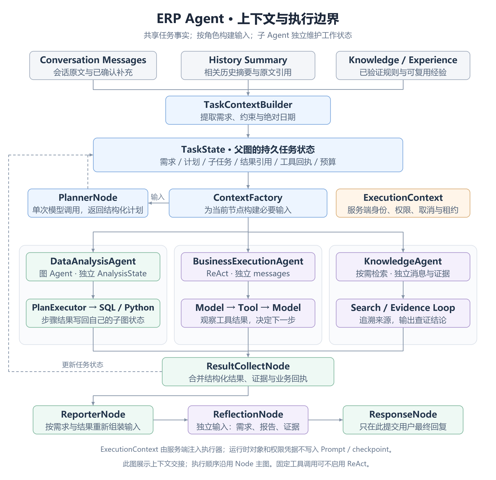

# ERP Agent 与上下文完整设计（讨论稿）

日期：2026-10-14。本文在已确认的 [Node 架构图](./ai-graph-architecture-proposal.md) 基础上补充 Agent 边界、上下文传递、状态持久化和恢复设计。原流程图保持不变；本文不是已部署实现，也不修改现行 API/数据库契约。

如果希望先理解 State 如何实际编程，建议先阅读 [State 管理的最小实现](./ai-state-management-guide.md) 并运行配套示例，再扩展本文的完整字段设计。

## 1. 上下文不依赖每个节点都是 Agent

所有节点通过图的任务状态协作。需要调用模型的节点，从任务状态取本次所需信息生成 Prompt；普通代码节点读取字段、执行工作、返回状态更新。持久任务事实、模型输入和子 Agent 的循环消息是三种不同对象。

推荐结构：**一个外层业务 StateGraph，若干单次模型节点，数据分析图 Agent，以及按需要启用的业务/检索 ReAct Agent**。共享同一个 ChatModel 可以节约组装和连接资源，不代表共享 messages、检查点或用户身份。



[SVG 图](./diagrams/erp-ai-agent-context.svg)。此图表达数据传递和 Agent 边界，业务执行顺序仍以已确认的 Node 图为准。

## 2. 参考项目源码如何处理上下文

| 参考 | 本轮核实的代码行为 | ERP 可以借鉴的部分 |
| --- | --- | --- |
| DataAgent `PlannerNode` | 从 OverAllState 取规范化问题、schema、语义模型、证据及修复反馈，渲染 Prompt，再调用 LlmService | 模型节点按角色读取状态，规划不是依靠一份无限增长的聊天记录 |
| DataAgent `SqlGenerateNode` | 取当前执行步骤的 instruction；重试读取失败 SQL 与原因 | 当前子任务上下文与总体需求分开，错误反馈定向注入 |
| DataAgent `PlanExecutorNode` | 程序读取计划与 currentStep，选择下一节点并校验计划 | 图 Agent 的循环由状态和条件边控制，调度本身不需要模型 |
| DeepResearch `ResearcherNode` | 从 plan 找分配给本执行器的步骤，再创建该步骤的 messages，加入所需记忆、检索和修复信息 | 执行器只拿自己任务所需上下文 |
| DeepResearch `ReporterNode` | 从 state 收集计划、各研究/计算节点结果，再构建报告输入 | 输出阶段按结果组装上下文，不复制完整执行过程 |

源码：[DataAgent PlannerNode](https://github.com/spring-ai-alibaba/DataAgent/blob/main/data-agent-management/src/main/java/com/alibaba/cloud/ai/dataagent/workflow/node/PlannerNode.java)、[SqlGenerateNode](https://github.com/spring-ai-alibaba/DataAgent/blob/main/data-agent-management/src/main/java/com/alibaba/cloud/ai/dataagent/workflow/node/SqlGenerateNode.java)、[PlanExecutorNode](https://github.com/spring-ai-alibaba/DataAgent/blob/main/data-agent-management/src/main/java/com/alibaba/cloud/ai/dataagent/workflow/node/PlanExecutorNode.java)、[DeepResearch ResearcherNode](https://github.com/spring-ai-alibaba/deepresearch/blob/main/src/main/java/com/alibaba/cloud/ai/example/deepresearch/node/ResearcherNode.java)、[ReporterNode](https://github.com/spring-ai-alibaba/deepresearch/blob/main/src/main/java/com/alibaba/cloud/ai/example/deepresearch/node/ReporterNode.java)。

这些是公开源码行为核对，不是三个项目的集成运行结果。上游 main 与 ERP 固定框架版本可能不同，具体 API 以实施时固定版本验证为准。

DataAgent 的多轮记忆和执行检查点也分开：GraphServiceImpl 普通新请求按 conversationId 读取历史、创建新的图 threadId；人工反馈关联此前 threadId 恢复。MultiTurnContextManager 主要保存“用户问题 + 截断后的规划结果”，再将历史文本显式注入图状态。ERP 可借鉴会话/任务分离，但不能把计划历史当完整用户对话记忆或业务完成证明。

源码：[GraphServiceImpl](https://github.com/spring-ai-alibaba/DataAgent/blob/main/data-agent-management/src/main/java/com/alibaba/cloud/ai/dataagent/service/graph/GraphServiceImpl.java)、[MultiTurnContextManager](https://github.com/spring-ai-alibaba/DataAgent/blob/main/data-agent-management/src/main/java/com/alibaba/cloud/ai/dataagent/service/graph/Context/MultiTurnContextManager.java)。

## 3. 上下文分为六类

| 类别 | 存什么 | 谁使用 | 建议保存方式 |
| --- | --- | --- | --- |
| 会话原文 | 用户/助手原文、可追溯的工具调用记录 | 用户界面、历史查证、审计 | 保留现有 MySQL 原文能力 |
| 会话摘要与需求快照 | 相关历史摘要、原始问题、人工补充、已确认约束 | TaskContextBuilder、Planner | 摘要由原文派生；需求及约束进入 TaskState |
| TaskState | 计划、任务依赖、状态、结果引用、工具回执、预算、暂停位置 | 外层 StateGraph 的各节点 | 可序列化状态、官方检查点和任务级业务记录 |
| 本次模型输入 | 角色 Prompt、当前任务、需要的证据和修复反馈 | 本次模型调用 | ContextFactory 临时构建；记录输入来源与版本便于追溯 |
| 子 Agent 工作状态 | ReAct 的 messages/toolCalls/toolResponses，或数据子图 AnalysisState | 对应子 Agent/子图 | 独立作用域；短任务可临时，需恢复的长任务独立检查点 |
| 长期知识及大型产物 | 已验证经验、规则；数据集、图表、长原文 | 按需检索/授权读取 | 知识库/产物存储；TaskState 存引用和必要元数据 |

此外还有 **ExecutionContext**：服务端身份、取消信号、租约、连接/执行器、权限服务。这是运行时对象，不是第七份可持久化聊天上下文。checkpoint 保存可解析 ID，不保存 Run、Scheduler、连接、闭包或访问 Token；恢复时由服务端重新建立作用域并复核授权。

## 4. 推荐的 TaskState

以下 JSON 是内部设计示例，字段和持久化方式尚未实施。对象以图运行 taskRunId 为归属，内部 tasks 再按 taskId 区分。

```json
{
  "stateVersion": 1,
  "conversationId": "conv_21",
  "taskRunId": "run_42",
  "ownerUserId": "u_7",
  "requestSnapshot": {
    "originalRequest": "分析上月销售趋势，并给客户甲创建指定商品的销售订单",
    "sourceMessageIds": [101, 103],
    "clarifications": {"warehouseId": "wh_3"},
    "resolvedTimeRange": {"from": "2026-09-01", "toExclusive": "2026-10-01"},
    "timezone": "Asia/Shanghai",
    "acceptanceCriteria": ["提供趋势及依据", "返回实际创建的订单编号"]
  },
  "historySummaryRef": "summary_8",
  "knowledgeRefs": ["rule_sales_v3"],
  "authorizationRef": {"policyVersion": "policy_12"},
  "planVersion": 2,
  "tasks": {
    "T1": {"capability": "DATA_ANALYSIS", "dependsOn": [], "status": "PENDING"},
    "T2": {"capability": "BUSINESS_TOOLS", "dependsOn": [], "status": "COMPLETED"}
  },
  "results": {
    "T2": {"status": "COMPLETED", "receiptRef": "receipt_88", "orderId": "SO_123"}
  },
  "datasetRefs": ["dataset_11"],
  "artifactRefs": [],
  "reportDraftRef": null,
  "review": null,
  "budget": {"modelCallsUsed": 4, "repairRoundsUsed": 0},
  "status": "RUNNING"
}
```

重要的日期和用户确认条件结构化保存，不只留在摘要里。“上月”在任务开始时解析成绝对日期，恢复时不重新按当天解释。authorizationRef 仅是策略版本线索，不能把旧快照当作持续执行授权。

stateVersion 控制状态协议；planVersion 标识计划变化；当前 requestId 只属于本次 HTTP/执行请求；checkpointId 对应可恢复位置。它们不是同一个 ID。

任务结果附带 `taskRunId/taskId/planVersion/attempt`。计划调整后，旧结果要按输入与口径确认可复用性；不能把已失效结果混入新报告。写工具已提交的订单不会因计划变化而自动回滚或重新创建。

## 5. ContextFactory：让每个模型看到恰当的信息

ContextFactory 是应用层组件，不是另一名自由推理 Agent。它依据节点角色、当前子任务、授权范围和输入预算，从 TaskState 构建不同视图。

| 消费方 | 应提供的上下文 | 不应默认加入的内容 |
| --- | --- | --- |
| PlannerNode | 原始需求、人工补充、相关历史、能力目录、验收要求、必要的失败摘要 | 全量表结构、全量工具日志和数据库记录 |
| DataAnalysisAgent | 当前分析任务、父计划必要片段、日期与指标口径、授权目录、依赖结果引用 | 创建订单的内部工具循环和其他无关子任务消息 |
| SqlGenerateNode | 当前 SQL 步骤、相关授权 schema、指标定义、必要依赖、失败 SQL/反馈 | 全部会话原文及 Python 的全部 stdout |
| PythonGenerateNode | 分析步骤、数据集 schema/样本/统计、依赖能力、上次代码和错误（修复时） | 不相关表结构、全量数据和数据库凭据 |
| BusinessExecutionAgent | 当前业务动作、已确认参数、授权工具目录、已有执行回执 | 数据分析的代码和明细数据 |
| KnowledgeAgent | 明确检索问题、业务范围、资料版本限制 | 整个父图状态 |
| ReporterNode | 用户需求、验收项、各任务结论、关键指标、证据、实际工具回执与缺口 | 子 Agent 全部 messages、模型推理过程 |
| ReflectionNode | 原始需求及补充、验收清单、报告草稿、关键结构化证据/回执 | 执行者的冗长自述和修复过程 |

SchemaRecallNode、权限节点、调度节点可以只读取普通字段，不构建 Prompt。

Prompt 中的数据明确标为数据，历史、文档和工具结果不能升级为系统指令。身份及访问权限从服务端 ExecutionContext 获取，不能让模型通过参数指定自己的权限。

## 6. Agent 怎么包在现有 Node 中

| 现有 Node | 推荐的实际实现 | 工作状态/循环 |
| --- | --- | --- |
| PlannerNode | ChatClient/ChatModel + 结构化 Plan 输出；职责上可称规划 Agent | 单次调用，外层图控制重新规划 |
| DataAnalysisNode | 调用 DataAnalysisAgent 的编译子图 | 独立 AnalysisState；PlanExecutor 驱动 SQL/Python 步骤循环 |
| BusinessToolNode | 参数明确时程序调工具；需动态组合时调用 BusinessExecutionAgent（ReactAgent） | 独立 messages；model → tool → model 循环 |
| KnowledgeNode | 一次检索即可满足时程序检索；需多次检索查证时使用 KnowledgeAgent | 独立 messages 与来源证据 |
| ReporterNode / ReflectionNode | ContextFactory + 单次模型调用 + 程序检查 | 不共用执行 Agent 的聊天历史 |
| Human、Team、调度、鉴权、结果保存等 | 应用代码 | 读取/更新结构化状态 |

一个 Node 可以成为完整 Agent 的入口；一个图 Agent 也可以由很多非 Agent 的节点组成。只有需要工具选择和反复观察结果的部分才使用 ReAct，数据分析子图不用外面再套一个重复规划的 ReactAgent。

### 业务 Agent 的完整内部循环

```text
BusinessToolNode 收到当前子任务
  → ContextFactory 构建初始 messages
  → BusinessExecutionAgent.model 选择工具及业务参数
  → 服务端工具适配层注入当前身份、取消、预算和幂等作用域
  → ERP Service 执行查询/创建
  → 工具结果作为 ToolResponseMessage 返回同一个子 Agent
  → model 判断是否还需下一工具；完成则返回任务结果
  → 结果适配层校验回执，输出 TaskResult
  → ResultCollectNode 合并到父 TaskState
```

模型说“创建成功”不能替代工具回执。创建订单的幂等键是稳定业务动作 ID，与 requestId、toolCallId 及重试 attempt 分开；不因人工恢复或模型修复生成新键。未知执行结果先查证，不能直接再创建。

## 7. 父子 Agent 只通过受控任务包交接

分发给子 Agent 的 TaskEnvelope 至少包括：`taskRunId/taskId/planVersion/attempt`、当前目标、已确认参数、必要约束、验收项、依赖结果引用、可用能力目录。可信身份和实际授权通过服务端作用域传递；Prompt 中的能力说明不承担鉴权。

子 Agent 内部 messages 与父图分开，返回 TaskResult：`status/findings/evidenceRefs/artifactRefs/missingFields/error/receiptRefs`。需要的原文证据按引用查阅，不能只凭总结证明正确。父图可以记录子调用的审计轨迹，但不把所有轨迹重新拼到下一次模型输入。

官方 AgentTool 或 asNode 是接入便利，不保证符合 ERP 的最小上下文边界。应基于固定版本核对它们传哪些 state/config/messages，并用输入白名单适配；`includeContents=false` 之类开关不能替代数据范围控制。

本轮核对框架 main 的具体区别：AgentTool 主要把子输入组装成 messages，同时派生父 RunnableConfig，不复制完整父 OverAllState；asNode 的适配器则复制父 state，关闭 includeContents 主要是移除 messages。ReAct 本身内部有模型节点、工具节点和条件边，通过 messages 中的工具调用决定继续或结束。因此“Agent 作为工具”和“Agent 作为子图节点”的默认交接方式不同，两者都需要显式的作用域与输入控制。

源码：[AgentTool](https://github.com/alibaba/spring-ai-alibaba/blob/main/spring-ai-alibaba-agent-framework/src/main/java/com/alibaba/cloud/ai/graph/agent/AgentTool.java)、[ReactAgent](https://github.com/alibaba/spring-ai-alibaba/blob/main/spring-ai-alibaba-agent-framework/src/main/java/com/alibaba/cloud/ai/graph/agent/ReactAgent.java)。上述行为不代表 ERP 当前固定版本已具备同样的取消/上下文透传，实施前需要核对。

建议框架 threadId 命名区分作用域（示例）：

```text
会话原文关联：conversationId
父图：erp:task:{taskRunId}
分析子图：erp:task:{taskRunId}:data:{taskId}:v{planVersion}:a{attempt}
业务子 Agent：erp:task:{taskRunId}:business:{taskId}:v{planVersion}:a{attempt}
单次请求：新 requestId，服务端关联持久任务和子作用域
```

短生命周期子 Agent 可以不持久化检查点；长运行和可恢复的子 Agent 必须有独立检查点、父子关联及生命周期管理。在同一次 attempt 内正常恢复沿用子 thread/checkpoint，不因每次请求换 UUID 而丢掉进度；重新执行一项任务时才创建新的 attempt。不能直接使用所有用户共用的固定 threadId。

## 8. 上下文预算、并发与数据引用

按每个模型调用设置输入预算：角色说明/工具定义 → 需求与必需约束 → 当前步骤 → 关键证据 → 相关历史与经验；同时预留模型输出容量。超过预算先缩小召回、取统计与样本、分页读取，再摘要可摘要的历史。

不得为了压缩删除工具调用/响应配对、已确认参数、幂等回执或关键事实。固定结构字段不是聊天摘要的替代品。PythonGenerateNode 看到 schema/样本即可生成处理完整数据的代码；PythonExecuteNode 读取完整的授权数据集。不能把样本计算结果冒充完整数据分析。

数据集引用至少附数据归属、查询范围、生成时间、schema、行数、完整/截断标记、金额单位/精度和输入版本。读取引用同样校验授权与过期状态。持久化 TaskState 不塞几十万行数据或图片 base64。

并行执行器读取版本化的父状态快照，各自更新子状态。完成时输出独立 TaskResult，由 ResultCollectNode 按 taskId/attempt/planVersion 校验后串行合并，或通过经过验证的 keyed reducer 合并；不能在多个线程里修改同一 messages 或 ReplaceStrategy 的共享结果对象。

任务计划、父子检查点、模型/工具审计与大型产物各自有保留期限。模型/工具调用必须有取消和总预算；恢复后的剩余预算从持久记录计算，不能每次回退都重新获得完整额度。

## 9. Human 暂停与恢复

HumanNode 保存原需求、缺失字段、问题 ID、planVersion、已完成任务和父子 checkpoint 关联，标记 WAITING_HUMAN 后释放本次运行资源。用户补充写入会话原文，同时更新需求快照中的 clarifications。

恢复步骤：校验用户与任务归属 → 检查问题/计划版本和重复回复 → 新建 requestId/执行租约/取消作用域 → 按当前权限复核 → 加载父子任务状态 → 合并补充并使受影响步骤失效 → 回 Planner。未受影响的完成结果保留，已提交订单通过回执保留。

等待时不占着模型循环和线程。等待有效期与实际执行时间预算分开；不得把“用户补充”当成一个与原任务没有关联的新问题。

## 10. 一个完整例子

用户：“分析上月销售趋势，并给客户甲创建指定商品的销售订单。”

1. TaskContextBuilder 根据当前时间将“上月”解析为 2026-09，并从授权历史提取商品和数量等已确认字段。Planner 分出 T1 分析和 T2 业务动作。
2. 如果仓库等必填信息缺失，Human 追问。用户补充后保存原文与结构化 warehouseId，恢复同一任务，不重新猜测月份。
3. DataAnalysisAgent 收到 T1 的月份、指标、授权目录和验收要求；其 SQL 节点取当前查询步骤，Python 节点按数据集 schema/样本写代码，沙箱计算授权完整数据，返回指标与图表引用。
4. BusinessExecutionAgent 收到 T2 的业务参数及已有回执；在自己的 messages 中查询客户/商品并创建订单。客户/商品有歧义时返回 NEED_INPUT，不自行选择。真实订单编号和幂等回执保存。
5. 两任务允许独立执行时可并行。父图仅合并结论、证据、缺口和实际订单回执，不合并两个 Agent 的全部内部 messages。
6. Reporter 看到需求、分析结果和创建订单回执，生成统一答复。Reflection 使用独立输入检查趋势依据及实际订单完成情况。
7. 图表或报告解释需修复时，仅修复 T1/报告；不会重新创建 T2 已提交的订单。通过后 ResponseNode 保存唯一对用户的最终回复，异步提取经验候选。

## 11. Java 实现形状（伪代码）

下面展示职责边界；DTO、TaskStore、ContextFactory、ChildAgentRunner 均为拟议应用组件，不是框架现成类。示例未编译，省略流式完成、模型/工具预算、失败处理和检查点协调；不能直接复制为生产实现。

```java
// 普通模型节点：每次按角色从任务状态构造输入。
Map<String, Object> runPlanner(TaskState state, ExecutionContext execution) {
    ModelContext input = contexts.forPlanner(state, execution);
    Plan plan = plannerClient.prompt()
            .messages(input.messages())
            .call()
            .entity(Plan.class);
    validator.validate(plan, state, execution);
    return Map.of("plan", plan); // 由图的状态策略合并，不写用户最终回复。
}

// ReactAgent 对象可共享配置；每次子执行拥有独立配置与 messages。
ReactAgent businessAgent = ReactAgent.builder()
        .name("erp_business_execution")
        .model(businessChatModel)
        .systemPrompt(businessSystemPrompt)
        .tools(authorizedErpToolCallbacks)
        .parallelToolExecution(false)
        .build();

TaskResult runBusiness(TaskState state, Task task, ExecutionContext execution) {
    TaskEnvelope envelope = handoff.forTask(state, task, execution);
    ModelContext input = contexts.forBusiness(envelope, execution);
    RunnableConfig childConfig = scopes.newChildConfig(
            state.taskRunId(), task.id(), state.planVersion(), task.attempt(), execution);
    // Runner 消费完整子执行流，校验工具回执后提取 TaskResult。
    // 运行时身份从服务端作用域定位，不能让模型自己填 userId 当授权。
    return childRunner.run(businessAgent, input.messages(), childConfig, execution);
}

TaskResult runData(TaskState state, Task task, ExecutionContext execution) {
    TaskEnvelope envelope = handoff.forTask(state, task, execution);
    AnalysisState childState = analysisInputs.fromAuthorizedTask(envelope, execution);
    // 不把完整父状态原样复制给数据子图；子状态拥有独立检查点。
    return dataRunner.run(compiledAnalysisGraph, childState, execution);
}
```

作用域和 runner 负责：注册可信执行关系，检查权限与父取消，按固定版本的图 API 执行/恢复，保存审计，完成后回收运行时对象。StateGraph 的节点薄适配这些应用组件；不能依赖 Java ThreadLocal 在异步调度后仍自动携带身份。

## 12. 对当前 ERP 的具体适配

本轮阅读当前代码确认已有可保留的基础：MySQL 原文、RedisSaver、摘要 Hook、独立历史查证子 Agent、预算与取消。

需要适配的点：

1. `AiMessageRecordingHook` 把无 toolCalls 的模型输出设为当前 Run 的最终候选；Planner 的计划、Reflection 的判定不能原样使用这条逻辑。新增节点产物审计职责，ResponseNode 统一提交最终回复，工具调用仍在执行前记录并与响应配对。
2. `AiRecordingToolInterceptor` 根据主 Run 和登记的 toolCallId 授予工具执行权，子 thread 不能直接复用。持久子 Agent 通过可信 ID 映射建立子运行作用域，继承父预算与取消。
3. `AiHistoryRetrievalService` 当前使用独立临时 thread，不挂 Saver，metadata 中的 Scope 含运行时父 Run。这可作隔离模式参考，但持久数据子图不能把该 Scope 序列化进检查点。
4. `AiSummaryHook` 只压缩 messages，不自动处理 schema、tasks 和大型数据集。新 ContextFactory 仍需单独设置模型输入预算。
5. `AiContextRebuilder` 恢复的是聊天 messages，普通入口只复用 END；Human 和长运行子图需要独立任务恢复入口。
6. `AiMemoryConfig` 当前序列化器适配了消息和金额精度，新 TaskState/AnalysisState 还需类型、版本和精度验证。聊天、父图、子图的检查点清理范围都要单独明确。

相关代码：`infra/hook/AiMessageRecordingHook.java`、`infra/interceptor/AiRecordingToolInterceptor.java`、`infra/memory/AiHistoryRetrievalService.java`、`infra/hook/AiSummaryHook.java`、`infra/memory/AiContextRebuilder.java`、`infra/config/AiMemoryConfig.java`。

建议新增应用组件职责：`TaskContextBuilder` 提取任务需求；`TaskContextFactory` 组装各角色模型输入；`TaskStateStore` 管理任务与恢复关联；`ChildAgentRunner` 管理子执行；`TaskResultCollector` 合并结构化结果；`TaskAuditRecorder` 记录内部产物。命名只是建议，按现有工程风格实施。

## 13. 首次实现的验收项

- 节点模型输入只包含对应任务必要字段，事实来源可追溯；对同模型不同用户/任务进行并发隔离检查。
- 子 Agent 没有父图全量 messages；AgentTool/asNode 的输入白名单验证通过。
- Human 恢复后参数、日期、回执、预算与检查点关联不丢失；权限变化按当前授权处理。
- 消息摘要保留工具配对；大数据按引用处理，样本不会冒充全量结果。
- Planner/Reflection 输出不成为用户最终消息；最终报告引用真实数据与真实工具回执。
- 超时、取消、租约失效、应用重启和工具执行结果未知时不会重复创建订单。
- 外层重规划、内层 ReAct 和 SQL/Python 修复共享预算，每项完成判定清晰。

本轮产出完整设计和源码依据，没有实施业务源码、表结构或对外接口变更。后续实际实现时再执行相应测试和仓库前端预检。
