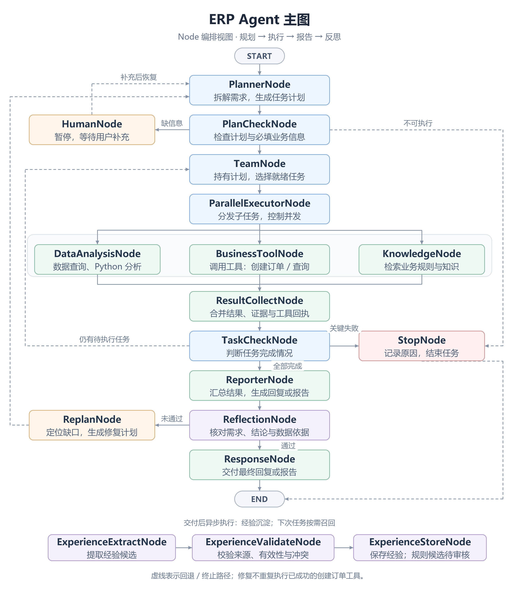
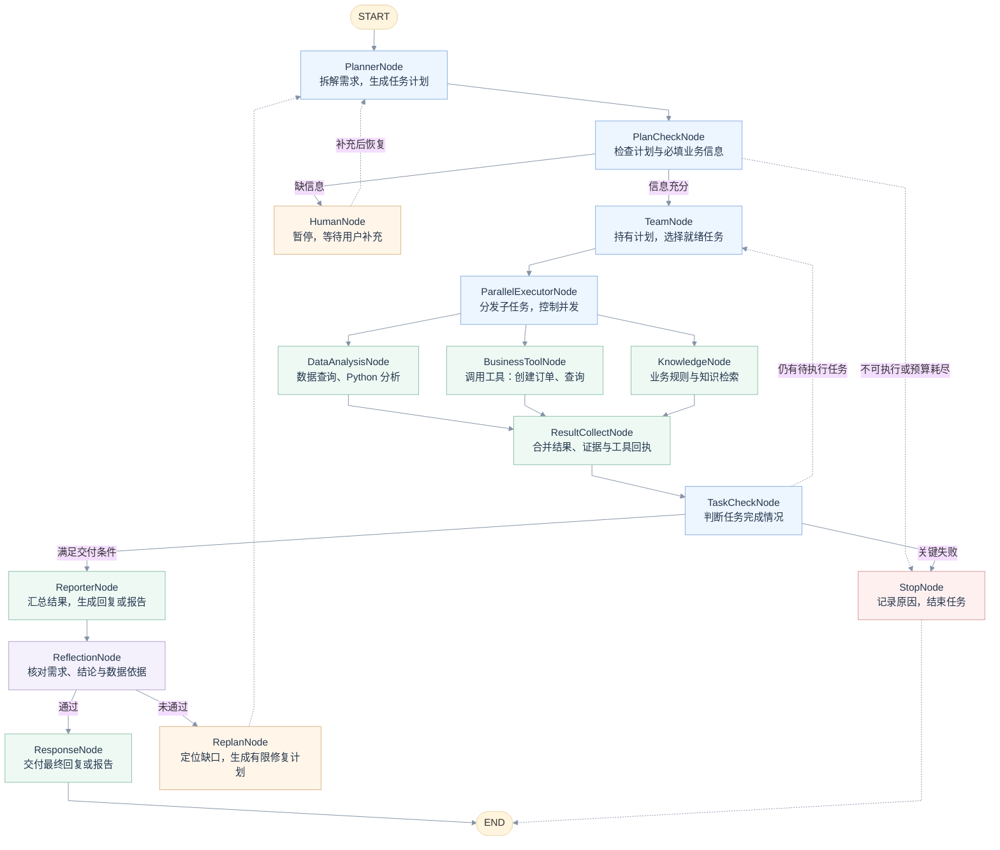
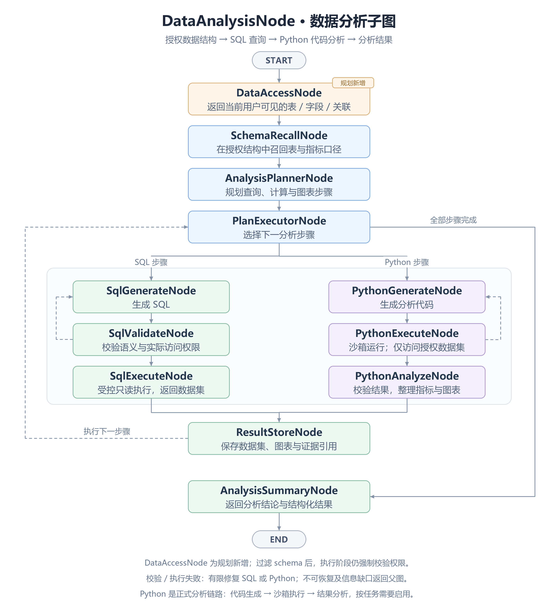
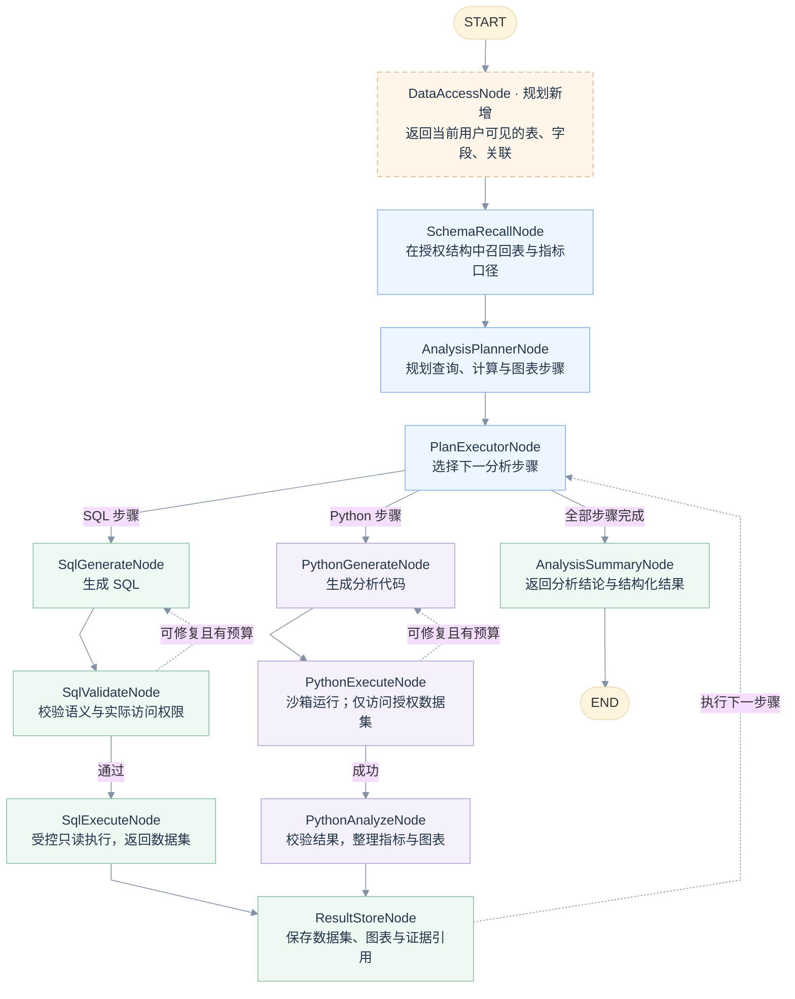

# ERP AI 图架构融合方案（讨论稿）

日期：2026-10-14。本文根据本次新架构讨论、当前工作区代码及三个上游项目的公开 main 文档/源码整理。它是下一版设计提案，不代表已经实施，也不替代现行功能说明、OpenAPI 或数据库契约。

Agent 边界、任务上下文、子 Agent 工作区和暂停恢复的完整配套设计见 [ERP Agent 与上下文设计](./ai-agent-context-design.md)。

## 1. 建议采用的架构

采用 **ERP 外层 StateGraph + DataAnalysis 数据分析子图 + 独立报告验收 + 异步经验沉淀**。

外层借鉴 DeepResearch 的 Planner、条件路由、Human、Team 和并行执行；DataAgent 为数据能力的二次开发底座；AssistantAgent 提供经验管理、检索及动态上下文的参考。三个项目各取适合 ERP 的部分，由 ERP 统一任务状态、权限、业务口径和生命周期。

固定 SQLtool 不再承担整个工作流。查询执行仍需要明确入口，SQL 生成、校验和执行可以成为数据子图内部节点。任务是否完成由结构化状态和验收证据判断。

本轮设计覆盖查询、分析、报告、知识问答与业务工具调用。按最新讨论，创建订单通过 BusinessToolNode 调用已注册的 ERP 工具完成；数据分析子图仍只读。工具底层复用 ERP Service 的权限、业务状态机、事务和幂等控制。数据子图新增 DataAccessNode 作为后续规划，Python 代码生成、执行与结果分析作为明确的核心链路。

## 2. 三个项目的实际能力与复用边界

| 项目 | 已核对的能力 | 本项目建议复用 | 需要二次开发的边界 |
| --- | --- | --- | --- |
| DeepResearch | StateGraph 中的规划、信息检查、Human、Team、并行研究/计算与报告 | 外层图的控制流、节点/条件边的组织方式 | ERP 必填信息判定、依赖调度、失败分级、持久化暂停恢复 |
| DataAgent | 元数据及知识召回、分析规划、SQL/Python 执行与报告工作流 | 数据分析子图及其语义建模、执行与报告相关能力 | ERP 数据范围、指标口径、结构化结果、子图取消/恢复、父子计划映射 |
| AssistantAgent | 前置 Evaluation、动态 Prompt、COMMON/REACT/TOOL 经验、learning 与 search 扩展模块 | 经验模型、检索及渐进披露、候选学习流程 | ERP 结果验收、经验审核生效、规则版本、与已有记忆的分工 |

DeepResearch 有几点不能照搬：

- `InformationNode` 的 Human 路由由 `auto_accepted_plan` 控制；计划解析失败会有限重试，耗尽后去 `END`。它还不是针对 ERP 必填业务信息的完整判定。
- `ResearchTeamNode` 把 `COMPLETED` 和 `ERROR` 都看作已有执行结果。ERP 必须区分“执行结束”和“目标达成”。
- `ParallelExecutorNode` 区分 RESEARCH 与 PROCESSING，后者等待研究阶段结束。ERP 更适合显式 `dependsOn` 的任务依赖。
- 图配置以 `END` 表示终止；本方案额外提出业务 `Stop` 节点，负责保存原因、清理运行资源和输出可理解的失败信息。

依据：[DeepResearch 图配置](https://github.com/spring-ai-alibaba/deepresearch/blob/main/src/main/java/com/alibaba/cloud/ai/example/deepresearch/config/DeepResearchConfiguration.java)、[InformationNode](https://github.com/spring-ai-alibaba/deepresearch/blob/main/src/main/java/com/alibaba/cloud/ai/example/deepresearch/node/InformationNode.java)、[ResearchTeamNode](https://github.com/spring-ai-alibaba/deepresearch/blob/main/src/main/java/com/alibaba/cloud/ai/example/deepresearch/node/ResearchTeamNode.java)、[ParallelExecutorNode](https://github.com/spring-ai-alibaba/deepresearch/blob/main/src/main/java/com/alibaba/cloud/ai/example/deepresearch/node/ParallelExecutorNode.java)。

DataAgent 已经包含自己的 Planner、Human 和报告流程。现有 MCP 的 `nl2SqlToolCallback` 调用 `graphService.nl2sql`，并另有智能体列表工具；不能据此认定完整分析报告已经能直接注册为 MCP Tool。完整分析需封装 Graph 流程，并定义统一结果协议。

依据：[DataAgent 架构](https://github.com/spring-ai-alibaba/DataAgent/blob/main/docs/ARCHITECTURE.md)、[MCP 服务源码](https://github.com/spring-ai-alibaba/DataAgent/blob/main/data-agent-management/src/main/java/com/alibaba/cloud/ai/dataagent/service/mcp/McpServerService.java)。

AssistantAgent 的 Evaluation 用于前置多维意图识别，不能直接替代报告完成后的准确性验收。其经验、学习和检索能力可作参考，但本轮没有验证其 learning 内部 Hook 在 ERP 中可独立运行。

依据：[AssistantAgent 中文说明](https://github.com/spring-ai-alibaba/AssistantAgent/blob/main/README_zh.md)。

## 3. 外层业务编排图（Node 版）

按最新反馈重画：统一矩形 Node，主流程纵向，Human 和修复回路放左侧，Stop 放右侧；分析、业务工具和知识检索并列。实际执行按计划选择分支，无依赖的任务可并行，合并结果后检查是否继续分发。

[SVG 矢量图](./diagrams/erp-ai-orchestration.svg) · [Mermaid 源码](./diagrams/erp-ai-orchestration.mmd)

节点检查产出枚举状态，条件边负责路由。图片以关键控制流为主，具体异常分级仍按第 6 节处理；所有回退检查预算，不进行无限循环。HumanNode 保存检查点并暂停，补充到达后恢复。

### BusinessToolNode：创建订单通过工具完成

主图注册 ERP 业务工具，例如查询订单、创建订单。BusinessToolNode 组装参数并调用工具；权限校验、字段校验、业务状态和事务由工具后的 ERP Service 执行。数据分析 Agent 的 SQL/Python 链路不承担创建订单。

写工具使用幂等键，保存业务单据 ID、执行状态和成功回执。ResultCollectNode 与 TaskCheckNode 按实际工具结果判断完成情况。ReflectionNode 可修复解释、报告或漏项，但不会重复调用已成功的创建订单工具；请求结果不确定时先按幂等键查证。

### 经验沉淀作为异步节点链

ResponseNode 交付后异步触发 `ExperienceExtractNode → ExperienceValidateNode → ExperienceStoreNode`。图片下方单独展示这条链，不把经验库回连到主流程；下一任务按需检索，规则候选仍需确认生效。

## 4. DataAnalysisNode 数据分析子图（Node 版）

此图是 ERP 二次开发设计，保留 DataAgent 风格的步骤执行结构，明确展开授权入口及 Python 分析。SQL 和 Python 是由 PlanExecutorNode 按计划选择的步骤分支，不代表两个分支必然同时运行；Python 可以消费先前 SQL 步骤保存的数据集。

[SVG 矢量图](./diagrams/erp-ai-data-analysis.svg) · [Mermaid 源码](./diagrams/erp-ai-data-analysis.mmd)

### DataAccessNode：新增的鉴权入口，暂不实施

节点由可信身份和服务端权限策略生成授权数据目录，返回当前用户可见的表、字段、允许的关联关系及数据范围约束。SchemaRecallNode、AnalysisPlannerNode 和 SQL 生成只接触这个目录，不把完整数据库结构交给模型后再要求模型自行过滤。

这项先纳入架构规划，不代表已经实现或本轮修改权限系统。表结构过滤只解决元数据可见性：SQL 在校验与执行阶段仍强制限定表、列、行范围，Python 仅能读本任务授权的数据集和产物；不能通过代码再接入全库或扩大数据范围。

### Python 的三个独立节点

| Node | 职责 | 产物 |
| --- | --- | --- |
| PythonGenerateNode | 根据分析步骤与授权数据集生成代码 | 分析脚本及数据集引用 |
| PythonExecuteNode | 在隔离沙箱执行代码，控制资源与可访问数据 | 计算结果、日志与图表文件 |
| PythonAnalyzeNode | 校验结果、单位、缺失值和图表，提取业务结论 | 指标、发现、图表和证据引用 |

Python 是正式分析能力，承担趋势计算、分组比较、异常识别、相关性分析及可视化；简单 SQL 查询可按计划不启用 Python。ResultStoreNode 保存结果后回到 PlanExecutorNode 选择下一步骤，全部完成后由 AnalysisSummaryNode 返回父图。

为避免重复长线，图片省略统一失败回传：错误处理针对具体 SQL 或 Python 步骤有限修复；权限拒绝、不可恢复错误及预算耗尽不继续执行，返回父图；关键口径缺失返回 NEED_INPUT，由父图进入 HumanNode。

父子图边界继续遵守：外层 PlannerNode 规划业务目标，AnalysisPlannerNode 只规划内部技术步骤；用户追问统一由外层 HumanNode 发起；子图报告能力用于分析摘要或报告片段，最终报告由外层 ReporterNode 汇总。AnalysisResult 至少包含 `taskId/status/datasetRefs/evidenceRefs/findings/artifactRefs/missingFields/errors`。

## 5. 人工补充是暂停状态

Planner 建议输出：`goal`、`acceptanceCriteria`、`resolvedInputs`、`assumptions`、`missingFields`、`clarifyingQuestions`、`tasks`。任务至少包含 `taskId/capability/dependsOn/input/outputContract/status`。这是拟议内部协议，不是对现行 API 的修改。

例如用户说“分析供应商表现”，可能缺时间范围、“表现”所指的指标或供应商范围。先从授权历史、现行评分定义和业务默认值判断；只有会实质改变结果、又无法可靠补齐的字段才追问。允许使用的默认值写入 `assumptions` 并向用户说明。

进入 Human 后保存任务、计划版本、缺失字段、checkpointId 和归属身份，标记 `WAITING_HUMAN`，结束本次响应并释放执行资源。用户补充通过同一持久化 `taskId/checkpointId` 关联恢复，为新的请求建立新的 `requestId/Run` 和执行租约；校验问题是否仍有效、重复提交和并发更新，再回 Planner。等待时间与实际执行预算分开计算，另设等待有效期。

当前 ERP 的 Run 随请求结束关闭；普通聊天的 `AiContextRebuilder.ensureCheckpoint` 只复用到达 END 的检查点，对其他状态会重建聊天上下文。因此人工恢复需要新增任务级持久状态与独立 resume 路径，不能直接把 WAITING_HUMAN 交给现有普通聊天恢复入口。

不能无限循环：同样的信息反复缺失时，解释具体阻碍，合并追问或终止；不会因为达到追问上限就强行执行。用户改变目标时提升计划版本，只使受影响的旧任务/证据失效。

任务建议状态：`PENDING/RUNNING/WAITING_HUMAN/COMPLETED/PARTIAL/FAILED/CANCELLED`。`END` 是图执行边界；最终业务状态由终态记录决定。成功也会到 END，等待则保留可恢复状态。

## 6. Team 与并行执行的责任

Planner 负责“要做什么”，Dispatcher 负责“现在能运行什么”，Team 负责“做得怎样、下一步去哪”。Team 不必再是一个进行自由推理的大 Agent，任务状态汇总和就绪判断优先用程序实现。

就绪任务必须满足依赖和授权范围。供应商交付统计与销售趋势可以并行；相关性分析必须等待需要的数据集准备完成。知识检索也可能是计算的前置依赖，图中分支不是固定同时启动。

子任务结果按 `taskId + attempt + planVersion` 合并，不能让多个执行器同时覆盖一个共享 `messages` 或 `results` 字段。独立子图使用自己的状态作用域，继承父任务取消、权限与执行预算。并行查询需要统一日期范围和明确的数据快照策略。

失败路由按原因处理：

| 情况 | 建议路由 |
| --- | --- |
| 缺少用户决定的口径或对象 | Human 暂停 |
| 计划解析错误、可修正的 SQL 或短暂网络错误 | 对应节点有限重试 |
| 个别非关键任务失败 | 标记缺口，符合用户验收要求时输出 PARTIAL |
| 关键证据不足、权限拒绝、用户取消、不可恢复错误 | Stop 保存原因后 END |
| 时间、Token、查询次数或重试预算耗尽 | 停止当前执行；仅在已满足部分交付条件时返回明确标注的 PARTIAL |

停止时保留已完成结果，不把“查询失败”解释为“没有业务数据”。同一异常不在模型、工具、子图、父图各重试一遍；指定一层负责重试并共享总预算。

## 7. 反思节点如何处理上下文

你的“清除中间上下文”想法适合减少执行过程对验收的影响。实现上为 Reflector 创建独立输入视图，不删除原始历史或检查点。

Reflector 至少读取四项：原始需求及人工补充、验收清单、待交付报告、结构化证据摘要。没有推理过程和冗长工具日志；必要时按引用读取原数据。只看用户和 AI 的最终文字可以检查是否答非所问，却无法证明 SQL 口径、金额或数据来源正确。

验收组合：程序核对数值/结构/引用/范围，模型判断需求覆盖、解释合理性、建议是否越出证据。使用独立 Prompt；条件允许时用不同模型交叉评估，但不能把模型自评当作正确性的证明。

拟议输出：`verdict=PASS/REPAIR/NEED_INPUT/STOP`、`failedCriteria`、`evidenceIssues`、`repairTarget`。表达问题修复报告，证据问题补充分析，目标误解重新规划。新版图将这些修复归入 ReplanNode，修复计划仅调度受影响的步骤，保留已成功的业务工具回执。各回路共享任务预算，另限反思轮次，首版可设最多两轮并通过实际样本调整。

报告未验收前是草稿。首版建议实时展示阶段进度，验收通过后发送最终报告；若将来需要草稿流式展示，必须支持草稿版本和最终结果替换，避免把已被否决的文字当最终结论。

## 8. 经验、规则与 RAG 的分工

记忆分为四类：会话记忆保存用户历史和偏好；任务状态保存计划/执行/暂停位置；经验库保存可复用的完成方法；规则和知识库保存有权威来源的业务定义。

最终通过验收后异步提取经验候选，也可从失败记录提取“应避免什么”，但失败不能当作成功模板。记录来源任务、验证证据、适用范围、口径版本、工具/schema 版本、有效期和状态。

- **执行经验**：例如完成某类分析所需的数据和步骤；经过验证后发布到经验库。
- **用户偏好**：例如希望按月查看趋势；在相应用户范围内保存。
- **业务规则候选**：例如如何计算交付及时率；必须与现行系统定义核对，冲突或新增规则交维护者确认。
- **RAG 文档**：发布已确认规则的解释和引用。索引是检索载体，权威规则仍由业务系统或版本化定义维护。

既有供应商评分直接引用采购模块的实际结果和规则，不让 Agent 另建一套评分公式。再次提问时可以复用验证过的步骤，但实时经营数据仍要重新查询。经验生效、淘汰和回滚独立管理；经验写入失败不改变已交付任务的结果。

## 9. 二次开发与接入策略

### 推荐先独立验证 DataAgent，再决定是否嵌入

先 fork 并固定上游提交，保留完整 DataAgent 应用作能力验证。由 ERP 新增适配层封装完整分析任务的提交、结果、状态、取消与恢复，接入其 Graph 服务；这些是需要实现和验证的接口，不假定上游现有 MCP 已具备。

DataAgent 内适配 ERP 数据源、语义模型、父任务输入和结构化输出。原始 ERP 登录 Token 不直接散发，服务侧校验短期任务授权与允许范围；实际查询再强制约束数据范围。仅传 `userId` 或在 Prompt 中说明权限不足以保证隔离。

独立运行可以隔离依赖，但增加任务授权、网络故障和远程取消的工作量。验证后，如团队希望单进程部署，再从 fork 抽出分析核心模块，统一 BOM 并检查自动配置、数据源、模型、Saver 和线程池冲突。当前不承诺其管理模块可作为干净的 Maven 核心库直接导入。

| 接入方式 | 适用情况 | 主要代价 |
| --- | --- | --- |
| DataAgent 独立服务 + ERP 适配层 | 希望先少改上游、尽快验证完整分析 | 远程任务生命周期、授权与运维 |
| 提取 DataAgent 核心为本地子图 | 已验证功能且希望单进程 | 模块拆分、版本对齐、Spring 配置隔离 |
| 仅通过现有 NL2SQL MCP | 只需要 SQL 生成能力 | 完整执行、分析、报告仍需补齐 |

DeepResearch 主要复用外层节点/路由的设计和适合的源码片段，替换网络研究业务；AssistantAgent 先复用经验与检索设计，模块是否直接依赖需通过实际构建与测试确认。引入源码时保留许可证和上游修改记录。

### 当前版本差异

以下为本轮读取的 POM 配置，不能视作跨项目兼容测试结果：

| 项目 | Java | Spring Boot | Spring AI | Spring AI Alibaba |
| --- | --- | --- | --- | --- |
| 当前 ERP 工作区 | 21 | 3.5.8 | 1.1.2 | 1.1.2.0 |
| DataAgent main | 17 | 3.4.8 | 1.1.2 | 1.1.2.2 |
| AssistantAgent main | 17 | 3.4.8 | 1.1.0 | 1.1.2.2 |
| DeepResearch main | 17 | 3.4.8 | 1.0.0 | 1.0.0.4 |

ERP extensions 为 1.1.2.1，AssistantAgent extensions 为 1.1.0.0。ERP 当前检查点外围清理依赖 SAA 1.1.2.0 的 key 约定；升级时还要复测已有消息序列化、摘要、恢复、并发租约与取消行为。

依据：本地 `erp-server/pom.xml` 与 `AiCheckpointMaintenance.java`；上游 [DataAgent POM](https://github.com/spring-ai-alibaba/DataAgent/blob/main/pom.xml)、[AssistantAgent POM](https://github.com/spring-ai-alibaba/AssistantAgent/blob/main/pom.xml)、[DeepResearch POM](https://github.com/spring-ai-alibaba/deepresearch/blob/main/pom.xml)。实施前固定 tag/commit 并做依赖树、编译和图运行验证。

## 10. 当前 ERP 可保留的基础

本轮代码核实：`AiMainAgentConfig` 当前是 ReactAgent，只注册历史检索工具，并明确尚未接入 ERP 业务查询或写入；文档中的 18 个 Service 查询 Tool 属于原设计，不能当作已实现能力。

已有 MySQL 原文消息、RedisSaver、摘要 Hook、历史检索子 Agent、消息录制、模型/工具预算与取消适配可以保留。它们承载运行和审计基础；接入外层图还需适配任务生命周期、Hook 作用域及父子检查点。现有聊天与执行生命周期需增加 WAITING_HUMAN、任务级状态和独立恢复入口。

未来源码组织可沿用当前 `infra/agent`，在 `infra/graph` 放节点/路由，在 `infra/analysis` 放 DataAgent 适配；任务生命周期仍放应用 Service，Controller 负责 HTTP/SSE 协议。对外传阶段、任务状态和产物引用，不直接泄露框架 NodeOutput。

## 11. 实施顺序与验收

1. **外层图骨架**：Planner → PlanCheck → Human/Team → Reporter → Stop/END，先接模拟执行器。验证补充信息不重复执行、重启可恢复、失败可解释、取消可传播。
2. **最小完整分析**：接一个明确业务场景，完整打通授权数据、口径、查询、计算、证据和报告。先验证销售趋势，再扩展供应商交付等跨表分析。
3. **任务依赖与反思**：增加有限并发、结果合并、定向修复和报告最终化。验证错误数字和错误口径能够被发现，重试与反思不会无限循环。
4. **经验闭环**：候选提取、校验、发布、检索、失效和回滚。验证不会将当前经营数字缓存成长期事实，也不会将未经确认的 AI 推断发布成业务规则。

首版无需把所有能力一次做齐，但第一个业务场景必须是完整闭环。重点验证缺时间/口径、多对象同名、空数据与查询失败、关键/非关键任务失败、授权变化、重复恢复、断线/重启、父子取消、并行证据一致性、经验污染与版本失效。

本轮更新 Node 版设计文档与图源码，并输出经过视觉检查的 PNG/SVG，未执行三个上游项目或实施业务改动；构建、契约和浏览器测试应在后续实际实现时进行，并遵循仓库前端预检要求。
