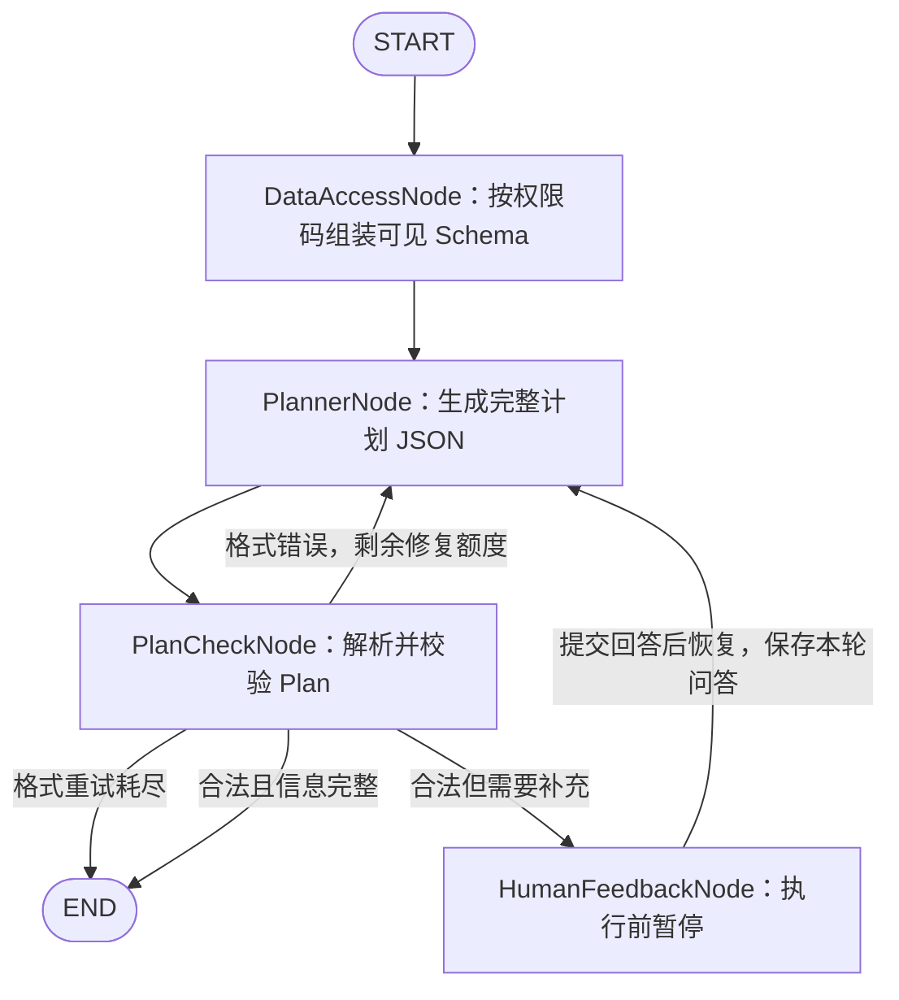

# AI Graph MVP 设计与运行说明

## 实施范围

当前阶段只完成任务规划闭环：生成结构化 Plan、自动修复格式错误、人工补充后重新规划。有效计划返回后结束，不执行 SQL、Python、报告生成或业务单据创建。

规划闭环之前多了一个**数据范围节点**：按当前登录用户的权限码算出可见表，组装成 Schema 文本写进 State。这是后续取数与报告的输入底座，本阶段只组装、不执行查询。

旧 ReactAgent 主运行体系、旧聊天 SSE 和旧的会话接口退出当前实现。AI 页面改用 `/ai/graph/*` 发起规划、用 `/ai/assistant/*` 管理会话：用户新建会话，发出需求，按需回答结构化问题，查看有效计划和执行进度。旧聊天路由（`/ai/assistant/messages`、`/ai/assistant/messages/stream`）不再存在；会话 CRUD 与节点进度 SSE 属于当前实现的一部分。其他 ERP 业务页面不在本次改动范围。

## 节点与流转



| 组件 | 职责 |
|---|---|
| `GraphController` | 校验请求，返回 SSE 进度流（内容按拍推送、终态薄载荷，正文以消息流水为准） |
| `GraphService` | 可信身份、任务创建、暂停点校验、更新 State、运行或恢复图、整理响应 |
| `DataAccessNode` | 按 State 里的权限码算出可见表，组装 Schema 文本写入 State；纯代码节点，不调模型 |
| `PlannerNode` | 将需求、当前任务澄清问答及最近错误反馈组成模型输入，写入原始 JSON |
| `PlanCheckNode` | 确定性解析与协议校验，管理格式修复计数和路由结果 |
| `HumanFeedbackNode` | 恢复后将当前问题与回答成对归档，再回到 Planner |

Planner 每次进入调用一次模型，澄清和格式修复由图的边控制，不另套 ReAct 工具循环。节点通过返回局部 State 更新完成写入，不引入新的 StateManager、运行注册表或内存任务存储。

## 代码结构

模块按**能力域**分包，不按技术分层。`graph` 与 `memory` 是两个能力域，`service` 只放对外服务与受控数据底座。

```text
com.qiheng.erp.ai/
├── config/                     Spring 装配（4）
├── constant/                   常量（8）：对外运行态、落库轮次态、路由枚举互不重名
├── controller/                 HTTP 入口（2）
├── domain/                     领域模型：dto / dto.plan / entity / model / vo
├── handler/                    类型处理器（1）
├── mapper/                     MyBatis 映射（8）
├── graph/                      ★ 图运行时
│   ├── GraphTopology.java      图拓扑：节点、边、State 键策略、编译参数
│   ├── node/                   4 个节点
│   ├── runtime/                编排、启动恢复、进度、失败、状态、运行上下文
│   └── support/                锁、线程标识、消息存储、记忆记录、权限解析
├── memory/                     记忆：history / node / summary
└── service/                    对外服务
    ├── impl/                   GraphServiceImpl / AiAssistantServiceImpl
    ├── progress/               进度事件发布
    └── data/                   ★ 受控数据底座
        ├── registry/           元数据登记与同步（启动时跑一次）
        └── schema/             Schema 组装与渲染（每轮请求）
```

| 分层 | 职责边界 |
|---|---|
| `graph/GraphTopology` | **图长什么样**：节点、边、条件边、State 键策略、编译参数。改图结构只动这里 |
| `graph/runtime` | **图怎么跑**：一轮执行的编排、加锁、准备、进度、失败收尾、状态推导 |
| `graph/support` | 图运行时的支撑：并发锁、线程标识、消息存储、节点记忆写入、权限解析 |
| `config/GraphConfiguration` | 只做 Spring 装配，不含图结构 |

> 历史上 `workflow` 与 `service.graph` 两个包混放图相关内容，且各有两个名字极像的状态常量类
> （对外运行态与落库轮次态都有 `RUNNING`/`FAILED`/`INTERRUPTED`）。现已分别收拢到 `graph/`
> 与 `constant/`，落库轮次态改名 `MessageRunStatus` 消歧。

## 受控数据范围（DataAccessNode）

模型能查到哪些表由服务端决定，不由模型或前端决定。链路是：

```text
登录用户权限码（会话快照，与 ERP 现有权限校验同源）
  → 模块前缀（product:query → product；"*" 是超管）
  → ai_data_table 中 status=1 且模块命中 → 可见表
  → ai_data_table_column 中 status=1 → 可见列（噪声列与敏感列挡在下发之外）
  → ai_data_table_relation 只保留两端表都可见的关系
  → 渲染成 Schema 文本，写入 State 的 authorized_schema_ref
```

**关系两端都可见才下发**：只看销售模块时 `sales_order_item → product` 这条关系不给模型，否则它会去 JOIN 一个 Schema 里不存在的表。

Schema 文本固定在一轮任务内：任务暂停后恢复，看到的仍是当初那份，不因中途改了权限而漂移。

| 组件 | 职责 |
|---|---|
| `SchemaSyncService` | 启动时把库里的真实结构刷新到登记表的结构字段；只更新结构字段，语义字段一个字不动 |
| `SchemaLibraryReader` | 从 `information_schema` 读列与索引的事实 |
| `SchemaIssueReporter` | 失效的表间关系不会自愈，送到系统异常通道，工作台出现待办由人工修正 |
| `AuthorizedSchemaProvider` | 权限码 → 可见表列关系 → Schema 文本，带进程内缓存 |
| `SchemaRenderer` | 渲染契约：口径与列同行、字母编码给 Examples、索引紧凑渲染、主键与唯一键标记 |
| `SchemaCache` | 按可见范围缓存 Schema 文本，元数据变更时清空 |

登记表的清单与语义在 [mvp-ai-schema.md](database/mvp-ai-schema.md)，建表与种子脚本是 `docs/database/sql/021_ai_data_schema.sql` 与 `022_ai_data_schema_seed.sql`。真库验证用 `-Dai.mysql.it=true` 开启。


## Plan 输出协议

`Plan`、`ClarificationQuestion`、`PlanStep`、`StepType` 定义结构；`BeanOutputConverter<Plan>` 生成模型输出格式提示，PlanCheck 仍独立校验实际输出。

```json
{
  "title": "库存补货分析",
  "objective": "分析一号仓库最近30天的库存与销量",
  "needs_clarification": false,
  "clarification_questions": [],
  "steps": [
    {
      "step": 1,
      "type": "SQL_QUERY",
      "instruction": "查询一号仓库当前库存及最近30天销量"
    },
    {
      "step": 2,
      "type": "PYTHON_ANALYSIS",
      "instruction": "依据前一步查询结果分析库存覆盖情况与补货需求"
    }
  ]
}
```

- `needs_clarification` 必须显式填写，不能用缺省 `false` 掩盖漏填。
- 需要澄清时问题对象列表非空，步骤为空；无需澄清时问题列表为空，步骤非空。
- 问题对象包含 `id`、`question`、`options`。id 在本轮唯一；options 非空时展示单选候选，空数组时展示自由输入；候选项不能为空或重复，用户始终可以自行补充。
- 日期和统计口径可提供明确候选；没有可信授权来源时不得杜撰仓库或商品列表，相关 options 必须为空。
- 步骤类型仅允许 `SQL_QUERY`、`PYTHON_ANALYSIS`，序号必须连续为 `1..n`，默认最多6步。
- 标题、目标、问题、步骤说明不允许空白字符串。
- 报告和业务动作不放入当前分析步骤；计划不包含执行状态或模型编造的查询结果。

提示词位于模块 `resources/prompts/planner.md`。已明确条件优先复用；用户改变需求、前后条件冲突或回答仍含糊时可以再次确认。库存、销量等待查询事实应转为查询步骤；缺少必须由用户决定的范围或口径时才请求澄清。无论初次生成、人工回答后重规划还是格式修复，都必须返回同一协议的完整 JSON。

## State 字段与写入责任

使用框架 `OverAllState`，Key 集中在 `GraphStateKeys`。State 只保存 JSON 兼容的数据；`current_plan` 以 Map 保存，节点需要时转换为 `Plan`，避免 Redis 恢复后直接将 Map 强转为 Java DTO。

| Key | 内容及更新者 |
|---|---|
| `user_id` | GraphService 从登录上下文写入的可信用户身份 |
| `request_id` | GraphService 写入本次 start/resume 请求标识，用于关联流水与当前执行，不能由前端指定 |
| `user_request` | 初始需求；后续回答不覆盖原文 |
| `permission_codes` | 入口从登录上下文解析后写入，客户端不可声明；DataAccess 节点据此算可见表 |
| `authorized_schema_ref` | DataAccess 节点写入的授权 Schema 快照（文本、可见表数、可见范围标记） |
| `clarification_history` | Human 保存的当前任务历轮问题与回答 |
| `planner_output` | Planner 最近一次完整输出；下一次生成替换 |
| `current_plan` | PlanCheck 最近一次通过协议校验的 Plan；无效输出清除旧值 |
| `plan_check_result` | PlanCheck 的路由结果：`RETRY_FORMAT`、`WAITING_HUMAN`、`READY`、`FORMAT_RETRY_EXHAUSTED` |
| `plan_format_retry_count` | PlanCheck 管理的本段格式修复次数，初始0 |
| `plan_format_error` | 最近一次格式错误，合法输出后清除 |
| `human_feedback` | GraphService 写入本轮回答，Human 消费后清除 |

Human 消费的是暂停时的合法 Plan 中的问题，成对保存后清理旧待澄清结果，再回 Planner。当前任务澄清历史是循环所需输入，不等于跨会话历史检索。

## 格式修复规则

配置 `erp.ai.graph.max-format-retries=2` 表示首次生成失败后最多修复两次，每段最多三次模型调用。仅 PlanCheck 修改计数；Planner 进入时不能重置计数。

| 检查结果 | State 更新 | 路由 |
|---|---|---|
| 格式或协议错误，仍有额度 | 增加修复计数，保存具体错误，清除旧 Plan | Planner |
| 格式或协议错误，额度耗尽 | 保存最后错误和次数，清除旧 Plan | END |
| 合法，业务信息不足 | 计数归零、清除错误，保存待澄清 Plan | Human |
| 合法，计划完整 | 计数归零、清除错误，保存最终 Plan | END |

格式错误包括 JSON 语法、字段反序列化、必填缺失、非法枚举、非连续序号及字段约束矛盾。错误记录包含 `type`、`path`、`message`，能取得时附 `line`、`column`；不保存 Java 堆栈作为提示词或接口错误。

Planner 修复时必须收到具体错误并重新生成完整 JSON；上一份完整输出由工作记忆历史提供（模型自己的最后一条 `[输出]`），不在输入里重复注入，也不堆积所有失败版本。模型网络故障、超时等不计入此格式修复次数，沿常规异常路径返回。

人工补充次数与格式计数无关。合法的澄清请求也代表协议输出成功，因此在暂停前立即重置格式计数。

## Redis 暂停与恢复

图直接挂载官方 `RedisSaver`，复用项目既有 Redis/Redisson 配置。任务 threadId 按可信用户与会话构造，与旧聊天检查点隔离。不会清空 Redis，也不批量删除历史检查点。

1. 新任务执行到 Human 前暂停，返回 `WAITING_HUMAN`；本次暂停标识 `pauseId` 随澄清卡与 `clarification_required` 事件下发。
2. 调用方保存本次 `threadId` 与 `pauseId`，按 `questions` 中的问题对象展示选择框或自由输入。每题支持自定义补充，提交前将已选值和补充与对应问题正文组合为 answer 文本，不向后端提交额外身份字段。
3. 提交回答时，服务校验可信用户归属、任务存在、当前仍等待 Human、请求暂停标识为最新暂停点，以及回答非空。
4. 服务调用 `compiledGraph.updateState(config, feedbackPatch)` 保存回答，再使用返回配置的 `withResume()` 调用 `compiledGraph.stream(null, resumeConfig)`。
5. Human 执行并回到 Planner。后续仍缺少信息时可以再次暂停，调用方必须更新为新的暂停点（pauseId）。

不从 START 重跑恢复任务，不重建旧聊天历史来覆盖进行中的检查点。终态和旧检查点不允许通过 resume 重放。执行与删除复用同一个会话级 Redisson 锁；执行线程从校验、输入落库一直持锁到图暂停或结束及结果落库，并在同线程释放。人工等待期间不占锁；恢复时重新获取锁、核对最新检查点并清除旧路由标志。前端禁用重复提交作为交互保护。

## 会话标识与记忆存储

- `ai_conversation.id` 是业务会话 ID；框架 `threadId` 按 `userId:conversationId` 构造，不新增 `thread_id` 列。不能用 `userId` 单独作 threadId——同一用户可以有多个会话，只用用户 ID 会让不同任务共用上下文。
- 图直接挂载官方 `RedisSaver`，由框架管理检查点；应用不实现自己的 Saver 算法，也不做运行/成功快照提升。Saver 保存的是稳定节点边界的进度与下一执行位置，不负责业务事务，也不是业务 exactly-once 的保证。
- 三层存储分工：MySQL `ai_message` 保存用户与助手原始消息，是历史回读与审计的事实来源；Redis 检查点保存模型当前使用的上下文与图执行状态；节点私有记忆存于 `ai_node_memory` 等表供节点按需读取。摘要只替换工作记忆窗口，不修改 MySQL 原文。
- 官方状态序列化器局部注册 Message Jackson 适配，主图与 Saver 共用该实例。
- 模型调用超时由 `erp.ai.model.read-timeout-seconds`（默认 300 秒）与 `flash-read-timeout-seconds`（默认 60 秒）控制，摘要模型超时由 `erp.ai.memory.summary-timeout-seconds`（默认 300 秒）控制。旧聊天式实现中的工具超时、历史检索超时和 Redis 租约已随旧运行体系退出，不作为现行约束。

## HTTP 接口

请求使用登录响应给出的动态 Sa-Token 请求头；登录用户身份不由请求 JSON 指定。接口前缀沿用服务端 `/api` context path，OpenAPI 见 [erp-openapi.yaml](api/erp-openapi.yaml)。

```http
POST /api/ai/graph/resume/stream
Accept: text/event-stream
Content-Type: application/json

{"threadId":"从待补充响应取得","pauseId":"最新澄清卡 content.data 取得","answer":"一号仓库，统计最近30天"}
```

```http
POST /api/ai/graph/stream
Accept: text/event-stream
Content-Type: application/json

{"conversationId":"2110785523187503105","query":"分析一号仓库最近30天的库存与销量，给出补货分析计划"}
```

`conversationId` 必须是当前登录用户自己的会话，缺失或不属于本人时按不存在处理；`query` 和 `answer` 为非空白文本，最多10000字符。启动与恢复都只提供流式入口，内容按拍推送、终态只发薄载荷，消息正文一律以 MySQL 消息流水为准，页面收到终态事件后重新拉取消息列表：

| 数据 | 来源 |
|---|---|
| 恢复所需 `threadId` / `pauseId` | 澄清卡 content.data（MySQL）与 `clarification_required` 事件同源，二者 pauseId 一致；恢复时必须提交最新暂停点，旧值消费后即失效 |
| 待补充问题 | 澄清卡 `content.data.questions`（事件 `content` 与落库卡同构，可先行渲染） |
| 计划正文 | PLAN 消息（MySQL）；执行中可先用 `artifact` 事件预渲染，`run_finished` 后以流水为准 |
| 失败说明 | `run_stopped.reason`；格式耗尽时正文看流水里的 ERROR 消息 |

启动与恢复接口返回 `Flux<ServerSentEvent<Object>>`，事件名为：

| 事件 | 事件体 | 含义 |
|---|---|---|
| `node-start` | `{node,label}` | 节点开始执行；`label` 由服务端给出，前端不硬编码节点名 |
| `node-end` | `{node,label,durationMs}` | 节点执行结束，带耗时毫秒 |
| `artifact` | `{type,checkpointId,content}` | 产物定稿即推送的内容事件，先于 `run_finished` 到达；`content` 与可见消息 `{type,data}` 展示协议同构，`type` 当前为 PLAN；顶层 `checkpointId` 由服务端补齐或为 null，仅作诊断 |
| `clarification_required` | `{type,checkpointId,content}` | 暂停轮收尾：等待人工补充；恢复所需暂停点在 `content.data.pauseId`（与澄清卡同源），顶层 `checkpointId` 仅作诊断 |
| `run_finished` | `{status,warning}` | 本轮完成，当前仅 `PLAN_READY`；`warning` 表示结果已生成但历史保存失败时的提示 |
| `run_stopped` | `{status,reason,warning}` | 本轮未完成（格式耗尽或执行失败）：`reason` 为可直接展示的说明，能力性终止（如格式耗尽）为 null，正文看流水 ERROR 消息 |

事件体是对象，由消息转换器序列化一次；服务端不手工拼接 JSON 字符串。连接带 15 秒注释心跳；`run_finished` 与 `run_stopped` 到达即收尾，暂停轮在澄清事件与收尾帧投递完后随通道关闭正常结束。每次执行只有一个终态事件（`run_finished`、`run_stopped` 或 `clarification_required`）。

## 会话与进度接口

会话管理挂在 `/api/ai/assistant/*`，与图接口共用权限码 `ai:assistant:use`：

| 方法 | 路径 | 作用 |
|---|---|---|
| GET | `/ai/assistant/overview` | 当前用户的会话列表，按最近一次活动倒序 |
| POST | `/ai/assistant/conversations` | 新建会话 |
| GET | `/ai/assistant/conversations/{id}` | 会话详情，含由检查点推导的 `running` / `runNode` / `runLabel` |
| PATCH | `/ai/assistant/conversations/{id}` | 重命名会话 |
| DELETE | `/ai/assistant/conversations/{id}` | 删除会话及其全部可见消息 |
| GET | `/ai/assistant/conversations/{id}/messages` | 用户可见消息分页，只含用户输入与最终回复 |
| GET | `/ai/assistant/conversations/{id}/progress/stream` | 接续订阅正在执行的进度；没有在跑的任务时立即结束 |

会话表不保存运行时状态。详情的 `runStatus`、`running`、`runNode`、`runLabel` 结合当前进度、最新输入、匹配请求的检查点和展示流水确定；读取 Redis 失败时仍可打开 MySQL 历史，人工卡片按中断状态只读展示。实时进度来自当前进程的 SSE 通道，浏览器断开不取消执行。启动与恢复入口共享相同的执行和收尾逻辑。

历史消息独立保存于 MySQL `ai_message.content`，采用 `{type,data}`：`TEXT`、`CLARIFICATION`、`PLAN`、`ERROR`。前端分页读取后按 type 渲染，不从 State 重建历轮消息。人工问题落库时包含本轮 threadId/pauseId，回答通过 `data.replyToMessageId` 关联原问题；恢复时仍校验当前暂停点，旧卡片不能重复提交。旧记录缺少 pauseId 时只读展示，不允许恢复。

图执行失败时记录失败输入和友好 ERROR；图已成功、仅展示消息保存失败时不调用通用失败收尾、不覆盖有效计划。会话删除只软删除可见流水及会话，保留节点原始记忆和工作记忆；运行期间拒绝删除，数据库提交后才释放锁。

`PLAN_READY` 只是计划可用于后续执行，不表示已经查询业务数据。`FORMAT_RETRY_EXHAUSTED` 是明确的图终态，不伪装成计划成功。业务校验失败沿项目异常约定返回，不能当作可恢复图结果。AI 未启用或模型未配置时返回503。

## 配置与验证

保留基础模型的启用开关、API key 环境配置和 Pro/Flash 模型配置，不读取或提交私有密钥。新增图配置：

```yaml
erp:
  ai:
    model:
      read-timeout-seconds: 300
      flash-read-timeout-seconds: 60
    graph:
      max-format-retries: 2
      max-plan-steps: 6
```

Planner 已接入节点工作记忆读取与现有 ContextCompressor：读取历史已完成任务的输入、澄清问答与模型输出原文，必要时压缩，再注入本次模型输入。原始审计记忆保留不变，压缩只替换工作记忆窗口；工作记忆里存的就是模型视角的纯文本转写，读侧逐行还原成消息，不做配对或反查。格式错误输出同样进入历史（模型要看见自己上轮错在哪），下一轮只补「具体错误」与「审阅反馈」。独立历史检索能力保留为扩展，没有额外检索 Agent、SQL/Python 执行工具、业务写入或后台摘要任务。会话与消息使用已有的 `ai_conversation`、`ai_message`，节点私有记忆使用 `ai_node_memory`、`ai_node_working_memory`、`ai_node_experience` 三张表，设计见 [mvp-ai-schema.md](database/mvp-ai-schema.md)。

验收需覆盖：前端新建任务、候选选择、自定义补充、连续澄清和计划展示；有效计划直达终态；一轮及多轮人工暂停恢复；错误 JSON、缺字段及矛盾字段的修复；修复耗尽终止；合法澄清和合法计划均重置计数；重建图后从 Redis 恢复；非所属用户、缺失检查点、旧检查点及终态恢复拒绝；AI 关闭或密钥缺失时 ERP 仍能启动。

Redis 集成验证只操作测试任务自身的 Key，不运行 `FLUSHDB` 或清理业务数据。契约检查运行 `npm run check:openapi`；`test:ai-sse` 验证流解析，`test:ai-state` 验证异步会话隔离，`test:ai-graph` 验证受控接口浏览器交互。`test:ai-graph-real` 与 `scripts/test-ai-graph-real-browser.cjs` 连接独立测试启动器，验证真实 HTTP/MySQL/Redis，模型仍使用本地确定性响应，不能据此声称已验证实际大模型的规划质量。

## 参考与后续接入

- DeepResearch 的 `Plan`、`PlannerNode`、`InformationNode` 和 `prompts/planner.md`：参考结构化规划和解析失败回边。
- DataAgent 的 `GraphController`、`service/graph`、`workflow/node`：参考入口命名、节点分层及计划校验反馈。
- 不整体引入参考项目的应用、旧版 API、专用 State 序列化器或研究任务提示词。

后续把 `READY → END` 出口接向执行器；SQL/Python、报告、反思和业务动作按阶段扩展，沿用当前图 State 和任务归属。

## 当前代码目录

```text
com.qiheng.erp.ai/
├── config/                 模型、官方 RedisSaver、主图装配
├── constant/               GraphStateKeys、运行状态与消息类型常量
├── controller/             GraphController
├── domain/
│   ├── dto/                图启动与恢复请求、plan 输出协议
│   ├── entity/             保留的历史表映射
│   └── vo/                 RunStateVO、Run*EventVO（进度事件载荷）、会话与消息展示 VO
├── mapper/                 保留的历史读取方法
├── memory/
│   ├── node/               节点审计/工作记忆与 Planner 上下文
│   ├── summary/            独立压缩器与薄 Hook，压缩器已被 Planner 复用
│   └── history/            显式范围的检索服务与 HistorySource，未接入主图
├── service/graph/          GraphService 薄入口、RunCoordinator 编排、准备/进度/收尾/状态读取组件
└── workflow/               检查结果枚举、三个 Node；run/ 运行上下文与结局判定
```

`resources/application-ai.yml` 只保留模型、图和预留摘要参数；`resources/prompts/planner.md` 为规划提示词。历史来源目前由调用方实现 `HistorySource` 后显式注入，没有自动扫描后台任务或默认数据库适配器。

## 本次验证记录

2026-10-15 完成以下验证：

- AI 模块32项测试全部通过：协议校验14项、真实 Redis 图集成5项、HTTP 契约3项、关闭/缺密钥装配3项、摘要3项、历史检索4项。
- Redis 集成使用本机独立16379端口、官方 RedisSaver、真实 JSON 序列化以及预设模型响应，覆盖跨图实例恢复和连续人工澄清；测试后关闭临时 Redis。
- `erp-admin` 及其依赖模块构建打包通过；前端类型检查及生产构建通过；`npm run check:openapi` 通过。
- 未调用外部付费模型，因此尚未验证实际模型的规划质量；旧 SSE 测试不作为新接口验收依据。

在准备好独立测试 Redis 后，可以从 `erp-server` 执行：

```powershell
mvn -pl erp-ai -am test -Dai.redis.it=true "-Dai.redis.address=redis://127.0.0.1:16379"
```

默认不传 `ai.redis.it=true` 时，真实 Redis 集成场景会跳过，其余测试正常运行。测试不读取私有模型密钥。

2026-10-16 完成图执行分层重构后的回归：

- `GraphServiceImpl` 收敛为薄入口：执行编排拆分为 RunCoordinator（会话锁、进度通道与终态事件）、RunStartPreparer / RunResumePreparer（校验与落库）、RunProgressTracker（节点进度）、RunFinalizer（成功收尾）、RunFailureHandler（失败收尾）和 RunStateResolver（状态读取），运行数据经不可变 RunContext 单向传递。
- 删除同步 `POST /ai/graph/resume`，恢复统一走 `/ai/graph/resume/stream`；OpenAPI、前端契约检查与联调脚本同步更新。
- erp-ai 单元测试 76 项通过（新增 RunOutcome、ConversationThreads、NodeMemoryRecorder 单测）；Redis 集成 5 项通过（跨图实例恢复、连续人工澄清、过期与终态拒绝）。
- 前端 `npm run check:openapi`、`npm run build`、`test:ai-sse`、`test:ai-state`、`test:ai-graph` 通过。

2026-10-19 完成终态处理改造（收尾零补写与暂停点换装）：

- 收尾收敛为 `RunCoordinator.finishRun` 三步：读图结局、结清用户输入行、发布终态事件；正常轮的消息与记忆写入全部归于各发布拍节点，失败路径保留 `RunFailureHandler` 的 ERROR 兜底卡。
- 成功收尾模型 `RunFinalizer`、`RunEnding`、`GraphResponse` 删除；落库、事件与前端展示继续由 `VisibleResultFactory` 单一构造。
- 澄清锚点从框架 `checkpointId` 平移为计划校验节点自生成的 `pauseId`：恢复接口提交 `{threadId,pauseId,answer}`，暂停点消费后旧值不可复用；事件顶层 `checkpointId` 仅作诊断，旧澄清卡缺 `pauseId` 时只读不可恢复。
- erp-web 同步换装（消息契约、SSE 解析、澄清视图与四个回归脚本），`check:openapi`、`test:ai-sse`、`test:ai-state`、`build`、受控浏览器回归、真实后端联调与真实浏览器全流程回归通过（验收报告：docs/qa-screenshots/2026-10-19-ai-graph-final/README.md）。

2026-10-23 需求协议收敛（去 `done_when` + 需求只增不改 + 字段说明补全）：

- **删除 `done_when`**：`done_when.keys` 与 `evidence_plan` 是子集关系，而 `next_step` 按整个 `evidence_plan` 算差集——没进完成门的项照样会被做，于是出现"清单没做完、需求已判完成"的不一致状态。任何自洽读法下完成门都等于整个清单，字段冗余，删除。完成判定退化为一行：`evidence_plan` 的 id 集合 ⊆ 证据链 key 集合。原先"列了但不阻塞完成"的项改为**不进清单**。连带删除 `DoneWhen` / `DoneWhenType`、`Need.doneWhen`、`need_check` 的两条校验，以及两处提示词里对 `done_when.keys` 的引用。
- **需求只增不改**：`need_check` 的合并规则重写。需求 id 没出现过 → 新需求整条收录；需求 id 已存在 → 只允许追加，本轮给出的每个证据项必须是新 id，追加到原有证据项之后；本轮重复给出的需求正文一律忽略，以已定稿的为准。证据项 id 撞了直接打回，并把"已被谁占用、要用新 id"写进 `REPAIR_ERROR`。
- **修掉一个会丢数据的缺陷**：`formatFailure` 原本无条件把 `NEEDS` 置空，导致后续轮次一次格式错误就把前几轮已定稿的需求全部清掉。改为不碰需求数组。
- **字段说明补全**：输出协议里每个字段都补了 `@JsonPropertyDescription`，写清"作用 + 什么时候用 + 怎么填"。`condition` 从"可选字段"改成完整规则（left 必须是已能算出的证据项、op 只跟字面量比、right 只能是字面量、判定由代码做），`op` 六个取值的含义逐个写明。
- **`condition` 的可空性**：record 构造器让 schema 把所有分量都算作 required，框架不认 `required = false`，所以"没有条件填 null"只能靠字段描述承载。真实模型实测输出的是 `"condition": null`，没有被 schema 误导。
- **提示词重写**：`planner.md` 新增「每轮你输出什么」，明确两条互斥分支（拆新需求 / 给已有需求追加新证据项），各带完整 JSON 例子与逐条说明；`need_review.md` 去掉 `done_when.keys` 相关表述。
- **真实模型验证**（`RealModelNeedsIntegrationTest`，真实 MySQL 表结构 + 真实 DeepSeek）三项问题：
  - "某仓库某产品下个月会不会缺货" → 1 轮 READY，审阅 OK
  - "上个月各仓库的商品销量排名前十" → 审阅连续两轮提问题，planner 两轮都按**追加分支**输出（同一需求 id、只给新证据项），结构校验每轮 READY；最终合并出 `N1-E1…N1-E5` 五个证据项，无重复、无覆盖；第 2 轮模型重写过的需求正文被代码忽略，保留第 1 轮定稿版本（**该行为当日被下文「四轮实测与协议收敛」取代：追加改为整条替换**）
  - "最近采购订单里有哪些供应商交货延期" → 合规请求澄清
- erp-ai 单元测试 203 项通过；真实 Redis 图集成 7 项通过（含"审阅回流 → 追加证据项 → 合并"的完整回环）；真实模型 1 项通过。无 DDL、接口与前端改动。

2026-10-23 完成节点工作记忆改纯文本转写：

- 工作记忆表 `ai_node_working_memory` 的 content 从事件 JSON 改为「模型视角的纯文本转写」：一行 = 模型的一条消息，首行 `[输入]` / `[输出]` / `[摘要]` 标记，正文与真正发给模型的内容一字不差（新增 `WorkingMemoryTranscript` 承担唯一的标记编解码）。迁移脚本 `026_ai_node_working_memory_plain_text.sql` 去掉 JSON_VALID 约束并清空旧窗口，流水表不动。
- 写侧分两类：planner 输入与模型输出同时写流水表与工作记忆表；澄清提问/回答、定稿标记、格式反馈、审阅问题只写流水表——它们在模型视角里已包含在上一轮输出与下一轮输入中。
- 读侧 `PlannerMemoryContext` 从 335 行降到 158 行（含注释，逻辑约 100 行）：逐行按标记还原消息 → 压缩 → 原样写回。删掉 pauseId 问答配对、requestId 反查正文、`steps`/`needs` 双协议判定、pendingInputs 挂起收尾、当前任务链回溯排除、相邻计划去重与旧格式兼容分支。效果是模型能看见自己上一轮的完整输出（此前 `MODEL_OUTPUT` 明确不注入历史）。
- 澄清问答仍走 State 的 `clarification_history` 动态拼接：前端提交的 `answer` 本身就是「问题\n答案」文本，`## 已确认的澄清` 段改为原样搬运，不再渲染 JSON；新任务启动时由 `RunStartPreparer` 重置。
- 任务句缩成短标签（`拆解需求` / `展开方案` / `补充缺口` / `修正输出` / `补齐证据`），与 `prompts/planner.md` 的任务表一一对应，去掉了输入里重复的完整指令。
- 输入冗余清理：修复轮不再重复注入「上一轮产出」——它就是历史里模型自己的最后一条 `[输出]`，输入只补「具体错误」与「审阅反馈」；时间口径从五行压成一行。工作记忆压缩阈值 500000 → 200000（按会话跨任务累积，阈值决定模型还能看到多少历史）。
- 状态重置口径：`clarification_history` 任务内累积、下一次 `start` 由 `RunStartPreparer` 重置；新增集成用例验证同一线程重新 start 后澄清历史与轮次号清零，且新任务提示词不带上一任务的澄清段。
- 压缩策略修正：触发条件从「消息数 > 保留数 **且** token ≥ 阈值」改为只看 token（消息少但单条巨大的历史同样要压）；保留条数同时受条数上限与「最近窗口预算（阈值一半）」约束，避免"只压掉一条、压完还超阈值"；摘要长度改为待压缩历史的 10%（受 5 万 token 硬上限约束），不再用固定 16K。
- 压缩进度可观测：压缩在读取路径内同步执行（会阻塞本轮），因此压缩前后各推一条 `node-start` / `node-end`，节点编码 `memory_compact`、文案「正在压缩历史记忆」。伪节点复用现有进度事件协议，前端无需改动；摘要失败也会收尾，界面不会停在"正在压缩"。
- erp-ai 单元测试 202 项通过（`PlannerMemoryContextTest` 重写、`NodeMemoryRecorder` 契约测试换协议、`PlannerNodeMemoryTest` 补"输入原文 == 记忆行文本"与"上一轮输出只出现一次"断言）；真实 Redis 图集成 7 项通过（含连续澄清回环与新任务重置）。无接口与前端改动。

2026-10-19 完成节点记忆全量过程化（二阶段）：

- 写侧补齐过程条目：PlanCheck 提问拍追加 CLARIFICATION_ASKED（含 pauseId 与问题原文），RunResumePreparer 在检查点写回成功后追加 CLARIFICATION_ANSWERED（写回失败不写），格式重试耗尽追加 FORMAT_RETRY_EXHAUSTED 结局标记（source=plan_check）；计划定稿的 ACCEPTED_PLAN 瘦身为“通过”标记（requestId/status），计划正文唯一存点为同轮 MODEL_OUTPUT 原文。
- 读侧 PlannerMemoryContext 改为索引 + 策展两趟：提问与回答按 pauseId 配对成历史消息，计划标记按 requestId 反查模型输出原文注入（旧带 plan 行原样兼容、相同计划相邻去重）；当前任务沿 pauseId 链回溯识别、整链不重复注入；工作记忆压缩替换时携带挂起输入，保证未收束输入随窗口保留。
- erp-ai 单元测试 111 项通过（新增 RunResumePreparerTest，NodeMemoryRecorder / PlanCheckNode / PlannerMemoryContext 用例同步二阶段协议）；Redis 图集成 6 项通过；无 DDL、接口与前端改动，失败路径一律告警降级。
- 真实联调 `npm run test:ai-graph-real`（真实 MySQL/Redis + 受控模型）10 项检查通过；抽查 ai_node_memory：主流程会话按拍落 USER_INPUT、MODEL_OUTPUT、CLARIFICATION_ASKED/ANSWERED 与瘦身 ACCEPTED_PLAN（无 plan 字段），格式耗尽会话落 FORMAT_RETRY_EXHAUSTED。
- 文档同步：018_ai_node_memory.sql 头注释、mvp-ai-schema.md 事件清单、ai-agent-architecture.md §3.1 现状注记与本验证记录。


## 人工澄清页面契约

页面只维护当前浏览器页内任务及交互记录，不虚构数据库持久会话列表、改名、删除或刷新后的历史回读。新建任务时清空当前图的展示与回答；请求期间锁定新建与重复提交，旧请求结果不得覆盖新任务。

`WAITING_HUMAN` 时逐题展示 question；options 非空时提供单选框，并同时允许补充输入；options 为空时直接提供回答输入。每题必须有选项或非空文字回答，提交前按问题归并成唯一 answer，最多10000字符。表单保留用户输入，失败时展示可理解错误并允许重试；旧 checkpoint 被拒绝时不能盲目继续恢复。

`PLAN_READY` 时展示 title、objective 和按 step 排列的查询/分析计划，明确计划尚未执行。`FORMAT_RETRY_EXHAUSTED` 时显示规划失败及安全错误说明，允许重新开始任务。不得出现“业务单据已创建”、虚构执行结果或旧 SSE 停止按钮。

前后端联调使用 test/dev 路径的预设模型服务：仅模型输出可控，HTTP Controller、Service、CompiledGraph 与 RedisSaver 均执行真实实现。浏览器不拦截或替换 Graph 接口响应；该联调验证交互和图流转，不代表外部云模型规划质量已经验收。浏览器与截图结果在联调完成后另行记录。

## 2026-10-21 受控数据范围底座（提交 2）

本轮把「模型能查哪些表、能看到哪些字段」变成服务端确定的事实，并接进主图。

- **元数据登记**：`ai_data_table`、`ai_data_table_column`、`ai_data_table_relation` 三张表，
  登记 20 张业务表的清单、389 个列的语义与 31 条表间关系。AI 自身表、权限与用户表、
  系统内部表一律不登记——不在清单里就查不到。建表与种子脚本是
  `021_ai_data_schema.sql` 与 `022_ai_data_schema_seed.sql`。
- **结构同步**：启动时 `SchemaSyncService` 从 `information_schema` 读真实结构，
  只刷新结构字段（列类型、可空、主键、唯一键、索引），语义字段一个字不动。
  新列自动登记但默认 `status=0` 不下发给模型，等人工补齐业务名与口径后再放开；
  表不自动登记，新增业务表必须人工登记一行。
- **可见范围**：权限码取自会话快照（与 ERP 现有权限校验同源），映射到模块前缀，
  再落到登记表。关系两端都可见才下发，否则模型会去 JOIN 一个 Schema 里不存在的表。
- **渲染契约**：口径与列同行、字母编码给 `Examples` 而数字枚举靠描述、索引渲染成
  `名称(列,列)`、主键与唯一键分别标记。
- **踩过的坑**：自定义 `@Select` 不套用 `@TableField` 的 typeHandler，JSON 列会读成 null，
  改为走 MyBatis-Plus 的 Wrapper 并给实体加 `autoResultMap`；工程未开启编译期 `-parameters`，
  record 的 JSON 反序列化拿不到参数名，索引定义要显式 `@JsonProperty`。
- **验证**：erp-ai 单元测试 134 项通过，新增 23 项（渲染契约、缓存、可见范围、同步差异处理、
  JSON 往返、节点读写 State）；真库集成测试 8 项通过（`-Dai.mysql.it=true`），覆盖同步幂等、
  人工语义在同步后保留、跨模块关系过滤与 JSON 列真实读取路径。

## 2026-10-21 模块结构整理（提交 2 附带）

模块按能力域重排，行为零变化（153 项测试全绿，其中真库集成 8 项）。

- **`graph/` 提为顶层能力域**：`GraphTopology`（图长什么样）、`node/`（4 个节点）、
  `runtime/`（编排与运行 8 个）、`support/`（跨域支撑 5 个）。原来的 `workflow` 与
  `service.graph` 两个包混放图相关内容，现已合并，`workflow` 包整体消失。
- **拓扑从 Spring 装配里抽出**：`config/GraphConfiguration` 只做 Bean 装配，图结构
  （节点、边、条件边、State 键策略、编译参数）全部在 `graph/GraphTopology`。改图结构
  不再要翻 Spring 配置类。
- **状态常量消歧**：对外运行态 `RunStatuses` 与落库轮次态 `MessageRunStatus`（原
  `AiRunStatus`）曾各有一半名字相同且会在同一方法里混用，改名后不再撞车；
  `PlanCheckResult` 从 `workflow` 挪进 `constant`。
- **`service/data` 拆两层**：`registry/`（元数据登记与同步，启动时跑一次）与
  `schema/`（Schema 组装，每轮请求跑），生命周期不同的两个子系统不再混在一个包里。
- **元数据失效走上报通道**：表间关系指向库中不存在的列时，模型会照着它生成必然失败的
  SQL，且问题不会自愈。先前只打日志，现经 `SchemaIssueReporter` 投到系统异常通道
  （新增异常类型 `DATA_SCHEMA_INVALID`），工作台出现 SYSTEM_EXCEPTION 待办由人工修正。
  只在「新出现」的失效关系时上报，避免刷屏；上报文本按 `system_exception` 列宽收敛，
  超长会 insert 失败并被 MQ 反复重投。

## 2026-10-22 需求驱动改造（提交 3）

把「一次性产出完整计划」改成「需求驱动 + 轮次式推进」。设计依据是
`docs/ai-agent-architecture.md` v4.1。

- **协议换血**：planner 的输出从「有序步骤列表」换成「需求数组」。每条需求带
  `intent`（要事实还是要建议）、`evidence_plan`（要产出的全部证据项，含计算产物）。
  证据项 id 同时就是证据链的 key——差集计算要求两边同构。
- **节点重排**：`planner → need_check → need_review → need_selector`。`need_check` 是
  代码节点，判 11 项结构合法性；`need_review` 是模型节点，审业务完整性（漏查了什么数据、
  判据答不答得了原话、查询口径对不对得上字段），审出问题回 planner 修复。
  **代码判不了业务遗漏，模型判不了结构错误**，两者分开。
- **输入三段分离**：system prompt（静态任务说明 + 授权 Schema + 输出格式）、
  user input（轮次头 + 本轮任务句 + 本轮上下文，每段有内容才出现）、节点记忆
  （本轮真正喂给模型的输入与模型输出，带轮次号）。
- **需求上限改成「同时未完成」**：终态需求不占名额，计数从 State 的状态派生，
  不维护第二份计数。
- **业务口径节点**：按权限码装配 `knowledge/*.md`，公共口径人人注入。口径与可见表
  同一套模块推导（权限码前缀 = 登记表 `module_code`），不会出现查得到表却没口径。
- **验证**：erp-ai 单元测试 189 项通过；真库集成 8 项、Redis 检查点集成 6 项通过；
  真实模型测试（`-Dai.model.it=true`）用真实 DeepSeek + 真实库 Schema + 真实业务口径
  跑三个真实业务问题，验证拆解质量与审阅能力。

## 2026-10-22 业务口径文档（提交 3 附带）

`erp-ai/src/main/resources/knowledge/` 下 8 份口径文档：公共口径 + 产品、客户、供应商、
采购、销售、退货、仓储。

- **口径从代码与真实数据双向核对**：状态枚举全集、状态名的中文读法（`SUBMITTED` 是
  "待审核"不是"已提交"）、数量 ×100 与金额按分的口径、在途量、可用库存、锁库时机、
  退货可退上限、评分公式与样本窗口。
- **三处「文档与代码不一致」以代码为准并在文档里标注**：销售锁库在提交不在审核；
  `APPROVED` 的销售单可取消；销售退货入库按入库总量计入可用库存（推荐口径未落地）。
- **真实数据验出的两条历史包袱**：2026-06 ~ 2026-08 的销售订单没有锁库痕迹
  （`locked_at` 为空、明细 `locked_qty = 0`，但货确实出库了）；退货单号存在
  `PRO`/`SRO` 历史号段与现行 `PR`/`SR` 并存。
- **后续走 RAG**：当前是整篇注入的过渡态，先把口径写准、把"哪些口径对哪些问题有用"
  沉淀下来，检索层再基于这些内容召回。这一版不提前切层。

## 2026-10-23 真实模型四轮实测与协议收敛

用真实 DeepSeek + 真实库 Schema 跑「缺货就给补货建议」，会话 `2113568563132088322`
（流水表 `ai_node_memory`，4 轮 planner 调用）。暴露四个问题，均已按本节结论收敛。

- **两条计算链并存**：第 1 轮 N2 同时产出「产品级」链（按 `product_id` 汇总销量 → 产品级
  月均需求 → 每个低库存仓都减一整份产品需求）和「仓库级」链。三条缺货行同属一个产品时，
  产品级链会把同一份需求重复计入三次，补货量放大近 2.7 倍。第 2 轮审阅报出后，协议只允许
  「追加」，模型无法表示"作废"，只能再加一条「口径裁决」证据项、再加一条「仓库范围校验」
  证据项——N2 从 7 项长到 14 项，其中 5 项是给前几轮打补丁，错误链仍会被执行。
- **`[输出]` 标记回显**：第 3 轮模型输出以 `[输出]` 开头（模仿工作记忆行首的标记），
  `need_check` 严格解析失败 → 白跑一轮。已在解析前剥标记。
- **instruction 写成了取数方案**：SQL 项的 instruction 写到表名、字段名、`status = 1 AND
  deleted = 0`、×100 口径与输出列。这些事实本来就在系统提示的 schema 段里，抄进清单后
  每轮随工作记忆重复喂回模型。已改为 planner 只写业务口径，实现细节归取数子图（§4.2.1）。
- **跨需求引用被挡**：`condition.left` 可以引用 `N1-E4`（全局判），`evidence.depends`
  却只能同需求，同一证据链两套规矩。已改为全局引用 + 引用即依赖。

协议收敛结论：已有需求**整条替换它的计划**（证据清单、`depends`、`condition` 一起换，不交回即删除），ADVICE **只出一条 `PROPOSAL` 项**，证据项**按执行顺序排列**，`need_review` 只判业务充分性与引用语义。

真实模型复测（4 个问题，含 ADVICE）：缺货判断 1 轮 READY+OK；销量排名 1 轮 READY+OK；供应商延期合规请求澄清；补货方案第 1 轮审阅指出"方案项缺供应商维度证据"，第 2 轮只重写 N2（`N2-E1 → N2-E2`）并通过——无补丁堆、无第二条链，instruction 从三百字降到约一百四十字，未出现表名/字段名/SQL 片段。

### 自审发现（同一批次，代码与提示词对读时抓出来的）

- **重写一条需求会打断引用它的人**：N1 重写时删掉 `N1-E4`，N2 的 `depends` 还指着它，
  错误信息只说"不存在的证据项"，模型不知道该改谁。已改成点名引用方（"它被需求 N2 引用，
  请同轮把引用改成新 id，或把它原样带上"），提示词同步补了这条规矩。
- **`[输出]` 标记只剥一个不够**：模型连写两个标记时会剩下一个，解析仍失败。改成连续剥干净。
- **被删掉的 id 会被复用**：替换语义下旧项消失后，同一个 id 后面几轮可以再出现，而证据链的
  key 与 id 一一对应。提示词已写明"删掉的 id 就退役了，不要再用"，文档同步记进约定。
- **依赖双轨**：模型在需求级 `depends` 里显式声明（看得见），代码再按引用自动推导一条边
  （漏写也不会排错序）。提示词原先写成"不用再写进 depends"，语义反了，已改。
