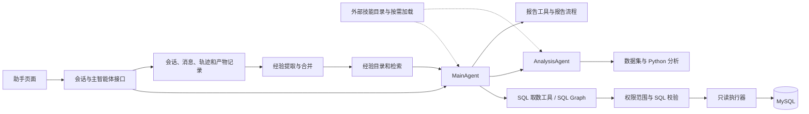
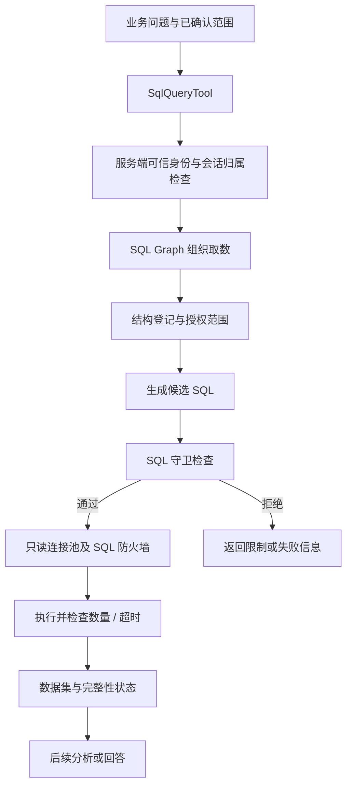

# AI 模块架构

本文按当前 `erp-ai` 源码入口整理。类和工具存在不等于所有配置都已启用，真实模型效果、数据权限和端到端行为需要在目标环境验证。



## 代码中的职责

- `MainAgentController`、`AiAssistantController` 和主智能体服务提供会话、任务及流式交互入口；前端页面与 API 在 `erp-web/src/modules/ai/`。
- `SqlQueryTool` 将可信用户上下文和取数需求交给 `SqlGraphService`；相关组件包括 schema 获取、数据范围、SQL 守卫与只读执行器。具体允许的表、字段、SQL 语法和数据范围以代码及配置为准。
- `AnalysisTool`、`AnalysisAgentService` 处理分析任务，可使用数据集、SQL 及 Python 工具；分析产物及文件有独立记录与存储。
- 报告工具、报告流程及 `AiReportController` 负责报告生成、持久化和接口访问。报告结果应保留数据来源及限制，不能把模型结论当成业务事实的自动证明。
- 会话、消息、数据集、分析结果、报告及执行轨迹使用 AI 相关表；文件和容器配置另见[部署说明](../deployment/README.md)。

## 上下文压缩与经验

- 主智能体配置接入上下文压缩。模型调用前，当消息历史超过配置阈值时，压缩钩子保留最近消息，将较早内容生成结构化摘要；摘要失败、截断或格式不合要求时保留原消息。压缩开关、阈值及摘要模型等配置见 `application-ai.yml`。
- 经验定时任务从任务轨迹中提取经验，再按智能体类型合并已发布经验并更新经验目录摘要；配置开关和定时表达式决定任务是否运行。已有经验可通过注入钩子提供目录，并通过检索工具按需查询。
- 经验及目录保存在 `ai_agent_experience`、`ai_agent_experience_summary`；任务轨迹在 `ai_agent_trace`。提供的空库建表文件已包含对应字段和索引，见 [AI 表结构](../database/schema/ai.md)。
- 报告代码包含内容准备、生成、审核和存储；前端报告图表按当前报告契约渲染。其具体输出和效果仍取决于模型、数据及配置。

## 边界与验证

AI 查询与业务写入是不同路径：现有代码提供受控只读 SQL 取数，业务写操作仍应经过权限、业务服务与必要确认。模型、只读账号、Redis 和 Python 沙箱未正确配置时，相应能力不能视为可用。具体限制、体验、数据隔离和故障恢复均需实际接口与安全测试；参见[当前代码状态](../current-status.md)和[测试资料](../testing/README.md)。

## 模块目标与组成

AI 模块尝试回答业务数据问题，并将取数、分析和报告组织成可追踪的任务。它使用传统业务形成的数据，不能假设模型知道数据库中的全部业务事实，也不能把模型生成的文字当成已核实的数据。

| 组件 | 输入 | 主要职责 | 输出或记录 |
|---|---|---|---|
| 会话与主智能体 | 用户消息、已确认的会话上下文 | 接收任务，组织模型和工具交互 | 消息、流式过程及任务轨迹 |
| SQL 取数 | 业务目标、时间范围、完整性要求及可信用户上下文 | 查询授权结构，生成并校验 SQL，通过只读连接执行 | 数据集引用、查询状态与完整性信息 |
| 分析智能体 | 分析目标、已确认条件及可用数据集 | 协调数据、计算和分析工具 | 结构化分析结果、数据集与分析结果引用 |
| 报告 | 已准备的内容、数据及分析结果 | 生成、审核、保存与展示报告 | 报告记录与相关产物 |
| 上下文与经验 | 会话历史、任务轨迹 | 压缩历史上下文，提取和检索经验 | 摘要、经验记录和目录 |
| 业务技能 | 外部技能目录及参考文件 | 向不同智能体提供任务规划和分析规则 | 按需加载的技能说明和参考资料 |

上表是职责划分，具体任务是否调用某个工具由模型、配置及运行情况决定。AI 不一定适合回答口径不明的问题；时间、范围或对象不足以支持查询时，需要补充条件。

## 会话与主智能体

前端助手页面向后端会话和主智能体接口发起请求；`MainAgentController`、`AiAssistantController` 等负责对应入口，前端代码位于 `erp-web/src/modules/ai/`。主智能体结合会话历史、可信运行上下文和已配置的工具处理任务；流式交互用于展示过程和回答，但一次模型输出不代表数据库或外部工具一定执行成功。

涉及工具调用时，服务端从运行上下文提供用户与会话身份，而不是信任模型自行填写的用户 ID。SQL 图会核对会话归属；数据集、文件及报告访问还需各自的服务端检查。应结合具体实现和目标环境测试其权限行为，不将架构设计等同于完整的安全审计结论。

## SQL 取数：从问题到数据集



图示为职责顺序，不限定图内部每个节点的精确执行次数。[`SqlQueryTool`](../../erp-server/erp-ai/src/main/java/com/qiheng/erp/ai/sql/tool/SqlQueryTool.java) 接收业务目标和数据需求；范围会实质影响结论时应先确认，单次调用提交一个查询需求。工具上下文提供用户、会话等可信信息，`SqlGraphService` 校验会话归属并启动独立查询。

取数要求区分完整范围和有限数量，例如“查询某时间段全部记录”与“列出前 10 条”具有不同语义。查询结果通过数据集引用及状态交给后续步骤；`PARTIAL` 或 `NEED_INFO` 代表需要处理限制或补充条件，不能直接表述成完整结果。

### SQL 约束与执行防线

| 环节 | 代码中的职责 | 需要注意 |
|---|---|---|
| 结构与权限 | 获取结构信息并结合授权快照、数据范围处理 | 可用的表、字段及范围随配置、角色和实现变化 |
| SQL 守卫 | 检查语句形态、表列授权、软删除条件、数量限制及分页前提等 | 包含单条 `SELECT` 检查，拒绝 `SELECT *` 等不允许形态；细节以实现为准 |
| 连接池防火墙 | 使用专用只读连接池及 Druid Wall 过滤危险语句形态 | 数据库账号本身也应配置为只读，不能只依靠模型遵守提示 |
| 查询执行 | 根据查询类型选择限量、游标分页或读取至总上限 | 超时、最大行数和最大页数可能导致失败或结果不完整 |
| 查询任务 | 有界工作线程和队列，超时后请求取消 | 资源限制和取消不能保证所有外部调用立即终止 |

例如用户问“过去一个月销量最高的 10 个商品”，系统需要明确时间及销量口径，在授权范围内组织查询并返回限量结果。若问“过去一个月所有销售明细”，则需要考虑完整结果的行数限制；数据被截断时，不能将部分数据当成完整汇总。

相关源码：[SQL 图服务](../../erp-server/erp-ai/src/main/java/com/qiheng/erp/ai/sql/graph/SqlGraphService.java)、[SQL 守卫](../../erp-server/erp-ai/src/main/java/com/qiheng/erp/ai/sql/guard/DruidSqlGuard.java)、[只读连接池](../../erp-server/erp-ai/src/main/java/com/qiheng/erp/ai/sql/pool/ReadOnlySqlPool.java)、[查询执行器](../../erp-server/erp-ai/src/main/java/com/qiheng/erp/ai/sql/execution/ReadOnlySqlExecutor.java)。

## 业务技能加载与扩展

业务技能是供智能体读取的任务方法和规则，**不是直接执行数据库操作的程序模块**。例如主智能体可以使用补货技能梳理问题、确认需求和交办分析，分析智能体再结合技能中的计算口径调用取数和分析工具；是否选用技能、实际执行及结果质量依赖模型、配置、工具和数据。

```text
技能根目录/
├── shared/                 # 两类智能体共享，可为空或不存在
├── main/<技能名>/SKILL.md # 主智能体：问题判断和规划
└── analysis/<技能名>/     # 分析智能体：取数及计算步骤
    ├── SKILL.md
    └── references/        # 可选的 Markdown 参考资料
```

| 分组 | 可见范围 | 典型职责 |
|---|---|---|
| `shared` | 主智能体与分析智能体 | 两者共用的技能 |
| `main` | 主智能体 | 判断问题类型、确认业务条件、交办任务和解释结论 |
| `analysis` | 分析智能体 | 选择数据与计算方法、检查计算结果和说明限制 |

当前代码将 `shared` 与对应专属分组合并；如果同一个智能体可见的分组出现同名技能，按注册顺序优先使用 `shared`。`main` 与 `analysis` 中同名技能分别用于不同智能体。每轮模型调用前，`SkillIndexInterceptor` 将技能名称和说明追加到本次系统消息；模型按需调用 `read_skill` 读取正文，参考资料则通过 `readSkillFile` 读取。支持文件限制为技能目录内的 Markdown 相对路径，并设有单次读取大小限制。

当前仓库中的技能目录如下，未来新增技能时应以目录和实际加载结果为准：

| 技能名 | 主智能体侧 | 分析侧 |
|---|---|---|
| `demand` | 明确预测用途、范围和口径 | 需求预测方法及回测 |
| `inventory-health` | 拆分周转、结构、库存风险等问题 | 库存健康指标及数据限制 |
| `inventory-policy` | 确定补货策略问题与适用场景 | 安全库存、再订货点等参数计算 |
| `replenishment` | 识别当前或未来缺口并组织分析 | 可用量、滚动余额和补货缺口计算 |
| `purchase` | 规划已确认缺口后的采购执行 | 起订量、包装、货值、预算及到货计算 |
| `supplier-selection` | 明确采购定位及选择标准 | 候选筛选、评分引用与比较分析 |

技能中的算法是智能体使用的指导和口径，不表示所有指标都由固定服务预先计算，也不表示目标环境已经完成端到端验证。特别是库存健康技能将最近入库天数作为估算参考，不能当作真实批次库龄；补货规划技能也不等于已完成独立补货功能或自动下单。

### 目录配置和刷新

技能从外部文件系统读取，不打包进 JAR。配置项为 `erp.ai.skills.dir` 和 `erp.ai.skills.refresh-ms`，环境变量分别为 `ERP_AI_SKILLS_DIR` 和 `ERP_AI_SKILLS_REFRESH_MS`；默认目录是相对于应用工作目录的 `./skills`，默认检查间隔为 30 秒。启用 AI 模型相关配置后，注册表按 `shared`、`main`、`analysis` 分组加载；定时刷新以文件修改时间和大小判断是否变化，变化后重载相应分组。

新技能需放在对应分组的独立目录中，提供包含 `name`、`description` 的 `SKILL.md`；技能名需与目录名一致，使用小写字母、数字和连字符。支持文件放在该技能目录内，以符合读取规则的相对路径引用。修改后应查看加载日志，并在实际模型任务中验证匹配、加载及分析结果；文件存在或刷新日志出现并不证明模型必然调用。

从 `erp-server` 目录启动时，默认 `./skills` 指向仓库的 `erp-server/skills`。当前 Docker 运行镜像工作目录为 `/app`，镜像和 Compose 未配置将仓库技能目录放入 `/app/skills`：启用 AI 时需要自行提供容器可读取的外部技能目录并配置路径，否则默认路径可能没有技能。具体部署方式应在目标环境验证。

源码：[技能装配](../../erp-server/erp-ai/src/main/java/com/qiheng/erp/ai/config/SkillConfiguration.java)、[分组注册表](../../erp-server/erp-ai/src/main/java/com/qiheng/erp/ai/skill/GroupSkillRegistry.java)、[技能索引](../../erp-server/erp-ai/src/main/java/com/qiheng/erp/ai/skill/SkillIndexInterceptor.java)、[支持文件读取](../../erp-server/erp-ai/src/main/java/com/qiheng/erp/ai/skill/tool/ReadSkillFileTool.java)、[定时刷新](../../erp-server/erp-ai/src/main/java/com/qiheng/erp/ai/job/SkillRefreshJob.java)。

## 分析智能体与 Python 工具

[`AnalysisTool`](../../erp-server/erp-ai/src/main/java/com/qiheng/erp/ai/analysis/AnalysisTool.java) 将一个分析目标、已确认的业务条件及可能存在的数据集引用交给分析服务。工具从服务端运行上下文取得可信身份和过程通道；分析智能体可按任务需要使用数据集、SQL 和 Python 相关工具，不要求主智能体先重复查询同一份数据。

分析结果包括任务完成情况、摘要及相关数据集或分析结果引用；分析文件和结果有相应记录。结果是否能支撑结论取决于数据范围、是否截断、统计口径与执行结果。Python 沙箱、文件路径和容器等运行配置需要单独准备，入口存在并不等于沙箱在当前环境可用。

例如分析某段时间的采购趋势时，需要先确定日期范围、订单状态和金额口径，再确认数据集是否完整；若数据不足或查询失败，报告应表达限制，不能补造缺失的数据。

## 报告和产物

报告代码将数据准备、生成、审核和保存作为不同阶段处理，`AiReportController` 提供报告访问入口，前端按报告契约展示内容与图表。报告可基于已有数据与分析结果，但它不自动证明模型推断正确：需要核对数据来源、时间范围、单位和可解释性。

会话、消息、数据集、分析结果、报告和执行轨迹使用 AI 相关数据库表；文件类产物还依赖配置的文件存储与运行环境。详细字段见 [AI 表结构](../database/schema/ai.md)，部署相关配置见[部署说明](../deployment/README.md)。

## 上下文压缩

长会话会增加模型输入；主智能体配置接入压缩钩子，当历史超过配置阈值时，尝试将较早消息归纳为结构化摘要，同时保留最近消息。若摘要失败、被截断或格式不符合要求，则保留原消息，避免把失败的摘要作为可靠上下文。

压缩的开关、触发阈值和摘要模型以 `application-ai.yml` 及实际配置为准。压缩并不意味着信息绝不会丢失；需要用户确认的日期、对象及统计口径仍应在分析中明确。

## 经验提取与检索

经验功能从任务轨迹提取内容，随后按智能体类型合并已发布经验并更新经验目录摘要；已有经验可通过注入钩子提供目录，由检索工具按需查询。经验和目录分别使用 `ai_agent_experience`、`ai_agent_experience_summary`，任务轨迹使用 `ai_agent_trace`。

[`AiExperienceJob`](../../erp-server/erp-ai/src/main/java/com/qiheng/erp/ai/job/AiExperienceJob.java) 的运行受开关和定时配置控制，代码中的默认调度表达式可由配置覆盖。经验是一种辅助上下文，不能取代当前数据库、权限或业务规则的实时检查。

## 验证与排查路径

| 现象 | 优先检查 | 不能据此推断 |
|---|---|---|
| 助手入口不可用 | 后端配置、模型启用状态、会话接口和网络 | 不能仅凭页面加载推断模型可用 |
| 查询被拒绝 | 当前身份、会话归属、授权结构、SQL 守卫和只读连接配置 | 不能简单放宽权限或把拒绝改为忽略 |
| 查询超时或数据不完整 | 时间范围、执行上限、分页及结果状态 | 不能把部分结果当作全量数据 |
| 分析或报告失败 | 模型、数据集归属、Python 沙箱、文件存储和具体错误 | 不能仅凭取数成功推断分析和报告成功 |
| 经验没有更新 | 调度开关、运行记录、轨迹及经验数据 | 定时任务存在不代表已经执行成功 |

相关测试入口见[测试资料](../testing/README.md)。真实模型、权限、隔离、故障与端到端结果均需在目标测试环境单独核验。
