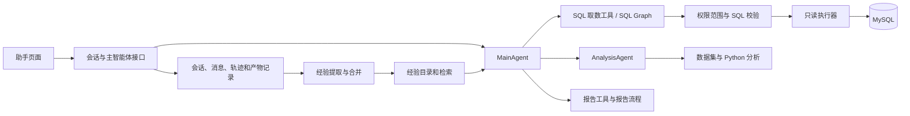

# AI 模块架构

本文按当前 `erp-ai` 源码入口整理。类和工具存在不等于所有配置都已启用，真实模型效果、数据权限和端到端行为需要在目标环境验证。

## 代码中的职责

- `MainAgentController`、`AiAssistantController` 和主智能体服务提供会话、任务及流式交互入口；前端页面与 API 在 `erp-web/src/modules/ai/`。
- `SqlQueryTool` 将可信用户上下文和取数需求交给 `SqlGraphService`；相关组件包括 schema 获取、数据范围、SQL 守卫与只读执行器。具体允许的表、字段、SQL 语法和数据范围以代码及配置为准。
- `AnalysisTool`、`AnalysisAgentService` 处理分析任务，可使用数据集、SQL 及 Python 工具；分析产物及文件有独立记录与存储。
- 报告工具、报告流程及 `AiReportController` 负责报告生成、持久化和接口访问。报告结果应保留数据来源及限制，不能把模型结论当成业务事实的自动证明。
- 会话、消息、数据集、分析结果、报告及执行轨迹使用 AI 相关表；文件和容器配置另见[部署说明](../deployment/README.md)。

## 上下文压缩与经验

- 主智能体配置接入上下文压缩。模型调用前，当消息历史超过配置阈值时，压缩钩子保留最近消息，将较早内容生成结构化摘要；摘要失败、截断或格式不合要求时保留原消息。压缩开关、阈值及摘要模型等配置见 `application-ai.yml`。
- 经验定时任务从任务轨迹中提取经验，再按智能体类型合并已发布经验并更新经验目录摘要；配置开关和定时表达式决定任务是否运行。已有经验可通过注入钩子提供目录，并通过检索工具按需查询。
- 经验及目录保存在 `ai_agent_experience`、`ai_agent_experience_summary`；任务轨迹在 `ai_agent_trace`。提供的空库建表文件已包含对应字段和索引，见 [AI 表结构](../database/schema/ai.md)。
- 报告代码包含内容准备、生成、审核和存储；前端报告图表按当前报告契约渲染。其具体输出和效果仍取决于模型、数据及配置。

## 边界与验证

AI 查询与业务写入是不同路径：现有代码提供受控只读 SQL 取数，业务写操作仍应经过权限、业务服务与必要确认。模型、只读账号、Redis 和 Python 沙箱未正确配置时，相应能力不能视为可用。具体限制、体验、数据隔离和故障恢复均需实际接口与安全测试；参见[当前代码状态](../current-status.md)和[测试资料](../testing/README.md)。
