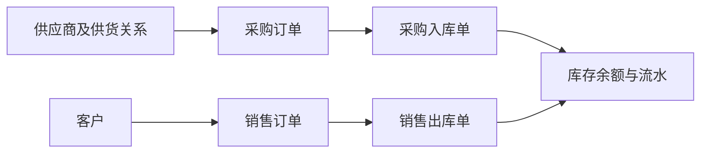
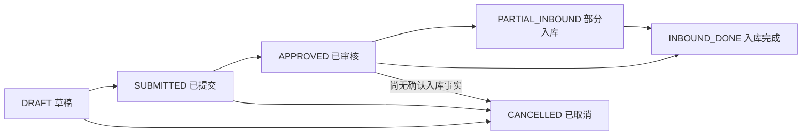
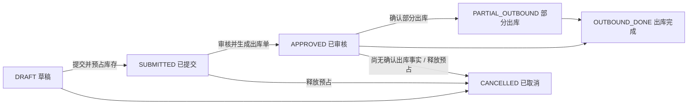
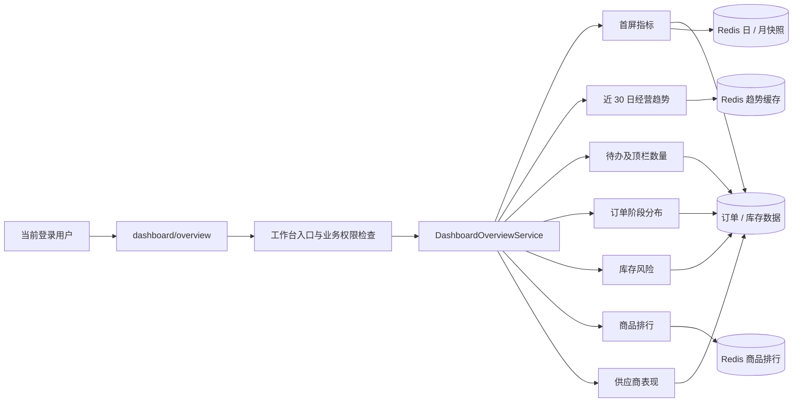

# 传统业务架构

以当前服务、状态枚举及 2026-11-21 结构导出为依据。权限、校验和状态流转以实际服务为准；示意只描述主要路径，不表示允许跳过审核或直接写库存。

## 主数据与库存

商品关联商品分类；供应商通过供货关系关联商品，客户和仓库为订单及出入库提供业务对象。`warehouse_stock` 按仓库与商品维护库存；入出库单及库存流水记录实际处理。商品和单据的金额、数量在数据库中可能采用放大整数，具体字段见[表结构](../database/schema/README.md)，接口与页面转换应依照代码。

## 采购与销售



采购订单状态包含草稿、已提交、已审核、部分入库、入库完成和取消；销售订单对应部分出库及出库完成。审核后是否能执行、处理数量与库存变化由对应采购、销售及仓储服务共同校验。库存锁定、取消或部分执行应按真实接口规则验证。

## 退货与评分

统一退货模块承载采购退货和销售退货，关联原订单及明细；采购退货经出库影响库存，销售退货经入库影响库存。退货状态包括草稿、提交、审核、部分执行、完成及取消，数量和来源约束由服务处理。

供应商评分有计算、变更记录、消息处理及定时校正代码。调度开关、数据窗口和运行结果需要结合目标环境检查；测试库导入评分快照不等于已重新计算。

关键代码入口：`erp-purchase`、`erp-sales`、`erp-warehouse`、`erp-return` 的 Controller、Service 和状态枚举；表字段及关联见[数据关系](../database/relations.md)。

## 阅读前：业务对象如何对应

| 层次 | 主要对象 | 作用 |
|---|---|---|
| 基础资料 | 分类、商品、供应商、供货关系、客户、仓库 | 定义交易对象、商品及仓储位置 |
| 业务单据 | 采购订单、销售订单、退货单及其明细 | 记录交易意图、来源、数量和状态 |
| 仓库作业 | 入库单、出库单及其明细 | 记录仓库本次需要确认的操作 |
| 库存事实 | 库存余额、库存流水及明细 | 记录当前数量、预占及变化来源 |
| 派生信息 | 供应商评分、工作台汇总 | 对业务事实进行计算和展示 |

订单审核与仓库确认是不同动作。审核可能生成待确认作业单；只有后续确认入库或出库，才产生对应的库存处理事实。不同状态下可执行的操作由服务校验，不能通过修改状态字段代替这些动作。

## 基础资料与关联约束

分类通过 `parent_id` 表示层级，商品以 `category_id` 关联所属分类。供应商与商品通过 `supplier_product` 建立供货关系；采购时服务检查供货关系属于选定供应商、对应商品且满足业务要求。销售订单关联客户和仓库；采购订单关联供应商和仓库。交易时还要核实相关对象存在且符合启用状态等要求。

订单明细包含商品、数量与价格等业务信息；已有采购明细采用下单时保存的数量精度快照，后续编辑不能随意用商品当前精度覆盖历史口径。仓库和单据还保留部分名称等快照，历史单据不应因为基础资料改名就改变原有语义。

数据库表关联及具体字段见[数据关系](../database/relations.md)和[表结构](../database/schema/README.md)。这份结构未声明数据库外键，导入数据时不能依赖数据库自动检查所有关联是否有效。

## 采购订单状态与执行



状态图展示主要路径；权限、版本和特定边界由实际服务决定。采购的关键顺序如下：

1. 创建草稿时准备供应商、仓库及商品明细；提交前重新检查订单及供货关系等数据。
2. 审核将订单从 `SUBMITTED` 推进到 `APPROVED`，在同一事务生成采购入库待确认单。
3. 仓库确认一批入库时，验证来源明细和本次数量，累计更新采购明细已入库量。
4. 未全部履约时进入部分入库并处理剩余明细；全部履约时进入入库完成。单次确认量不能超过剩余可入库量。
5. 草稿、已提交和未发生确认入库事实的已审核订单可按规则取消；已审核取消还需处理未确认入库单。已有入库事实的订单不能按此路径直接取消。

例如采购 100 件、首次确认入库 60 件，订单进入部分入库，剩余 40 件等待处理；再次确认 40 件后订单进入入库完成。示例仅说明累计逻辑，具体质检、数量精度及允许值以服务代码为准。

代码入口：[采购服务](../../erp-server/erp-purchase/src/main/java/com/qiheng/erp/purchase/service/impl/PurchaseOrderServiceImpl.java)、[采购状态](../../erp-server/erp-purchase/src/main/java/com/qiheng/erp/purchase/domain/purchaseorder/enums/PurchaseOrderStatus.java)、[入库服务](../../erp-server/erp-warehouse/src/main/java/com/qiheng/erp/warehouse/service/impl/InboundBillServiceImpl.java)。

## 销售订单、预占与出库



销售提交和审核分工不同：提交时预占，审核后生成待确认出库单。提交时对同一仓库相关商品库存行加锁，以 `实物库存 - 锁定库存` 判断可用量；数量不足、库存不存在或并发版本冲突会拒绝处理。库存余额与订单明细的锁定量随订单状态在事务中更新。

仓库确认出库后，实际扣减库存和对应锁定量，记录流水，并回写销售明细的累计出库量。部分出库后可继续处理剩余数量；已完成则结束履约。取消前需检查状态及关联出库事实：提交或审核状态取消时释放对应预占，已发生出库的订单不走直接取消路径。

**示例**：库存 100 件、已有锁定 20 件，提交 30 件销售订单后，锁定 50 件、可用 50 件；若随后确认出库 10 件，则库存和该订单对应预占随处理量变化，订单仍有剩余待出库。示例未涵盖其他单据的并发操作。

已提交订单编辑时服务会回算预占；为了避免直接跨仓调整已锁定库存，当前实现不允许已锁定订单直接更换仓库。代码入口：[销售服务](../../erp-server/erp-sales/src/main/java/com/qiheng/erp/sales/service/impl/SalesOrderServiceImpl.java)、[库存预占支持](../../erp-server/erp-warehouse/src/main/java/com/qiheng/erp/warehouse/service/support/WarehouseStockReservationSupport.java)。

## 仓储确认与库存追溯

入库或出库工作单使用 `DRAFT`、`PENDING_CONFIRM`、`CONFIRMED`、`CANCELLED` 等状态。不同来源可以产生仓库作业；`source_type` 与 `source_id` 指向业务来源，作业明细的 `source_item_id` 指向来源明细。来源类型决定 ID 应解释为哪类业务，不能只按 ID 猜测。

仓库确认涉及作业状态检查、数量和来源校验、库存余额变化、库存流水记录，以及向来源业务回写。回写负责推进原订单或退货单的执行进度；部分执行要保留剩余量，避免重复确认。代码通过来源回写适配器连接仓储与其他业务模块；具体步骤及事务范围以入出库服务为准。

`warehouse_stock` 是余额，`stock_bill` 及明细是变化记录，入库单与出库单是作业记录。排查库存差异时应同时核对三者、来源单及锁定量，而不是只比较订单总数。商品数量及金额可能使用放大整数存储，展示与计算需按[字段说明](../database/schema/README.md)及代码转换。

## 统一退货与并发控制

统一退货单通过类型区分采购退货和销售退货，并保存来源订单、往来对象和来源明细。状态为 `DRAFT → SUBMITTED → APPROVED → PARTIAL_EXECUTED / COMPLETED`，符合条件的单据可取消；实际可操作路径以服务实现为准。

提交和审核时，会重新聚合来源已履约数量及其他退货占用情况，校验本次可退数量。采购退货还受仓库可用库存约束。审核对来源订单加分布式锁，逐条验证审核数量在申请范围内且符合精度，并要求至少一条明细审核数量大于零。

| 对比 | 采购退货 | 销售退货 |
|---|---|---|
| 来源 | 采购订单及明细 | 销售订单及明细 |
| 审核通过 | 生成退货出库作业单，预占库存 | 生成退货入库作业单 |
| 仓库确认 | 出库并减少库存 | 入库并增加库存 |
| 取消未确认作业 | 取消关联工作单并释放相应预占 | 取消关联入库工作单 |

实际退货进度由作业确认回写；发生部分执行后，状态和剩余数量需要以服务规则核对。入口：[退货服务](../../erp-server/erp-return/src/main/java/com/qiheng/erp/returnorder/service/impl/ReturnOrderServiceImpl.java)、[退货状态](../../erp-server/erp-return/src/main/java/com/qiheng/erp/returnorder/domain/enums/ReturnStatus.java)。

## 供应商评分

评分由价格、交付、质量、服务四项构成。供货关系价格分以参考采购价与有效报价比较；质量分使用近 180 天完全入库订单的合格与不合格金额；交付分按近 180 天到达承诺日的有效订单应交金额和逾期罚额计算；服务分为供应商维度的人工评分。各指标具体筛选、日期和无效数据处理以计算及事实聚合代码为准。

综合分和供货推荐分的权重均为价格 30%、交付 30%、质量 30%、服务 10%；任一项缺失时结果为未就绪。价格和质量可在供货关系维度计算，交付和服务在供应商维度计算；供应商级价格汇总还使用评分依据金额加权。计算结果使用百分制放大 100 倍的整数存储。

评分存在消息驱动重算、人工调整入口和定时校正。采购完成入库的评分事件在事务提交后投递；消息不可用或投递失败时，代码记录问题并依赖后续校正。定时任务是否运行取决于 `supplier-score.scheduled.enabled` 等配置，导入已有评分数据不代表目标环境已重算。源码：[综合评分](../../erp-server/erp-purchase/src/main/java/com/qiheng/erp/purchase/service/scoring/AggregateScoreCalculator.java)、[定时任务](../../erp-server/erp-purchase/src/main/java/com/qiheng/erp/purchase/job/SupplierScoreScheduledJob.java)。

## 工作台库存提示与后续规划

当前工作台提供库存风险展示与简化补货提示，代码中的提示量基于安全库存和可用库存；停用商品提示量为零。它不是销量预测或完整补货规划。AI 模块已有需求预测、库存健康与补货等技能规则，可在满足环境及数据条件时指导分析；技能是否被正确调用及计算仍需实测。独立库存健康与补货功能的增强方案见[后续规划](../plans/inventory-replenishment.md)，不能将技能文件等同于该方案已经完整交付。

## 工作台：聚合入口与数据组织

工作台是对已有业务数据的聚合视图。它不取代订单、库存或供应商服务，也不因为卡片展示了数值就构成新的业务事实。



`DashboardController` 的 `/dashboard/overview` 首先检查 `dashboard:overview:query`，`DashboardOverviewServiceImpl` 再读取当前用户，分别判断销售、采购、仓储、供应商及系统异常等权限，并调用各 Loader 组装返回值。概览响应包含 `refreshedAt`、指标、趋势、待办、风险、订单阶段、商品排行和供应商表现等部分。

多数区块的 `access` 使用 `ALLOWED`、`EMPTY`、`DENIED` 区分有数据、无数据和无权限；趋势沿用单独的 `trendPermissions`。固定指标对无权用户将数值及对比字段返回 `null`，避免把无权限误读为业务零。需要注意：这里的业务权限裁剪不等同于已确认的部门级数据隔离。

### 四张首屏指标：口径与比较基线

| 指标 | 当前值 | 对比与权限 |
|---|---|---|
| 本月销售额 | 本月审核时间内，符合销售状态范围的订单金额累计 | 上月月快照；需要销售查询权限 |
| 本月毛利额 | 本月销售订单金额累计减本月采购订单金额累计 | 上月两项累计差额；同时需要销售和采购查询权限 |
| 待处理订单 | 按权限累加待审核采购、销售、退货与待确认出入库等分项 | 对比昨日日快照中相同权限组合的分项 |
| 库存风险 SKU | 通过库存风险查询统计 | 对比昨日日快照；需要仓储查询权限 |

销售金额纳入 `APPROVED`、`PARTIAL_OUTBOUND`、`OUTBOUND_DONE`，采购金额纳入 `APPROVED`、`PARTIAL_INBOUND`、`INBOUND_DONE`；按 `approved_at` 和对应时间段聚合。这是订单金额口径，不是出入库金额或收付款金额。

**本月“毛利额”卡片只是销售订单总额减采购订单总额的经营差值，并非匹配已售商品成本后的财务毛利。** 采购和销售可能不在同一期、数量也未必对应，不能据此推断真实盈利。首屏该指标使用订单累计；下方趋势还会分别扣减销售退货和采购退货，因此两处口径不能直接混为一谈。

月快照缺失时，代码尝试从数据库实时回算并回填；回算失败标记不可用而不是伪装成零。昨日运营快照缺失则明确标为无可比基线，不能将缺失的昨日值当作真实零。入口：[DashboardMetricsLoader](../../erp-server/erp-dashboard/src/main/java/com/qiheng/erp/dashboard/loader/DashboardMetricsLoader.java)、[订单金额状态口径](../../erp-server/erp-dashboard/src/main/java/com/qiheng/erp/dashboard/domain/metric/enums/OrderMetricScope.java)。

### 经营趋势：近 30 天与退货

趋势按日返回近 30 天数据，分别按权限读取销售、销售退货、采购和采购退货的日金额。当前实现的展示计算为：

```text
销售净额 = 当日销售金额 - 当日销售退货金额
采购净额 = 当日采购金额 - 当日采购退货金额
趋势中的经营差值 = 销售净额 - 采购净额
```

负差值保留，不截成零。日期缓存缺失时由缓存协调器查询并回填；与订单有关的事务提交后触发相关日期缓存失效，随后按需重读。次日凌晨还有昨日数据校准任务。由于销售、采购和退货的日期、状态及金额口径不同于财务核算，该趋势应解释为经营数据比较。

入口：[DashboardTrendLoader](../../erp-server/erp-dashboard/src/main/java/com/qiheng/erp/dashboard/loader/DashboardTrendLoader.java)、[趋势缓存协调器](../../erp-server/erp-dashboard/src/main/java/com/qiheng/erp/dashboard/cache/TrendDailyAmountRefreshService.java)。

### 待办、订单阶段与顶栏

待办根据当前业务状态实时聚合：采购、销售及两类退货待审核，出入库待确认，库存风险复核，以及按权限可见的系统异常。单据进入下一状态后，下次聚合会相应变化；异常待办读取独立异常记录。不同类型按 `sortWeight` 排序，单据类待办仅附有限条代表性明细，并不代表只有这些单据待处理。

工作台将可见待办的 `count` 累加得到 `pendingCount`，顶栏铃铛复用同一概览结果，减少重复聚合。当前库存风险待办使用风险列表大小，列表上限为 20；它与独立统计的风险 SKU 总数可能不同，不能假定铃铛数字是所有风险记录的完整计数。订单阶段面板按本月创建时间统计采购、销售当前状态，返回草稿、待审核、已审核、部分出入库、已完成和已取消六行；权限决定可见列。

前端工作台页面和顶栏使用同一个 `dashboardOverviewStore`：普通刷新对已加载结果做 60 秒节流，页面进入、主动刷新和错误重试可强制请求；并发刷新复用正在进行的请求。会话重置会递增请求代次并清除缓存，旧请求即使晚返回也不能覆盖新会话的数据。刷新失败时页面可以继续展示上次结果并提示失败，`refreshedAt` 不能被误读为当前时刻的实时结果。源码：[前端工作台 Store](../../erp-web/src/stores/dashboardOverviewStore.ts)。

源码：[待办聚合](../../erp-server/erp-dashboard/src/main/java/com/qiheng/erp/dashboard/loader/DashboardTodoAggregator.java)、[待办服务](../../erp-server/erp-dashboard/src/main/java/com/qiheng/erp/dashboard/service/impl/DashboardTodoServiceImpl.java)、[订单阶段](../../erp-server/erp-dashboard/src/main/java/com/qiheng/erp/dashboard/loader/DashboardOrderStageLoader.java)。

### 库存风险、商品排行和供应商表现

库存风险使用 `可用量 = 库存量 - 锁定量`，区分无库存、库存存在但可用量为零、可用量低于或等于安全库存等情况。首页风险列表最多 20 条；风险总数由单独的数据库统计提供。启用商品的提示采购量按 `max(0, 安全库存 × 2 - 可用量)` 计算，停用商品为零。这是简单阈值提示，不包含预测、在途、交期或财务成本。

`/dashboard/inventory-status` 另提供按全部仓库或指定仓库的库存状态分布与风险预览，预览最多 5 条并通过额外一条判断是否还有更多；需先拥有工作台入口权限，再按仓储查询权限裁剪。

销售商品排行从 Redis 维护的近 30 天累计金额及数量读取，页面最多展示 10 个，再实时补齐商品资料和可用库存。业务事务提交后触发排行增减，定时全量重建作为校正；冷启动或检测到异常数据时也会尝试重建。供应商表现读取已启用、评分状态为 `READY` 的供应商，按综合分降序最多展示 10 条，评分由采购评分链路维护。

入口：[库存风险](../../erp-server/erp-dashboard/src/main/java/com/qiheng/erp/dashboard/loader/DashboardStockAlertLoader.java)、[库存状态](../../erp-server/erp-dashboard/src/main/java/com/qiheng/erp/dashboard/loader/DashboardInventoryStatusLoader.java)、[商品排行](../../erp-server/erp-dashboard/src/main/java/com/qiheng/erp/dashboard/cache/TopProductRankCache.java)、[供应商表现](../../erp-server/erp-dashboard/src/main/java/com/qiheng/erp/dashboard/loader/DashboardSupplierPerformanceLoader.java)。

## 关键并发场景

| 场景 | 代码使用的控制 | 作用及边界 |
|---|---|---|
| 多个销售单同时占同一库存 | 外层事务内对同仓商品库存 `SELECT ... FOR UPDATE`；商品 ID 去重、排序；再校验可用量并更新 | 串行处理同一库存行，排序降低多商品交叉加锁的死锁风险；不保证所有死锁都消失 |
| 单据被同时审核、编辑或取消 | 状态及版本校验；相关更新失败抛出异常 | 避免旧页面覆盖新状态；调用方需要刷新并重新判断 |
| 退货竞争同一来源可退量 | 按来源订单分布式锁，锁内重查可退量，审核时校验并生成工作单 | 避免并发超额退货；锁及 Redis 状态仍需在运行环境验证 |
| 出库确认与退货取消竞争 | 退货取消加锁退货单，与仓储确认互斥；工作单状态及版本再次检查 | 避免取消释放预占与确认出库同时生效 |
| 同来源重复生成作业单 | 检查已有未确认工作单，按来源和状态决定是否生成 | 适用于具体生成路径，不应推广成所有接口都具备通用幂等 |
| Redis 编号序列初始化 | 分布式锁保护；缓存缺失时回查数据库最大序列，再初始化和自增 | 减少并发初始化冲突；导入模拟数据后仍应执行包内编号同步 |

库存加锁辅助类将数据库锁等待超时转换为业务提示；它专门识别 MySQL 1205，并不把死锁 1213 当作同一种等待超时。入库场景可能需要创建不存在的库存行，不能假设所有锁定对象在加锁前已经存在。固定租期的分布式锁与使用 Redisson watchdog 自动续约的锁行为不同，具体按调用点判断。

例子：A、B 两张销售订单同时提交同一仓库同一商品，若可用量只够其中一张，先取得库存行锁的一方在事务中检查并预占；另一方等待后应基于更新后的库存重新检查，而不能沿用等待前读到的可用量。锁等待超时、版本冲突或进程故障等还需集成测试覆盖。

源码：[库存行锁](../../erp-server/erp-warehouse/src/main/java/com/qiheng/erp/warehouse/service/support/WarehouseStockLockSupport.java)、[销售提交](../../erp-server/erp-sales/src/main/java/com/qiheng/erp/sales/service/impl/SalesOrderServiceImpl.java)、[分布式锁切面](../../erp-server/erp-common/src/main/java/com/qiheng/erp/common/aop/DistributedLockAspect.java)、[序列生成器](../../erp-server/erp-common/src/main/java/com/qiheng/erp/common/util/AbstractSequenceGenerator.java)。

## 验证建议

阅读源码时可依次检查 Controller 权限、Service 状态变化、仓储确认与来源回写，再比对库存余额与流水。使用隔离库按[四模块接口测试](../testing/integration/README.md)验证正常流程、分批执行、取消、重复操作、库存不足及并发边界；具体是否通过以实际测试记录为准。
