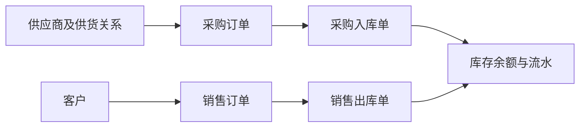

# 传统业务架构

以当前服务、状态枚举及 2026-11-21 结构导出为依据。权限、校验和状态流转以实际服务为准；示意只描述主要路径，不表示允许跳过审核或直接写库存。

## 主数据与库存

商品关联商品分类；供应商通过供货关系关联商品，客户和仓库为订单及出入库提供业务对象。`warehouse_stock` 按仓库与商品维护库存；入出库单及库存流水记录实际处理。商品和单据的金额、数量在数据库中可能采用放大整数，具体字段见[表结构](../database/schema/README.md)，接口与页面转换应依照代码。

## 采购与销售

采购订单状态包含草稿、已提交、已审核、部分入库、入库完成和取消；销售订单对应部分出库及出库完成。审核后是否能执行、处理数量与库存变化由对应采购、销售及仓储服务共同校验。库存锁定、取消或部分执行应按真实接口规则验证。

## 退货与评分

统一退货模块承载采购退货和销售退货，关联原订单及明细；采购退货经出库影响库存，销售退货经入库影响库存。退货状态包括草稿、提交、审核、部分执行、完成及取消，数量和来源约束由服务处理。

供应商评分有计算、变更记录、消息处理及定时校正代码。调度开关、数据窗口和运行结果需要结合目标环境检查；测试库导入评分快照不等于已重新计算。

关键代码入口：`erp-purchase`、`erp-sales`、`erp-warehouse`、`erp-return` 的 Controller、Service 和状态枚举；表字段及关联见[数据关系](../database/relations.md)。
