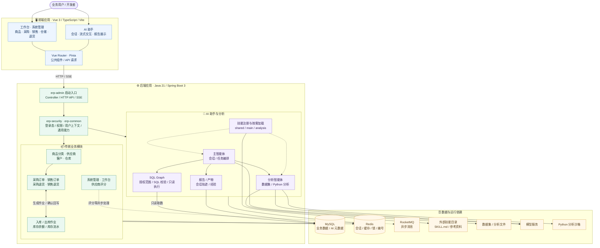
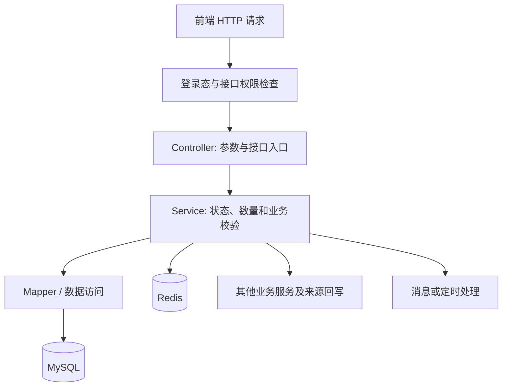
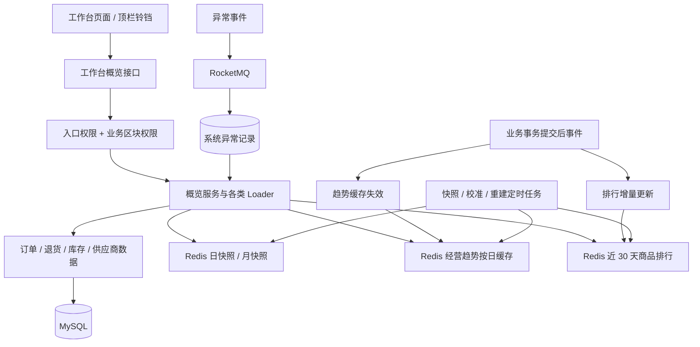

# 系统总体架构

本页依据当前仓库代码整理，说明项目的主要模块和运行关系；具体版本以工程配置为准，部署和验证结果另见[部署](../deployment/README.md)及[测试](../testing/README.md)。

图中箭头概括主要组件协作，虚线表示按需使用或异步处理；实际调用路径因接口、任务和配置而异。后端各模块由 `erp-admin` 组装在同一个应用中，AI 的模型、技能和沙箱均需配置。

前端使用 Vue 3、TypeScript、Vite、Pinia 和项目内组件。`erp-server` 是 Java 21、Spring Boot 3 多模块应用，由 `erp-admin` 启动：

| 模块 | 主要职责 |
|---|---|
| `erp-common`、`erp-security` | 通用结果、异常及登录、权限和用户上下文 |
| `erp-system` | 用户、部门、角色、权限目录及系统异常 |
| `erp-product` | 产品和分类 |
| `erp-purchase` | 供应商、供货关系、采购订单及供应商评分 |
| `erp-sales` | 客户和销售订单 |
| `erp-warehouse` | 仓库、库存、入出库与库存流水 |
| `erp-return` | 采购退货和销售退货 |
| `erp-dashboard` | 工作台数据聚合 |
| `erp-ai` | 会话、智能体、受控取数、数据分析和报告 |

MySQL 保存业务和 AI 元数据，Redis 用于会话、缓存、锁和编号等能力；RocketMQ 用于供应商评分和系统异常等异步处理，实际主题与消费行为以配置和代码为准。AI 分析文件使用独立数据卷；Python 沙箱、模型及只读取数需配置后才能使用。

业务流程见[传统业务架构](business.md)，AI 见 [AI 架构](ai.md)，数据库见[数据关系](../database/relations.md)。代码存在不等于所有功能都在特定环境启用或完成验收。

## 项目定位与阅读路线

启衡 ERP 面向学习和演示，主要由进销存业务与 AI 数据分析两部分组成。传统业务负责建立商品、交易和库存事实；AI 模块在配置允许的范围内读取数据、执行分析并组织结果，采购单的创建、编辑、提交和取消需要用户在前端确认卡片上确认后，由前端调用采购模块接口完成。系统采用前后端分离和后端多模块组织，当前后端通过一个启动模块组装，并非本文所描述的多个独立微服务。

| 想了解的问题 | 推荐阅读 |
|---|---|
| 一次采购或销售如何影响库存 | [传统业务架构](business.md) |
| AI 如何取得数据并形成分析结果 | [AI 架构](ai.md) |
| 各表、字段及索引具体是什么 | [数据库资料](../database/README.md) |
| 如何在空测试库搭建项目 | [本地开发](../deployment/local.md)、[数据库初始化](../database/init/README.md) |
| 设计中哪些已经验证 | [当前代码状态](../current-status.md)、[测试资料](../testing/README.md) |

## 前端：页面、路由和请求

前端工程位于 [`erp-web`](../../erp-web/)。Vue 组件负责展示与交互，Vue Router 管理页面路由，Pinia 保存应用状态；`src/modules` 按 `product`、`purchase`、`sales`、`warehouse`、`returns`、`system`、`dashboard`、`ai` 等业务划分，公共布局、组件与基础工具分布在 `layouts`、`components`、`shared` 等目录。各页面调用 API 获取和提交数据，后端负责最终权限及业务校验。

本地 Vite 开发服务器将 `/api` 请求代理到后端，并去掉该前缀；默认代理目标端口与后端默认端口不同，应通过 `VITE_PROXY_TARGET` 明确设置。AI 页面还存在流式交互；实际请求、错误与状态处理以 `src/modules/ai` 中代码为准。配置与启动见[本地开发说明](../deployment/local.md)。

## 后端：从接口到业务处理

这张图概括常见路径，具体接口未必使用每个组件。`erp-admin` 负责应用启动及配置装配；业务模块各自维护领域对象、接口、服务和数据访问。跨模块流程中，例如采购审核后生成仓库作业单，仓库确认再回写订单进度，不能将单个表的更新当作完整业务流程。

`erp-security` 基于 Sa-Token 保存登录会话与用户上下文，接口按需要检查权限编码。权限控制和数据范围是不同问题；当前文档没有确认采购、销售普遍实现按部门数据隔离，具体取决于各接口实现。

## 数据、缓存与异步处理

| 组件 | 当前职责 | 使用时需要理解的边界 |
|---|---|---|
| MySQL | 保存系统、商品、订单、库存以及 AI 元数据 | 结构导出未声明外键；关联和业务一致性由应用及导入规则共同维护 |
| Redis | 支持会话、缓存、锁和单号序列等 | 数据包提供编号同步；恢复或更换 Redis 后需要检查编号序列 |
| RocketMQ | 承担供应商评分、系统异常等消息处理 | 消息是否投递、消费与重试取决于配置及服务状态 |
| 模型服务 | 支持智能体对话、取数规划、分析和报告 | 模型、凭据和启用条件由环境提供，模型输出需要核验 |
| Python 沙箱及文件存储 | 执行分析任务并保存相关产物 | 沙箱及挂载文件需配置，数据权限与清理边界需实际验证 |

例如供应商评分既有事件触发，也有定时校正；消息服务不可用时不能简单认定评分立即更新。数据结构和系统数据按[初始化说明](../database/init/README.md)导入，演示业务数据另按[模拟数据包](../database/demo-data/README.md)操作。

## 典型调用链与一致性

1. 用户从页面提交销售订单，请求经登录与权限检查进入销售服务。
2. 销售服务检查客户、仓库、明细和可用库存，在事务中预占库存并更新订单状态。
3. 审核通过后生成销售出库作业单；仓库确认时处理库存余额和流水，并回写订单已出库数量与状态。
4. 需要退货时，从原销售订单建立退货单；审核后生成销售退货入库单，由仓库确认并回写退货进度。
5. AI 分析查询的是这些业务数据，具体取数范围、完整性和结论仍需验证。

库存并发涉及事务、数据库行锁和版本校验；特定退货流程还按来源使用分布式锁。锁的使用和事务边界应按具体服务阅读，不能推断所有写入都采用完全相同的机制。[传统业务架构](business.md)提供详细状态、数量规则与示例。

## 工作台的聚合与缓存架构

工作台并非单独的数据仓库：概览服务按照当前用户权限，从采购、销售、仓储、供应商和系统异常数据中组装结果，一部分指标读取 Redis 快照、趋势缓存和商品排行。业务服务仍负责数据状态与库存变更，工作台负责面向当前用户的查询和展示。

图中展示主要数据流，不表示所有业务变更都经过同一种事件。销售、采购金额的首屏指标按审核时间及限定状态汇总；趋势会处理退货净额；库存风险与待办使用不同查询范围。当前“本月毛利额”卡片按销售订单金额减采购订单金额计算，是经营差值，并非财务毛利。指标权限、对比基线、待办及排行机制详见[传统业务架构：工作台](business.md#工作台聚合入口与数据组织)。

## 定时任务：触发、用途和失败边界

下表列出当前代码中主要的工作台和供应商任务；工作台任务的 `@Scheduled` 未显式指定时区，其实际触发时间取决于运行环境和调度配置。供应商评分两个任务明确使用 `Asia/Shanghai`。时间为代码中的调度时间，不表示任务在任何部署环境都已启用或执行成功。

| 任务 | 调度条件 / 代码时间 | 做什么 | 并发与失败处理 |
|---|---|---|---|
| 工作台日快照 | 每日 23:55 | 写待处理分项、库存风险等对比快照，供次日指标比较；日快照 TTL 3 天 | 使用分布式锁；分步骤重试并上报失败；缺失的日快照不能当作零 |
| 工作台月快照 | 每月 28～31 日 23:55 触发，代码只在月末执行 | 写销售与采购月累计快照，供下月比较；月快照 TTL 90 天 | 使用分布式锁；读取缺失时可尝试按数据库回算 |
| 经营趋势日终校准 | 每日 00:05 | 从数据库重算昨日趋势维度，补齐临近午夜的变化 | 使用分布式锁；失败上报系统异常，可能需要人工处理 |
| 销售商品排行重建 | 每日 01:30 | 根据近 30 天业务数据重建排行，修正增量缓存偏差 | 重建使用 Redisson 锁和缓冲；失败记录并上报，后续可重试 |
| 供应商到期报价处理 | 每日 01:30；需启用供应商评分定时配置 | 处理前一天到期报价并重算相关价格 | 失败由每日校正等后续流程补偿，实际结果以日志和数据为准 |
| 供应商评分每日校正 | 每日 02:00；需启用供应商评分定时配置 | 分页重新计算启用供应商的评分事实 | 单个供应商失败不阻断后续，异常汇总上报；必要时补跑 |

工作台提供 `/dashboard/snapshot/trigger` 手动触发日快照和当月月快照；当前 Controller 代码检查的是 `dashboard:overview:query`。当月尚未结束时，该月快照只是截至触发时的累计，不能当作已结束月份的完整事实。调用者必须检查目标环境及实际权限配置。

AI 还有技能刷新、经验提取、数据保留和沙箱清理等任务，它们的开关、周期和资源边界见 [AI 架构](ai.md)及对应代码；不要把上表时间理解为系统所有定时任务。

源码：[日快照](../../erp-server/erp-dashboard/src/main/java/com/qiheng/erp/dashboard/job/DashboardDailySnapshotJob.java)、[月快照](../../erp-server/erp-dashboard/src/main/java/com/qiheng/erp/dashboard/job/DashboardMonthlySnapshotJob.java)、[趋势校准](../../erp-server/erp-dashboard/src/main/java/com/qiheng/erp/dashboard/job/DashboardTrendDailyCacheJob.java)、[排行重建](../../erp-server/erp-dashboard/src/main/java/com/qiheng/erp/dashboard/cache/TopProductRankRefresher.java)、[供应商评分任务](../../erp-server/erp-purchase/src/main/java/com/qiheng/erp/purchase/job/SupplierScoreScheduledJob.java)。

## 工作台缓存一致性与重建

### 趋势缓存：提交后失效、读取回填、日终校准

1. 与趋势相关的业务事务提交后，监听器按业务日期和指标失效对应缓存；提交后的监听失败不能回滚已提交的业务事务。
2. 失效操作有重试；重试耗尽时上报系统异常，不能因此声称数据库与缓存始终实时一致。
3. 用户查询时，缓存协调器对缺失日期从数据库回填；次日任务按数据库重算昨日趋势以校准临近午夜的变化。
4. 日终校准失败会记录并上报，已有但过期的数据仍可能展示漂移，需结合日志与目标环境排查。

源码：[趋势缓存失效监听器](../../erp-server/erp-dashboard/src/main/java/com/qiheng/erp/dashboard/cache/TrendCacheInvalidationListener.java)、[缓存协调器](../../erp-server/erp-dashboard/src/main/java/com/qiheng/erp/dashboard/cache/TrendDailyAmountRefreshService.java)。

### 商品排行：增量更新和全量重建如何并存

排行缓存将金额排行保存在 Redis Sorted Set，数量保存在 Hash；商品名称、编码和库存由读取时补充。事务提交后的业务事件调整金额和数量，定时任务则从数据库重建近 30 天数据，减少窗口变化及异常导致的偏差。

重建期间用 Redisson 锁控制多实例，并设置 Redis 重建标记。增量事件通过 Lua 原子判断：正在重建则写共享缓冲，否则直接更新排行；临时结果准备完成后原子切换，再回放缓冲并关闭重建窗口。读取脚本一次获取排行金额和数量，减少跨结构读取不一致。冷启动、数据损坏或重建失败时，页面可能暂时无排行，具体恢复取决于重建结果。

这是提高缓存一致性的设计，不等于缓存和数据库在任何故障下都强一致。源码：[TopProductRankCache](../../erp-server/erp-dashboard/src/main/java/com/qiheng/erp/dashboard/cache/TopProductRankCache.java)、[排行加载器](../../erp-server/erp-dashboard/src/main/java/com/qiheng/erp/dashboard/loader/DashboardTopProductLoader.java)。

## 事务、锁和异步消息

| 层次 | 主要机制 | 示例 |
|---|---|---|
| 请求和权限 | 登录态、权限编码、参数与状态校验 | 工作台接口检查入口权限，再裁剪业务区块 |
| 数据库事务 | 相关业务修改在事务内提交或回滚 | 销售提交同时修改订单状态、明细锁定量和库存锁定量 |
| 数据库锁与版本 | 库存行 `FOR UPDATE`、单据或余额版本校验 | 同仓商品竞争预占，或旧页面重复编辑与审核 |
| 分布式协调 | Redisson 锁；不同场景使用不同锁键及租期 | 退货来源竞争、编号生成、部分定时任务及排行重建 |
| 事务后事件 / 消息 | 业务提交后触发缓存更新或评分消息；消费者与任务各自处理失败 | 排行增减、趋势失效、供应商评分及异常记录 |

行锁、版本、分布式锁和幂等检查解决不同层面的问题，不能只依赖某一种机制。Redis 或 MQ 故障、固定租期超时、重复消息、进程中断、SQL 死锁及回写失败都需要结合实际代码和测试处理；不应把设计目标描述成已经证明的全局强一致。

### 供应商评分消息链路

采购订单首次完全入库后，代码在事务提交后触发评分事件；部分入库等交付变化由每日校正覆盖。评分事件按供应商合并到 Redis pending，首个事件安排 5 分钟合并窗口及延迟触发，消费端持供应商锁并核对批次：已处理或被新窗口接管的批次跳过，匹配批次重算成功后再清理 pending；重算或 Redis 失败抛出以供消息重投。定时校正作为后续纠偏，并非每次事件都保证立即成功。

系统异常走另一条消息路径：异常发布后由消费者校验并写入异常表，事件 ID 的唯一约束用于去重；字段非法的消息跳过，数据库异常可触发重投。工作台系统异常待办随后按权限读取。消息服务不可用时异常上报本身也可能受影响，不能将其视为绝对可靠的审计系统。

源码：[评分合并](../../erp-server/erp-purchase/src/main/java/com/qiheng/erp/purchase/service/support/ScoreRecalcPendingService.java)、[评分消费](../../erp-server/erp-purchase/src/main/java/com/qiheng/erp/purchase/mq/SupplierScoreFireConsumer.java)、[异常消费](../../erp-server/erp-dashboard/src/main/java/com/qiheng/erp/dashboard/mq/SystemExceptionRecordConsumer.java)、[业务并发场景](business.md#关键并发场景)。

## 部署与验证视角

本地开发和 Docker 是两种不同的运行方式，前者自行准备依赖并启动工程，后者按照仓库部署配置准备基础服务和应用；详见[部署文档](../deployment/README.md)。结构文件和系统测试数据面向空测试库，模拟数据可选，测试帐号及数据仅供隔离演示。

前端构建、模拟接口冒烟、静态契约检查、数据库规则检查和真实业务链路测试验证的是不同层次。代码入口存在或应用成功启动，都不能替代目标环境中的权限、库存、评分及 AI 全链路验证。
