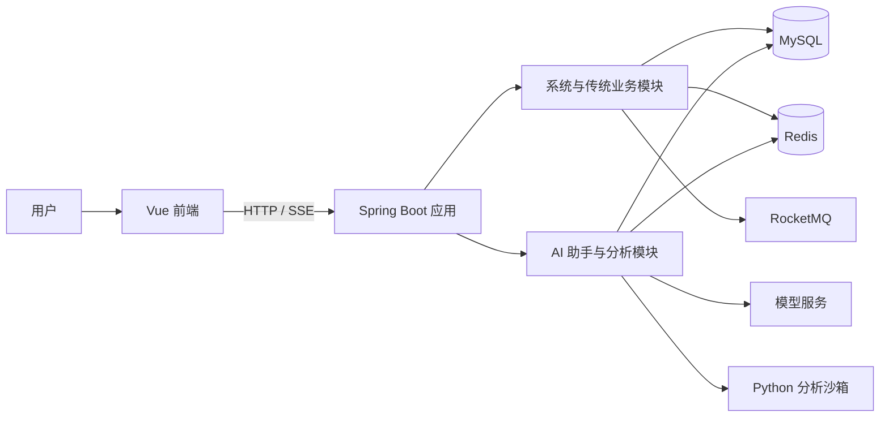

# 系统总体架构

本页依据当前仓库代码整理，说明项目的主要模块和运行关系；具体版本以工程配置为准，部署和验证结果另见[部署](../deployment/README.md)及[测试](../testing/README.md)。

前端使用 Vue 3、TypeScript、Vite、Pinia 和项目内组件。`erp-server` 是 Java 21、Spring Boot 3 多模块应用，由 `erp-admin` 启动：

| 模块 | 主要职责 |
|---|---|
| `erp-common`、`erp-security` | 通用结果、异常及登录、权限和用户上下文 |
| `erp-system` | 用户、部门、角色、权限目录及系统异常 |
| `erp-product` | 产品和分类 |
| `erp-purchase` | 供应商、供货关系、采购订单及供应商评分 |
| `erp-sales` | 客户和销售订单 |
| `erp-warehouse` | 仓库、库存、入出库与库存流水 |
| `erp-return` | 采购退货和销售退货 |
| `erp-dashboard` | 工作台数据聚合 |
| `erp-ai` | 会话、智能体、受控取数、数据分析和报告 |

MySQL 保存业务和 AI 元数据，Redis 用于会话、缓存、锁和编号等能力；RocketMQ 用于供应商评分和系统异常等异步处理，实际主题与消费行为以配置和代码为准。AI 分析文件使用独立数据卷；Python 沙箱、模型及只读取数需配置后才能使用。

业务流程见[传统业务架构](business.md)，AI 见 [AI 架构](ai.md)，数据库见[数据关系](../database/relations.md)。代码存在不等于所有功能都在特定环境启用或完成验收。
